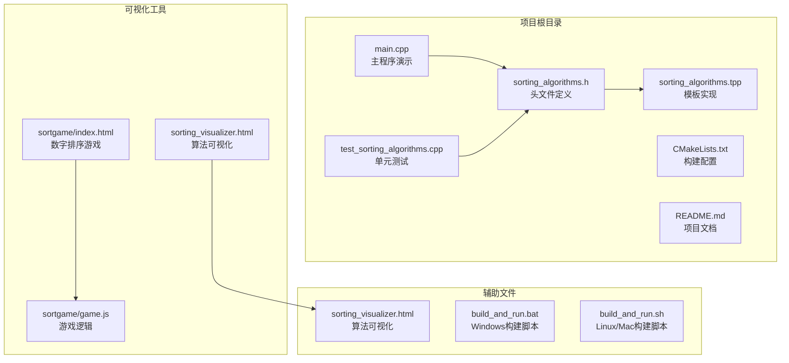
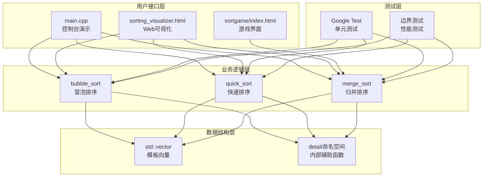
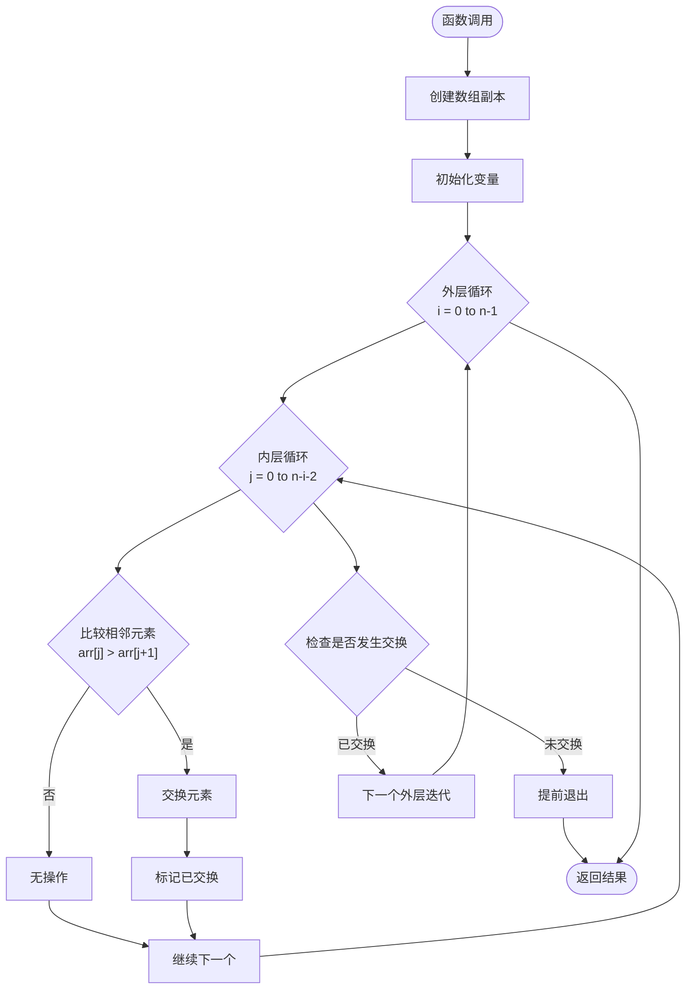
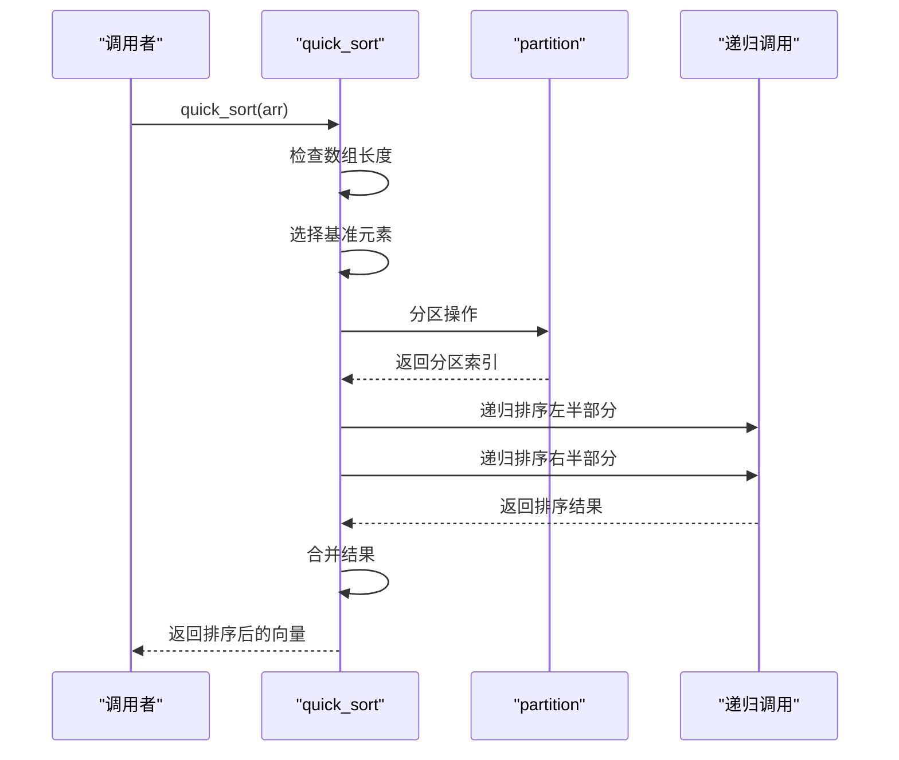
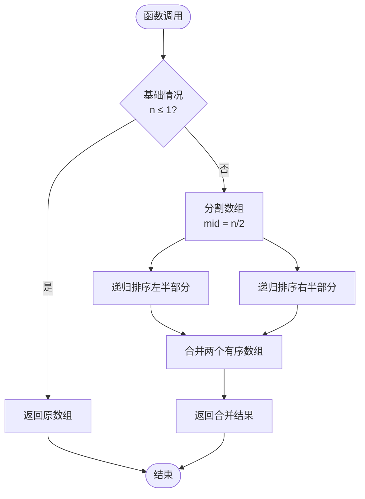
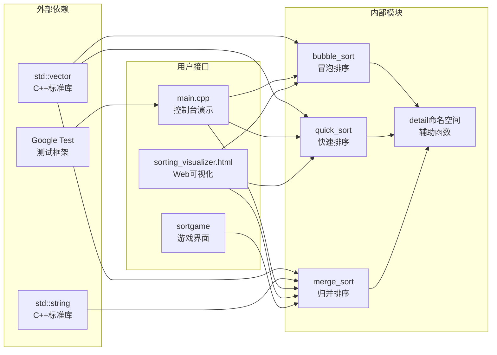

# API参考手册

<cite>
**本文档引用的文件**
- [sorting_algorithms.h](file://sorting_algorithms.h)
- [sorting_algorithms.tpp](file://sorting_algorithms.tpp)
- [test_sorting_algorithms.cpp](file://test_sorting_algorithms.cpp)
- [main.cpp](file://main.cpp)
- [README.md](file://README.md)
- [CMakeLists.txt](file://CMakeLists.txt)
- [sorting_visualizer.html](file://sorting_visualizer.html)
- [sortgame/index.html](file://sortgame/index.html)
- [sortgame/game.js](file://sortgame/game.js)
</cite>

## 目录
1. [简介](#简介)
2. [项目结构](#项目结构)
3. [核心组件](#核心组件)
4. [架构概览](#架构概览)
5. [详细组件分析](#详细组件分析)
6. [依赖关系分析](#依赖关系分析)
7. [性能考虑](#性能考虑)
8. [故障排除指南](#故障排除指南)
9. [结论](#结论)
10. [附录](#附录)

## 简介

SortTest是一个完整的C++排序算法项目，实现了三种常见的排序算法：冒泡排序、快速排序和归并排序。该项目提供了简洁易用的API接口，支持模板化设计，能够处理多种数据类型，并采用了非侵入式的设计理念，确保原始数组不被修改。

该项目的主要特点包括：
- **模板化设计**：支持任何可比较的数据类型（整数、浮点数、字符串等）
- **非侵入式**：不修改原始数组，返回新的排序数组
- **完整测试**：包含30+个单元测试用例
- **易于使用**：简洁的API接口
- **可视化支持**：提供交互式排序算法可视化界面

## 项目结构



**图表来源**
- [sorting_algorithms.h](file://sorting_algorithms.h#L1-L104)
- [sorting_algorithms.tpp](file://sorting_algorithms.tpp#L1-L162)
- [main.cpp](file://main.cpp#L1-L158)
- [test_sorting_algorithms.cpp](file://test_sorting_algorithms.cpp#L1-L294)

**章节来源**
- [CMakeLists.txt](file://CMakeLists.txt#L1-L45)
- [README.md](file://README.md#L5-L16)

## 核心组件

SortTest项目的核心由三个主要组件构成：

### 排序算法模块
- **sorting_algorithms.h**: 定义了三个排序算法的模板函数接口
- **sorting_algorithms.tpp**: 包含模板函数的具体实现
- **detail命名空间**: 提供内部辅助函数的实现

### 演示和测试模块
- **main.cpp**: 提供基本的功能演示和性能对比
- **test_sorting_algorithms.cpp**: 包含完整的单元测试套件
- **CMakeLists.txt**: 构建配置文件，支持Google Test集成

### 可视化工具模块
- **sorting_visualizer.html**: 交互式排序算法可视化界面
- **sortgame/**: 数字排序挑战游戏

**章节来源**
- [sorting_algorithms.h](file://sorting_algorithms.h#L14-L56)
- [sorting_algorithms.tpp](file://sorting_algorithms.tpp#L9-L162)
- [main.cpp](file://main.cpp#L42-L156)

## 架构概览



**图表来源**
- [main.cpp](file://main.cpp#L42-L156)
- [sorting_algorithms.h](file://sorting_algorithms.h#L14-L56)
- [sorting_algorithms.tpp](file://sorting_algorithms.tpp#L96-L160)
- [test_sorting_algorithms.cpp](file://test_sorting_algorithms.cpp#L16-L294)

## 详细组件分析

### bubble_sort 函数

#### 函数签名和接口
```cpp
template<typename T>
std::vector<T> bubble_sort(const std::vector<T>& arr);
```

#### 参数说明
- **arr**: 输入的常量引用向量，包含待排序的元素
- **类型要求**: T必须支持比较运算符（<, >, ==）

#### 返回值描述
- 返回一个新的排序后的向量，原向量保持不变
- 对于空向量或单元素向量，直接返回副本

#### 算法特性
- **时间复杂度**: O(n²)
- **空间复杂度**: O(1) 额外空间
- **稳定性**: 稳定排序
- **工作原理**: 通过相邻元素的比较和交换逐步推进

#### 使用示例路径
- [整数排序示例](file://main.cpp#L43-L72)
- [字符串排序示例](file://main.cpp#L109-L132)
- [单元测试示例](file://test_sorting_algorithms.cpp#L277-L279)



**图表来源**
- [sorting_algorithms.tpp](file://sorting_algorithms.tpp#L96-L109)

**章节来源**
- [sorting_algorithms.h](file://sorting_algorithms.h#L14-L25)
- [sorting_algorithms.tpp](file://sorting_algorithms.tpp#L96-L109)

### quick_sort 函数

#### 函数签名和接口
```cpp
template<typename T>
std::vector<T> quick_sort(const std::vector<T>& arr);
```

#### 参数说明
- **arr**: 输入的常量引用向量，包含待排序的元素
- **类型要求**: T必须支持比较运算符

#### 返回值描述
- 返回一个新的排序后的向量，原向量保持不变
- 对于空向量或单元素向量，直接返回原向量

#### 算法特性
- **时间复杂度**: 平均 O(n log n)，最坏 O(n²)
- **空间复杂度**: O(log n) 额外空间
- **稳定性**: 不稳定排序
- **工作原理**: 采用分治策略，选择基准元素进行分区

#### 使用示例路径
- [基本使用示例](file://README.md#L87-L106)
- [浮点数排序示例](file://README.md#L111-L113)
- [字符串排序示例](file://README.md#L115-L117)



**图表来源**
- [sorting_algorithms.tpp](file://sorting_algorithms.tpp#L111-L142)

**章节来源**
- [sorting_algorithms.h](file://sorting_algorithms.h#L27-L38)
- [sorting_algorithms.tpp](file://sorting_algorithms.tpp#L111-L142)

### merge_sort 函数

#### 函数签名和接口
```cpp
template<typename T>
std::vector<T> merge_sort(const std::vector<T>& arr);
```

#### 参数说明
- **arr**: 输入的常量引用向量，包含待排序的元素
- **类型要求**: T必须支持比较运算符

#### 返回值描述
- 返回一个新的排序后的向量，原向量保持不变
- 对于空向量或单元素向量，直接返回原向量

#### 算法特性
- **时间复杂度**: O(n log n)
- **空间复杂度**: O(n) 额外空间
- **稳定性**: 稳定排序
- **工作原理**: 采用分治策略，递归分割和合并

#### 使用示例路径
- [基本使用示例](file://README.md#L87-L106)
- [浮点数排序示例](file://README.md#L111-L113)
- [字符串排序示例](file://README.md#L115-L117)



**图表来源**
- [sorting_algorithms.tpp](file://sorting_algorithms.tpp#L144-L160)

**章节来源**
- [sorting_algorithms.h](file://sorting_algorithms.h#L40-L56)
- [sorting_algorithms.tpp](file://sorting_algorithms.tpp#L144-L160)

## 依赖关系分析



**图表来源**
- [sorting_algorithms.h](file://sorting_algorithms.h#L10-L12)
- [CMakeLists.txt](file://CMakeLists.txt#L22-L42)
- [main.cpp](file://main.cpp#L6-L10)

**章节来源**
- [CMakeLists.txt](file://CMakeLists.txt#L1-L45)
- [sorting_algorithms.h](file://sorting_algorithms.h#L10-L12)

## 性能考虑

### 时间复杂度对比

| 算法 | 最好情况 | 平均情况 | 最坏情况 | 空间复杂度 | 稳定性 |
|------|---------|---------|---------|-----------|--------|
| 冒泡排序 | O(n) | O(n²) | O(n²) | O(1) | 稳定 |
| 快速排序 | O(n log n) | O(n log n) | O(n²) | O(log n) | 不稳定 |
| 归并排序 | O(n log n) | O(n log n) | O(n log n) | O(n) | 稳定 |

### 内存使用分析

- **bubble_sort**: O(1) 额外空间，原地排序
- **quick_sort**: O(log n) 额外空间，递归栈空间
- **merge_sort**: O(n) 额外空间，临时数组空间

### 性能优化建议

1. **大数据集推荐**: 使用 merge_sort，具有稳定的 O(n log n) 性能
2. **内存敏感场景**: 使用 bubble_sort，空间复杂度最低
3. **一般用途**: 使用 quick_sort，平均性能最佳
4. **需要稳定性**: 使用 merge_sort 或 bubble_sort

**章节来源**
- [main.cpp](file://main.cpp#L83-L104)
- [README.md](file://README.md#L195-L200)

## 故障排除指南

### 常见问题和解决方案

#### 1. 编译错误
**问题**: 模板函数未找到定义
**解决方案**: 确保头文件包含实现文件
```cpp
#include "sorting_algorithms.tpp"  // 在头文件末尾
```

#### 2. 类型不匹配错误
**问题**: 自定义类型无法排序
**解决方案**: 为自定义类型提供比较运算符
```cpp
struct MyType {
    int value;
    bool operator<(const MyType& other) const {
        return value < other.value;
    }
};
```

#### 3. 内存不足错误
**问题**: 处理大数组时内存溢出
**解决方案**: 使用 quick_sort 或 bubble_sort 替代 merge_sort

#### 4. 性能问题
**问题**: 排序速度慢
**解决方案**: 
- 使用 quick_sort 进行一般用途排序
- 对小数组使用 bubble_sort
- 对需要稳定性的场景使用 merge_sort

### 调试技巧

1. **启用详细输出**: 在实现中添加调试信息
2. **使用单元测试**: 利用现有的测试套件验证功能
3. **性能监控**: 使用计时器测量算法执行时间
4. **内存检测**: 使用 valgrind 或 AddressSanitizer 检测内存问题

**章节来源**
- [test_sorting_algorithms.cpp](file://test_sorting_algorithms.cpp#L16-L294)
- [sorting_algorithms.tpp](file://sorting_algorithms.tpp#L17-L18)

## 结论

SortTest项目提供了一个完整、高效且易于使用的排序算法库。其主要优势包括：

1. **非侵入式设计**: 所有排序函数都返回新数组，不修改原始数据
2. **模板化实现**: 支持多种数据类型，具有良好的扩展性
3. **完整测试**: 包含30+个测试用例，覆盖各种边界情况
4. **清晰的API**: 简洁明了的接口设计，易于理解和使用
5. **可视化支持**: 提供交互式可视化工具，便于学习和演示

对于实际项目中的选择建议：
- **一般用途**: 优先考虑 quick_sort
- **需要稳定性**: 选择 merge_sort  
- **教学演示**: 使用 bubble_sort
- **内存受限**: 选择 bubble_sort
- **大数据集**: 使用 merge_sort

## 附录

### API使用最佳实践

#### 1. 类型安全
```cpp
// 推荐：明确指定类型
auto sorted = bubble_sort<int>(numbers);

// 不推荐：依赖自动类型推导
auto sorted = bubble_sort(numbers);  // 可能导致类型推导问题
```

#### 2. 内存管理
```cpp
// 推荐：使用移动语义
std::vector<int> numbers = {1, 2, 3, 4, 5};
auto sorted = bubble_sort(std::move(numbers));  // 避免不必要的拷贝

// 确保原数组仍然可用
assert(!numbers.empty());  // 原数组保持不变
```

#### 3. 错误处理
```cpp
try {
    auto result = bubble_sort(invalid_input);
} catch (const std::exception& e) {
    // 处理异常情况
    std::cerr << "排序失败: " << e.what() << std::endl;
}
```

#### 4. 性能优化
```cpp
// 对于小数组，bubble_sort可能更快
if (arr.size() < 10) {
    return bubble_sort(arr);
}

// 对于大数组，使用 quick_sort
return quick_sort(arr);
```

### 常见陷阱避免

1. **忘记包含实现文件**: 确保头文件包含 `.tpp` 文件
2. **类型不兼容**: 确保数据类型支持比较运算符
3. **内存泄漏**: 所有函数都返回新对象，不需要手动释放
4. **性能误解**: 根据数据规模和特性选择合适的算法
5. **稳定性需求**: 如果需要稳定性，不要使用 quick_sort

### 算法选择决策树

```mermaid
flowchart TD
A[需要排序吗?] --> |否| B[直接返回原数组]
A --> |是| C[数据规模]
C --> |小 (< 10)| D[bubble_sort]
C --> |中等 (10-1000)| E[quick_sort]
C --> |大 (> 1000)| F[merge_sort]
D --> G[稳定性需求?]
E --> G
F --> G
G --> |是| H[merge_sort]
G --> |否| I[quick_sort]
H --> J[完成]
I --> J
B --> J
```

**图表来源**
- [sorting_algorithms.h](file://sorting_algorithms.h#L14-L56)
- [main.cpp](file://main.cpp#L83-L104)