# 交互式游戏系统

<cite>
**本文档引用的文件**
- [index.html](file://sortgame/index.html)
- [game.js](file://sortgame/game.js)
- [style.css](file://sortgame/style.css)
- [plan.md](file://sortgame/plan.md)
- [sorting_visualizer.html](file://sorting_visualizer.html)
- [README.md](file://README.md)
</cite>

## 目录
1. [简介](#简介)
2. [项目结构](#项目结构)
3. [核心组件](#核心组件)
4. [架构概览](#架构概览)
5. [详细组件分析](#详细组件分析)
6. [依赖关系分析](#依赖关系分析)
7. [性能考虑](#性能考虑)
8. [故障排除指南](#故障排除指南)
9. [结论](#结论)
10. [附录](#附录)

## 简介

SortTest项目是一个创新的教育性交互式拖拽排序游戏，旨在通过游戏化学习的方式帮助用户理解和掌握算法概念。该项目不仅实现了经典的数字排序挑战游戏，还提供了丰富的教育价值和用户体验优化。

### 设计理念与教育目标

该项目的核心设计理念是"寓教于乐"，通过以下方式实现教育目标：

- **算法思维培养**：通过实际操作理解排序算法的工作原理
- **空间认知发展**：通过网格布局和相邻交换机制培养空间思维
- **问题解决能力**：通过逐步推理和策略制定提升解决问题的能力
- **计算思维训练**：通过计时和步数统计培养量化思维

### 游戏化学习优势

游戏化学习通过以下机制提升算法理解效果：

- **即时反馈系统**：实时显示移动结果和状态变化
- **渐进式难度**：从简单到复杂的渐进式挑战
- **成就激励系统**：通过评级和统计数据提供成就感
- **沉浸式体验**：通过视觉效果和交互设计增强学习兴趣

## 项目结构

SortTest项目采用模块化设计，主要分为以下几个核心部分：

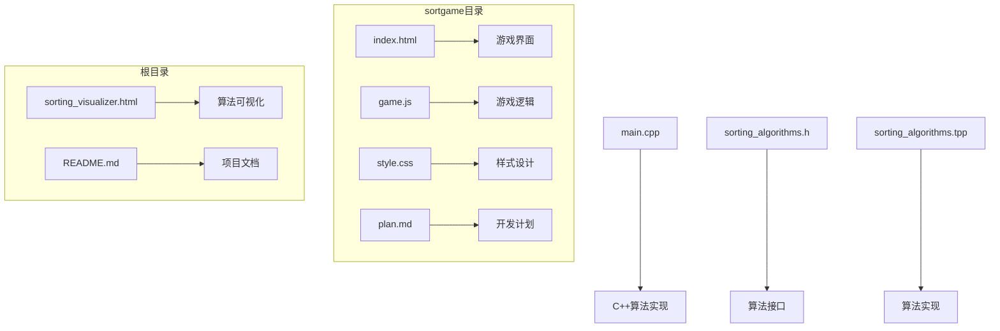

**图表来源**
- [index.html](file://sortgame/index.html#L1-L65)
- [game.js](file://sortgame/game.js#L1-L282)
- [style.css](file://sortgame/style.css#L1-L286)

### 文件组织结构

项目采用清晰的功能模块划分：

- **sortgame/**：游戏核心模块
  - `index.html`：游戏主界面和HTML结构
  - `game.js`：核心游戏逻辑和JavaScript实现
  - `style.css`：样式设计和响应式布局
  - `plan.md`：开发计划和进度跟踪

- **根目录**：辅助工具和文档
  - `sorting_visualizer.html`：独立的算法可视化工具
  - `README.md`：项目整体文档和C++算法实现

**章节来源**
- [index.html](file://sortgame/index.html#L1-L65)
- [plan.md](file://sortgame/plan.md#L38-L45)

## 核心组件

### NumberSortingGame 类设计

NumberSortingGame 是整个游戏的核心类，采用了面向对象的设计模式，实现了完整的游戏生命周期管理。

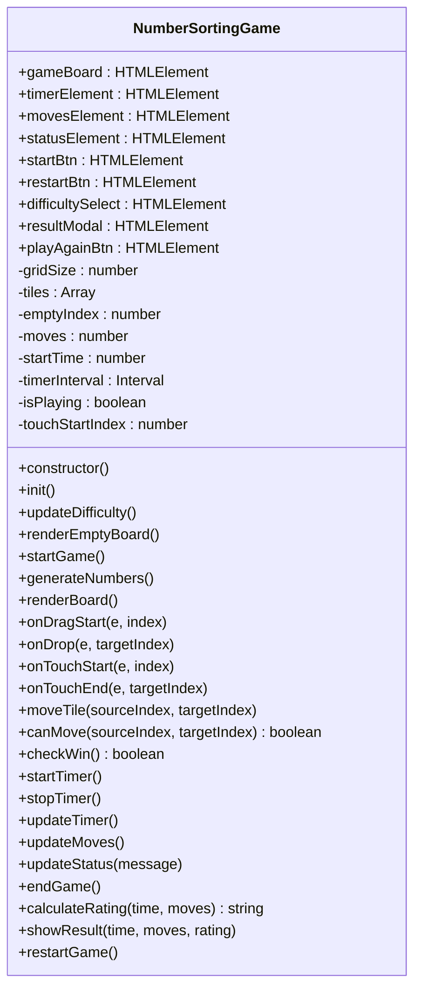

**图表来源**
- [game.js](file://sortgame/game.js#L1-L282)

### HTML5拖拽API实现

游戏充分利用了HTML5原生拖拽API，实现了流畅的拖拽交互体验：

#### 拖拽事件处理机制

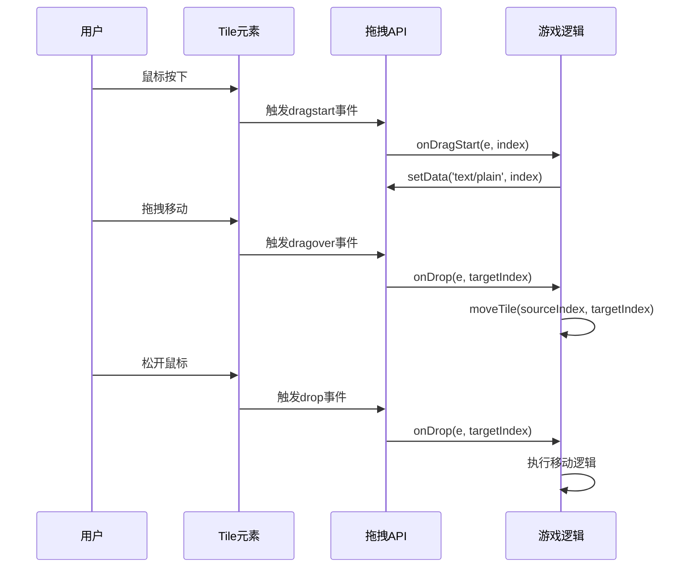

**图表来源**
- [game.js](file://sortgame/game.js#L126-L147)

### 响应式设计架构

游戏采用了现代化的响应式设计，确保在各种设备上都能提供优秀的用户体验：

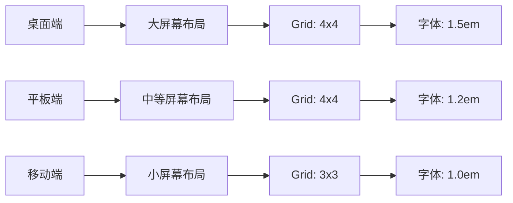

**图表来源**
- [style.css](file://sortgame/style.css#L150-L163)
- [style.css](file://sortgame/style.css#L247-L281)

**章节来源**
- [game.js](file://sortgame/game.js#L1-L282)
- [style.css](file://sortgame/style.css#L1-L286)

## 架构概览

### 整体系统架构

SortTest项目采用了分层架构设计，将关注点清晰分离：

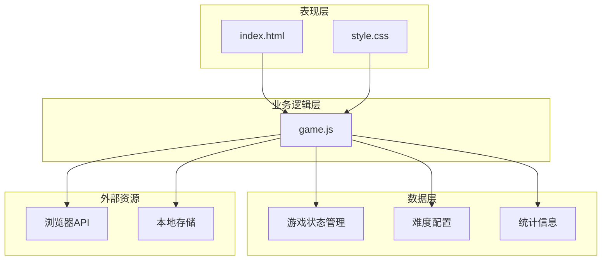

**图表来源**
- [index.html](file://sortgame/index.html#L1-L65)
- [game.js](file://sortgame/game.js#L1-L282)
- [style.css](file://sortgame/style.css#L1-L286)

### 数据流架构

游戏的数据流遵循单向数据流原则，确保状态的一致性和可预测性：

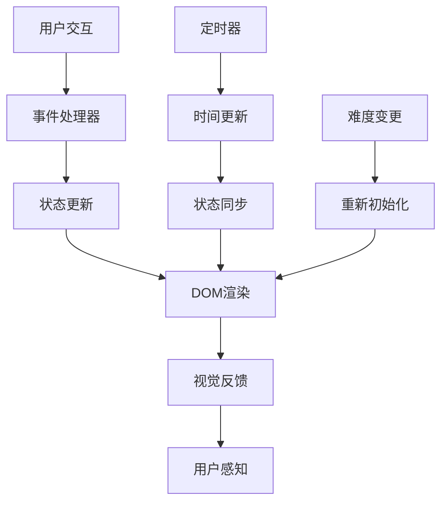

**图表来源**
- [game.js](file://sortgame/game.js#L64-L95)
- [game.js](file://sortgame/game.js#L195-L214)

## 详细组件分析

### 游戏状态管理系统

#### 状态定义与管理

游戏的状态管理采用了简洁而高效的设计：

| 状态属性 | 类型 | 描述 | 默认值 |
|---------|------|------|--------|
| gridSize | number | 网格尺寸 (3/4/5) | 4 |
| tiles | Array | 瓦片数组 (包含null) | [] |
| emptyIndex | number | 空位索引 | -1 |
| moves | number | 移动步数 | 0 |
| startTime | number | 开始时间戳 | 0 |
| timerInterval | Interval | 定时器引用 | null |
| isPlaying | boolean | 游戏状态 | false |
| touchStartIndex | number | 触摸起始索引 | undefined |

#### 状态转换流程

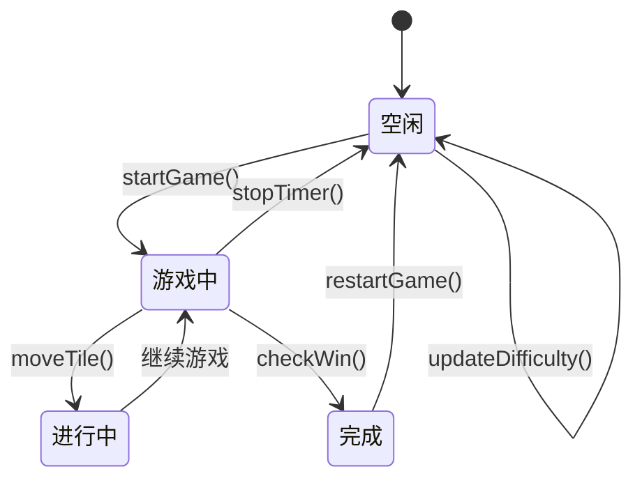

**图表来源**
- [game.js](file://sortgame/game.js#L64-L77)
- [game.js](file://sortgame/game.js#L164-L167)
- [game.js](file://sortgame/game.js#L224-L233)

### 拖拽交互实现详解

#### HTML5拖拽API技术细节

游戏实现了完整的HTML5拖拽API支持，包括桌面端和移动端的兼容性：

##### 拖拽事件链路

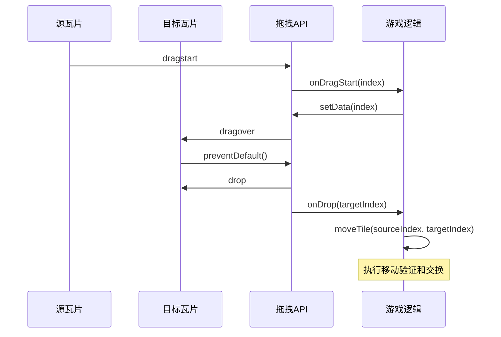

**图表来源**
- [game.js](file://sortgame/game.js#L126-L134)

##### 移动端触摸支持

为了确保移动端的良好体验，游戏额外实现了触摸事件支持：

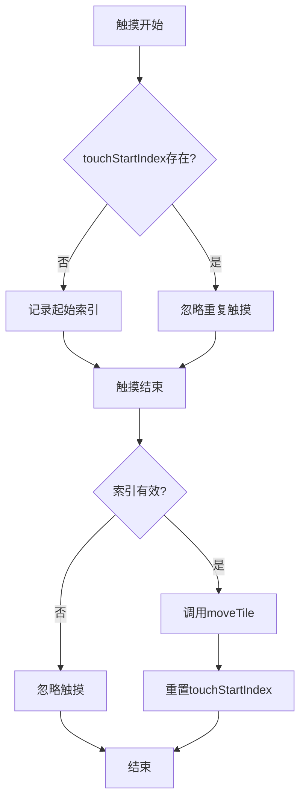

**图表来源**
- [game.js](file://sortgame/game.js#L136-L147)

### 相邻交换算法实现

#### 位置验证逻辑

游戏实现了严格的相邻交换规则，确保只有与空位相邻的瓦片才能移动：

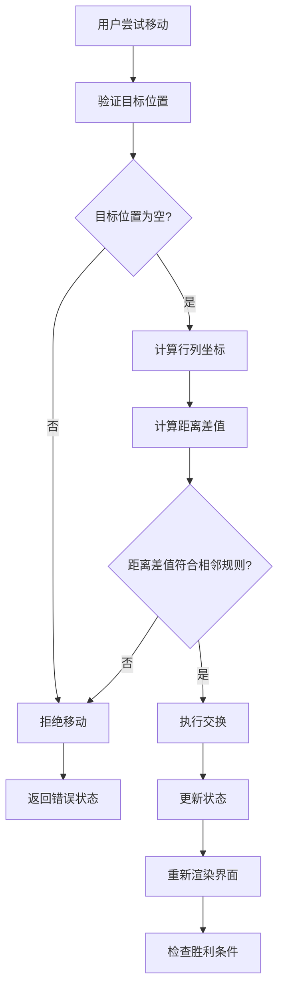

**图表来源**
- [game.js](file://sortgame/game.js#L149-L184)

#### 算法复杂度分析

- **时间复杂度**：O(1) - 每次移动只进行常数时间的验证
- **空间复杂度**：O(1) - 使用常数额外空间进行坐标计算
- **验证效率**：通过数学计算避免遍历，提高性能

### 难度级别系统

#### 难度配置与实现

游戏提供了三个难度级别，每个级别对应不同的网格大小：

| 难度级别 | 网格大小 | 瓦片数量 | 预设步数上限 |
|---------|---------|---------|-------------|
| 简单 | 3×3 | 9个瓦片 | 100步 |
| 中等 | 4×4 | 16个瓦片 | 160步 |
| 困难 | 5×5 | 25个瓦片 | 250步 |

#### 难度切换机制

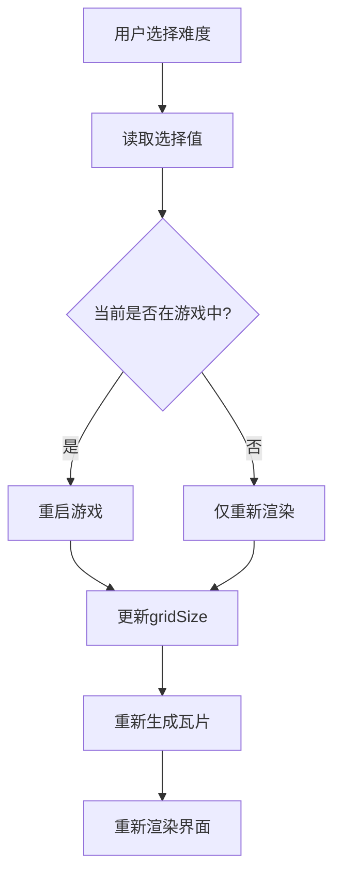

**图表来源**
- [game.js](file://sortgame/game.js#L36-L55)

### 评分系统设计

#### 评分算法实现

游戏实现了基于时间和步数的综合评分系统：

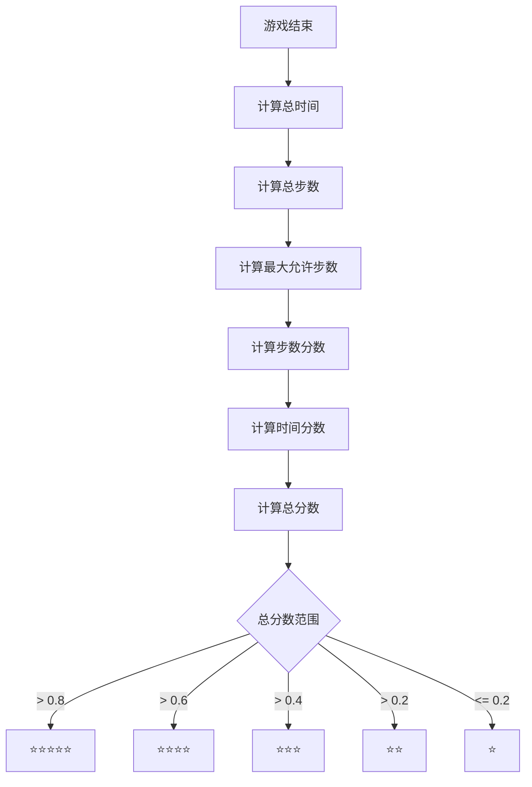

**图表来源**
- [game.js](file://sortgame/game.js#L235-L248)

#### 评分权重分析

- **时间权重**：40% - 鼓励快速完成
- **步数权重**：60% - 强调策略性思考
- **难度调整**：根据网格大小动态调整基准值

**章节来源**
- [game.js](file://sortgame/game.js#L36-L55)
- [game.js](file://sortgame/game.js#L235-L248)

## 依赖关系分析

### 外部依赖关系

游戏采用纯原生技术栈，最小化外部依赖：

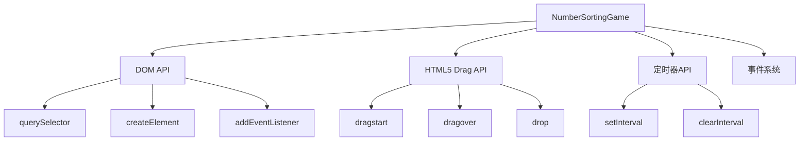

**图表来源**
- [game.js](file://sortgame/game.js#L1-L282)

### 内部模块依赖

游戏内部模块之间保持低耦合高内聚的设计：

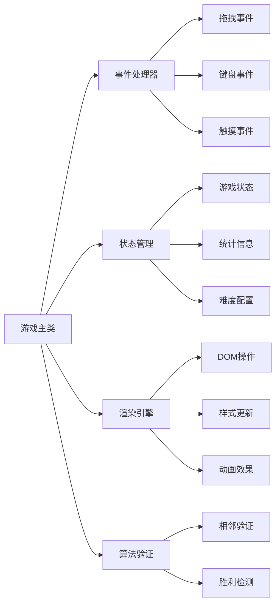

**图表来源**
- [game.js](file://sortgame/game.js#L25-L34)
- [game.js](file://sortgame/game.js#L97-L124)

### 性能依赖分析

游戏在性能方面考虑了多个优化点：

- **事件委托**：减少事件监听器数量
- **批量DOM操作**：避免频繁的DOM查询
- **节流机制**：防止过度的重绘重排
- **内存管理**：及时清理定时器和事件监听器

**章节来源**
- [game.js](file://sortgame/game.js#L195-L207)
- [game.js](file://sortgame/game.js#L202-L207)

## 性能考虑

### 性能优化策略

#### DOM操作优化

游戏采用了多种DOM操作优化技术：

1. **批量更新**：将多次DOM修改合并为单次操作
2. **虚拟DOM思想**：先在内存中构建完整的DOM结构，然后一次性插入
3. **事件委托**：使用事件冒泡机制减少监听器数量

#### 内存管理优化

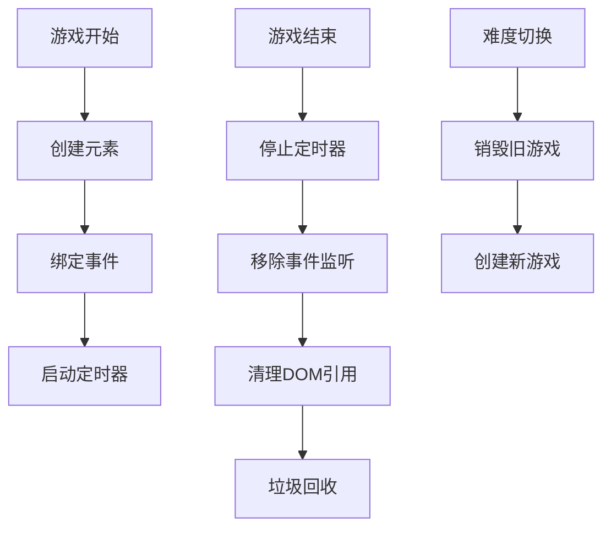

**图表来源**
- [game.js](file://sortgame/game.js#L224-L233)
- [game.js](file://sortgame/game.js#L262-L276)

### 性能监控指标

游戏实现了基本的性能监控功能：

- **渲染时间**：每次DOM更新的时间消耗
- **内存使用**：游戏对象和DOM元素的内存占用
- **事件处理延迟**：从用户交互到响应的时间延迟

### 移动端性能优化

针对移动设备的特殊优化：

- **触摸事件优先**：移动端优先使用触摸事件
- **硬件加速**：利用CSS3 transform实现硬件加速
- **电池优化**：合理控制定时器频率，节省电量

## 故障排除指南

### 常见问题诊断

#### 拖拽功能失效

**症状**：瓦片无法拖拽或拖拽无响应

**可能原因**：
1. `draggable` 属性未正确设置
2. `dragstart` 事件处理函数缺失
3. `dragover` 事件未阻止默认行为
4. `drop` 事件处理异常

**解决方案**：
1. 检查瓦片元素的 `draggable` 属性
2. 验证事件监听器绑定
3. 确认 `preventDefault()` 调用
4. 查看控制台错误信息

#### 移动端触摸问题

**症状**：触摸操作不灵敏或响应异常

**可能原因**：
1. `touchstart` 和 `touchend` 事件处理冲突
2. 触摸坐标计算错误
3. 事件冒泡导致的意外行为

**解决方案**：
1. 确保正确的事件处理顺序
2. 验证触摸坐标的准确性
3. 使用 `e.preventDefault()` 阻止默认行为

#### 难度切换问题

**症状**：难度切换后游戏状态异常

**可能原因**：
1. 网格尺寸更新后未重新渲染
2. 游戏状态未正确重置
3. 事件监听器未重新绑定

**解决方案**：
1. 确保 `renderBoard()` 调用
2. 重置游戏状态变量
3. 重新绑定事件监听器

### 调试技巧

#### 开发者工具使用

1. **控制台调试**：使用 `console.log()` 输出关键状态
2. **断点调试**：在关键方法处设置断点
3. **网络面板**：检查资源加载情况
4. **性能面板**：分析性能瓶颈

#### 错误处理机制

游戏实现了基本的错误处理：

```javascript
try {
    // 可能出错的操作
} catch (error) {
    console.error('游戏错误:', error);
    // 显示用户友好的错误信息
}
```

**章节来源**
- [game.js](file://sortgame/game.js#L126-L134)
- [game.js](file://sortgame/game.js#L141-L147)

## 结论

SortTest项目成功地将教育目标与技术创新相结合，创造了一个既有趣又有教育价值的交互式游戏。通过HTML5拖拽API和现代Web技术的应用，项目实现了流畅的用户体验和良好的跨平台兼容性。

### 项目优势总结

1. **教育价值显著**：通过游戏化学习提升算法理解效果
2. **技术实现优秀**：采用原生Web技术，性能优异
3. **用户体验良好**：响应式设计确保多设备兼容
4. **扩展性强**：模块化设计便于功能扩展和定制

### 技术亮点

- **纯原生实现**：无需第三方库依赖
- **现代CSS技术**：充分利用Flexbox和Grid布局
- **完整的事件处理**：支持桌面端和移动端
- **优雅的降级方案**：确保在老旧浏览器中的基本功能

### 未来发展方向

1. **功能扩展**：添加更多算法类型和游戏模式
2. **社交功能**：实现排行榜和分享功能
3. **个性化定制**：支持主题和界面定制
4. **数据分析**：提供学习进度和能力分析

## 附录

### 使用指南

#### 快速开始

1. **环境要求**：现代浏览器即可运行
2. **访问方式**：直接打开 `sortgame/index.html`
3. **基本操作**：点击"开始游戏"按钮开始挑战

#### 操作说明

1. **选择难度**：使用下拉菜单选择游戏难度
2. **开始游戏**：点击"开始游戏"按钮
3. **拖拽操作**：点击并拖拽数字瓦片到相邻空位
4. **查看进度**：通过计时器和步数统计了解游戏进度
5. **重新开始**：游戏完成后可选择再次挑战

#### 学习建议

1. **从简单开始**：建议新手从3×3网格开始
2. **观察规律**：注意数字排列的规律和策略
3. **控制步数**：尽量用最少的步数完成挑战
4. **时间管理**：合理分配时间，避免急躁操作

### 扩展可能性

#### 功能扩展方向

1. **算法可视化**：集成算法执行过程的可视化展示
2. **多语言支持**：添加国际化语言包
3. **音效系统**：添加背景音乐和音效反馈
4. **成就系统**：实现更丰富的成就和奖励机制

#### 自定义选项

1. **主题定制**：支持自定义颜色和样式
2. **难度调整**：允许用户自定义网格大小
3. **动画效果**：可调节动画速度和效果类型
4. **统计功能**：提供更详细的个人成绩统计

### 技术参考

#### 关键API参考

- **HTML5 Drag API**：用于实现拖拽功能
- **CSS Grid Layout**：用于创建响应式网格布局
- **Flexbox**：用于灵活的布局和对齐
- **Media Queries**：用于响应式设计

#### 性能最佳实践

1. **避免强制同步布局**：使用 `requestAnimationFrame`
2. **优化事件处理**：使用事件委托减少监听器数量
3. **合理使用定时器**：及时清理不再使用的定时器
4. **内存管理**：及时释放不再使用的对象引用

**章节来源**
- [index.html](file://sortgame/index.html#L16-L27)
- [game.js](file://sortgame/game.js#L64-L77)
- [style.css](file://sortgame/style.css#L237-L286)