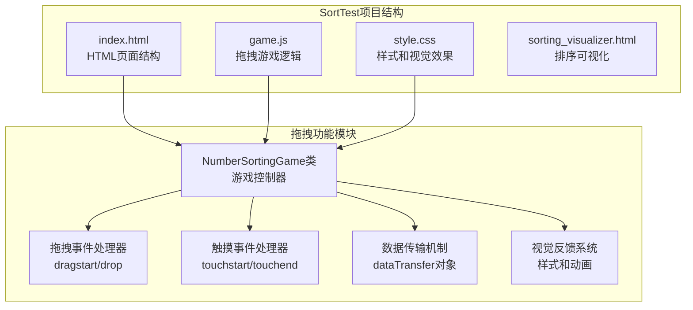
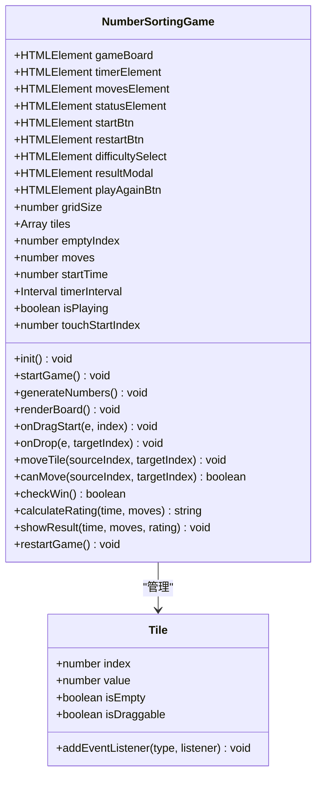
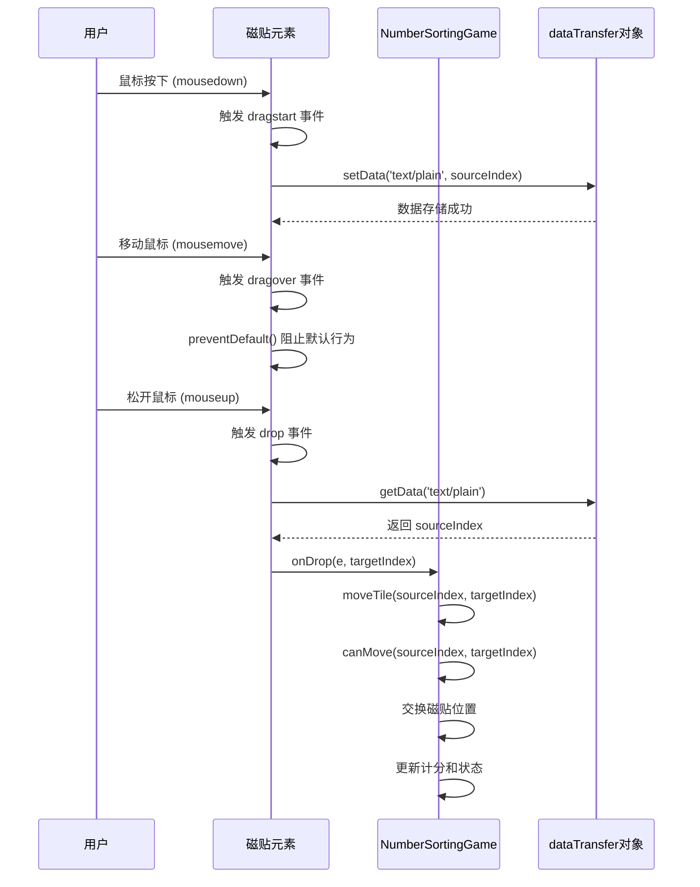
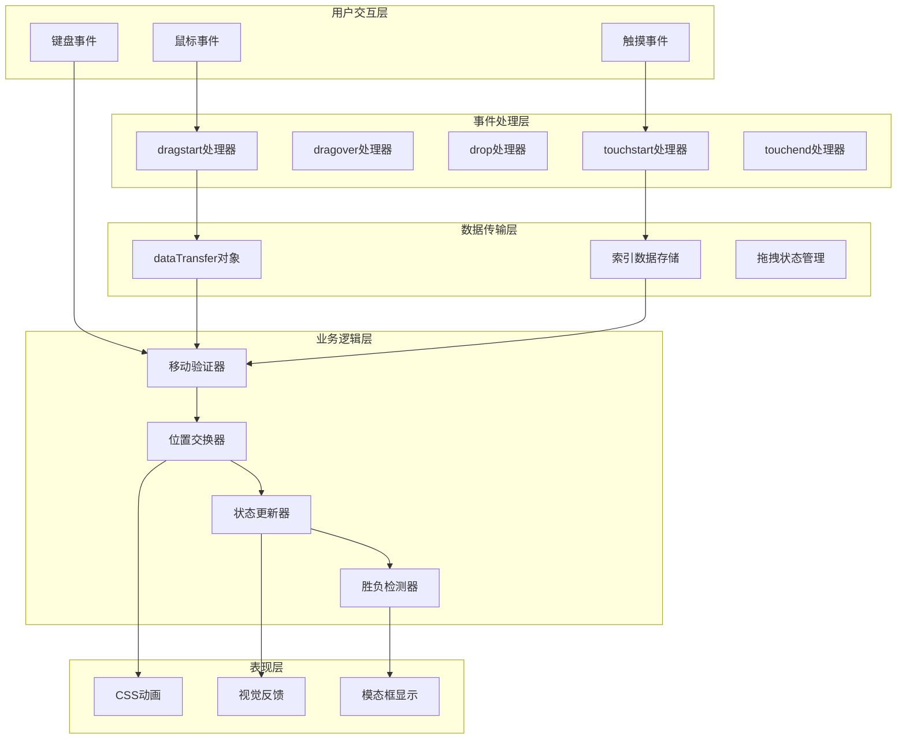
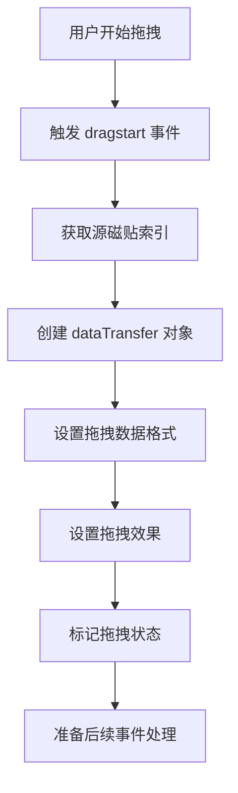
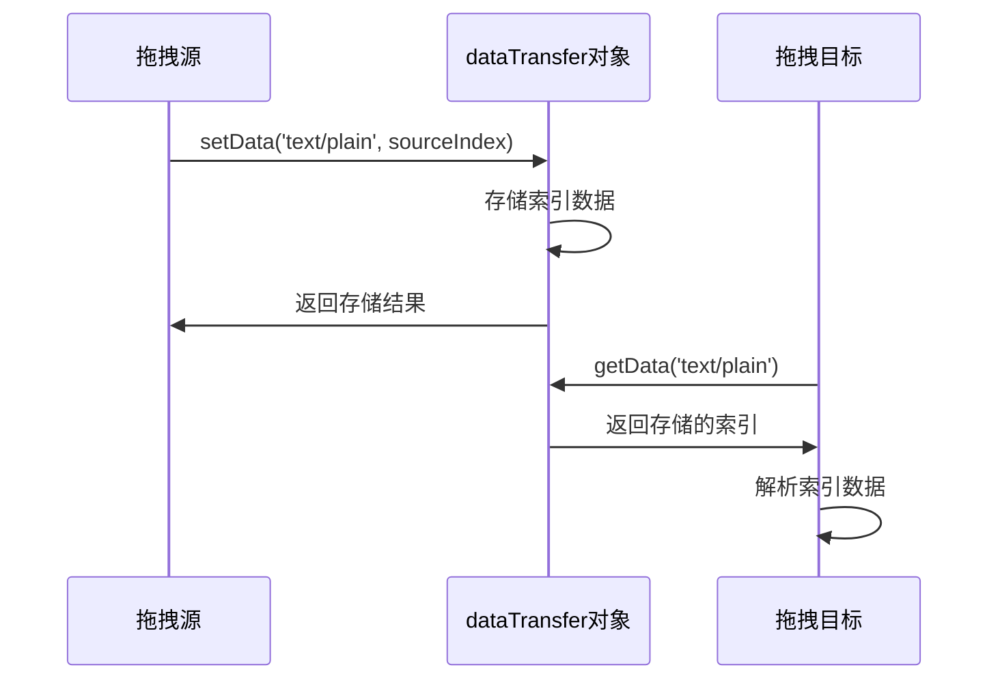
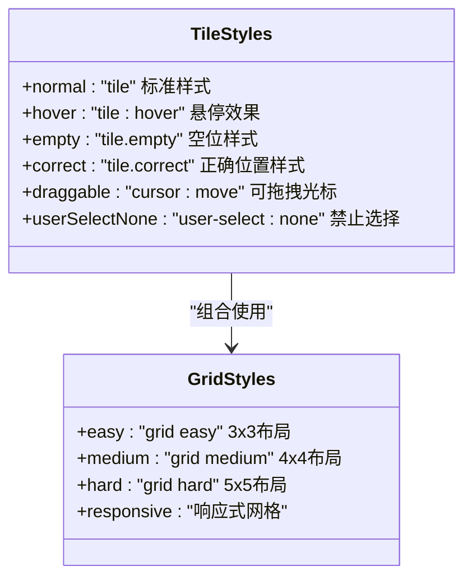
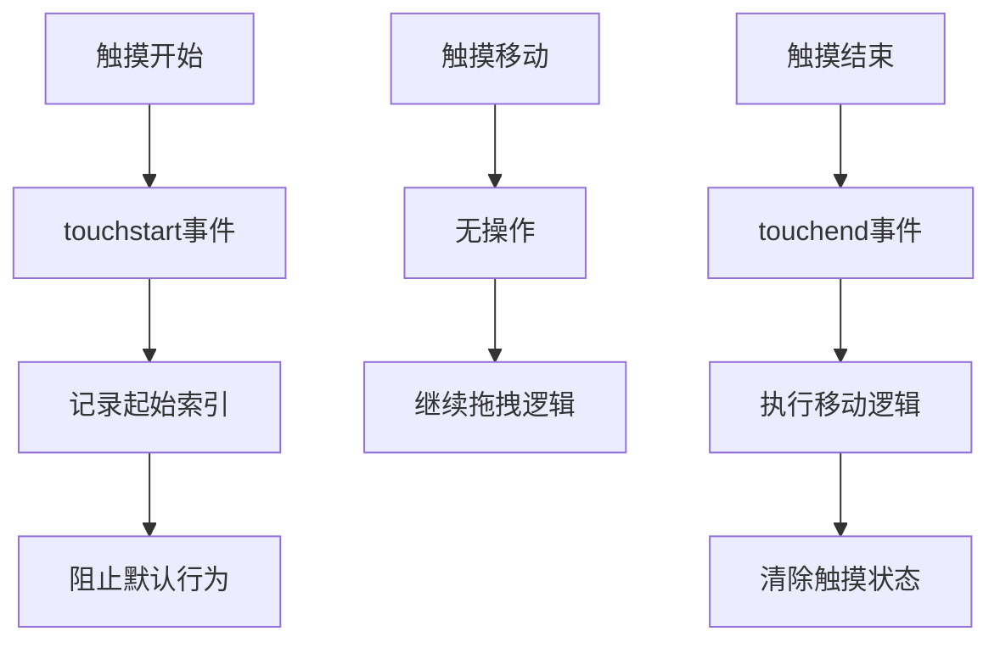
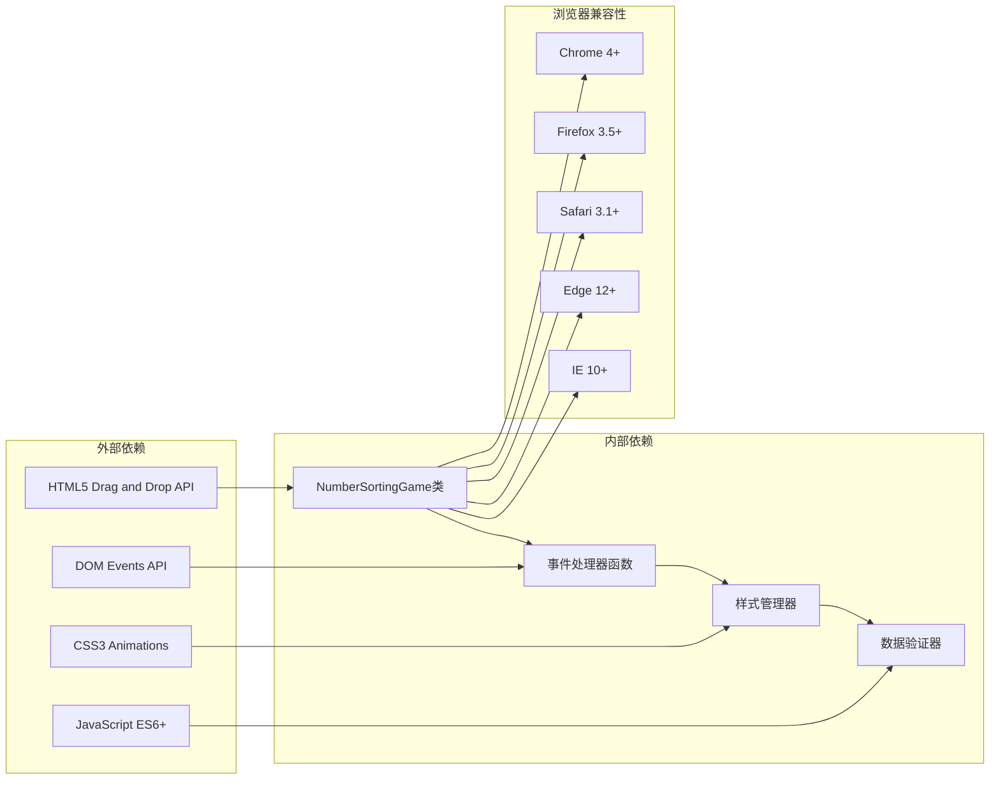

# 拖拽功能实现

<cite>
**本文档引用的文件**
- [index.html](file://sortgame/index.html)
- [game.js](file://sortgame/game.js)
- [style.css](file://sortgame/style.css)
- [sorting_visualizer.html](file://sorting_visualizer.html)
</cite>

## 目录
1. [简介](#简介)
2. [项目结构](#项目结构)
3. [核心组件](#核心组件)
4. [架构概览](#架构概览)
5. [详细组件分析](#详细组件分析)
6. [依赖关系分析](#依赖关系分析)
7. [性能考虑](#性能考虑)
8. [故障排除指南](#故障排除指南)
9. [结论](#结论)

## 简介

SortTest项目中的拖拽功能是一个基于HTML5拖放API的数字排序游戏，允许用户通过拖拽数字磁贴来手动排列数字序列。该项目实现了完整的拖拽生命周期管理，包括拖拽开始、拖拽悬停、放置和拖拽结束等事件处理，以及数据传输机制和视觉反馈系统。

该拖拽系统采用现代Web标准，支持桌面端鼠标操作和移动端触摸操作，提供了流畅的用户体验和良好的跨浏览器兼容性。

## 项目结构

SortTest项目采用模块化架构，拖拽功能主要集中在sortgame目录中：



**图表来源**
- [index.html](file://sortgame/index.html#L1-L65)
- [game.js](file://sortgame/game.js#L1-L282)
- [style.css](file://sortgame/style.css#L1-L286)

**章节来源**
- [index.html](file://sortgame/index.html#L1-L65)
- [game.js](file://sortgame/game.js#L1-L282)
- [style.css](file://sortgame/style.css#L1-L286)

## 核心组件

### NumberSortingGame类

NumberSortingGame是拖拽功能的核心控制器，负责管理整个游戏的状态和逻辑：



**图表来源**
- [game.js](file://sortgame/game.js#L1-L282)

### 拖拽事件处理机制

拖拽功能实现了完整的事件处理链路，确保拖拽操作的正确性和响应性：



**图表来源**
- [game.js](file://sortgame/game.js#L126-L134)

**章节来源**
- [game.js](file://sortgame/game.js#L1-L282)

## 架构概览

拖拽系统的整体架构采用了事件驱动的设计模式，通过DOM事件监听器和数据传输机制实现松耦合的功能模块：



**图表来源**
- [game.js](file://sortgame/game.js#L112-L134)
- [style.css](file://sortgame/style.css#L165-L198)

## 详细组件分析

### 拖拽事件生命周期

拖拽功能实现了标准的HTML5拖放API事件序列，每个事件都有明确的职责和处理逻辑：

#### dragstart事件处理

dragstart事件是拖拽操作的起点，负责初始化拖拽数据和状态：



**图表来源**
- [game.js](file://sortgame/game.js#L126-L128)

#### dragover事件处理

dragover事件在整个拖拽过程中持续触发，主要用于阻止默认行为和提供放置反馈：

```mermaid
flowchart TD
A[拖拽元素悬停在目标上] --> B[触发 dragover 事件]
B --> C[调用 preventDefault()]
C --> D[阻止浏览器默认放置行为]
D --> E[允许放置操作]
E --> F[更新视觉反馈]
```

**图表来源**
- [game.js](file://sortgame/game.js#L113-L115)

#### drop事件处理

drop事件是拖拽操作的关键节点，负责执行实际的磁贴交换逻辑：

```mermaid
flowchart TD
A[拖拽元素释放] --> B[触发 drop 事件]
B --> C[调用 preventDefault()]
C --> D[从 dataTransfer 获取源索引]
D --> E[验证拖拽有效性]
E --> F{验证通过?}
F --> |是| G[执行磁贴交换]
F --> |否| H[忽略拖拽操作]
G --> I[更新游戏状态]
I --> J[检查胜利条件]
J --> K[更新界面显示]
```

**图表来源**
- [game.js](file://sortgame/game.js#L130-L134)

### 数据传输机制

dataTransfer对象是拖拽功能的核心组件，负责在拖拽源和目标之间传递数据：

#### 数据存储和检索



**图表来源**
- [game.js](file://sortgame/game.js#L127-L132)

#### 数据格式支持

当前实现使用简单的文本格式存储磁贴索引，这种设计具有以下优势：
- 兼容性好，所有现代浏览器都支持
- 实现简单，减少代码复杂度
- 性能优异，数据量小
- 易于调试和测试

### 视觉反馈系统

拖拽系统提供了多层次的视觉反馈，增强用户的操作体验：

#### 状态样式管理



**图表来源**
- [style.css](file://sortgame/style.css#L165-L198)

#### 动画和过渡效果

系统使用CSS3动画和过渡效果提供流畅的视觉体验：
- 0.3秒的平滑过渡动画
- 1.05倍的悬停缩放效果
- 15px的阴影深度变化
- 渐变色背景的视觉层次

### 移动端触摸支持

为了支持移动设备，系统实现了触摸事件处理：

#### 触摸事件映射



**图表来源**
- [game.js](file://sortgame/game.js#L136-L147)

**章节来源**
- [game.js](file://sortgame/game.js#L112-L147)
- [style.css](file://sortgame/style.css#L165-L198)

## 依赖关系分析

拖拽功能的依赖关系相对简单，主要依赖于标准的Web API和DOM操作：



**图表来源**
- [game.js](file://sortgame/game.js#L1-L282)
- [index.html](file://sortgame/index.html#L1-L65)

**章节来源**
- [game.js](file://sortgame/game.js#L1-L282)
- [index.html](file://sortgame/index.html#L1-L65)

## 性能考虑

### 事件处理优化

拖拽系统在性能方面采用了多项优化策略：

#### 事件委托和批量更新

- 使用事件委托减少事件监听器数量
- 批量更新DOM以减少重排重绘
- 避免在拖拽过程中进行昂贵的操作

#### 内存管理

- 合理清理事件监听器
- 及时释放不需要的变量
- 避免内存泄漏

### 渲染性能优化

#### CSS硬件加速

系统充分利用CSS3硬件加速特性：
- 使用transform属性进行动画
- 避免触发布局的CSS属性
- 合理使用will-change属性

#### 重绘最小化

- 将多个样式变更合并
- 使用CSS类切换替代直接样式修改
- 避免频繁的offsetWidth等属性查询

## 故障排除指南

### 常见问题诊断

#### 拖拽无法开始

**症状**: 点击磁贴无反应或无法拖拽

**可能原因**:
1. draggable属性未正确设置
2. dragstart事件未正确绑定
3. 浏览器不支持拖拽功能

**解决方法**:
- 检查磁贴元素的draggable属性
- 验证事件监听器的绑定
- 测试不同浏览器的兼容性

#### 放置无效

**症状**: 拖拽到目标位置但磁贴不移动

**可能原因**:
1. canMove验证失败
2. dataTransfer数据丢失
3. 事件处理逻辑错误

**解决方法**:
- 检查canMove函数的逻辑
- 验证dataTransfer对象的状态
- 调试事件处理流程

#### 视觉反馈异常

**症状**: 拖拽过程中样式不正确

**可能原因**:
1. CSS类名冲突
2. 样式优先级问题
3. JavaScript样式修改错误

**解决方法**:
- 检查CSS类的定义和使用
- 验证样式优先级
- 调试JavaScript样式操作

### 调试技巧

#### 开发者工具使用

1. **事件监听器检查**: 在Elements面板查看事件绑定
2. **网络面板监控**: 检查资源加载状态
3. **性能面板分析**: 监控拖拽操作的性能

#### 日志记录

建议在关键位置添加日志输出：
- 拖拽开始和结束
- 数据传输过程
- 事件处理结果

#### 跨浏览器测试

1. **桌面浏览器**: Chrome、Firefox、Safari、Edge
2. **移动浏览器**: iOS Safari、Android Chrome
3. **旧版浏览器**: IE10+、Android Browser

**章节来源**
- [game.js](file://sortgame/game.js#L149-L184)

## 结论

SortTest项目的拖拽功能实现了一个完整、高效且用户友好的数字排序游戏。通过合理利用HTML5拖放API，系统提供了流畅的拖拽体验，同时保持了良好的性能和跨浏览器兼容性。

### 主要成就

1. **完整的事件处理**: 实现了标准拖拽生命周期的所有关键事件
2. **简洁的数据传输**: 使用dataTransfer对象实现高效的索引传递
3. **丰富的视觉反馈**: 提供多层次的样式和动画效果
4. **移动端支持**: 完整的触摸事件处理机制
5. **性能优化**: 采用多种技术确保流畅的用户体验

### 技术亮点

- **事件驱动架构**: 基于DOM事件的标准设计模式
- **数据分离**: 将业务逻辑与UI表现完全分离
- **渐进增强**: 从基础功能逐步添加高级特性
- **跨平台兼容**: 统一的API适配多平台需求

### 改进建议

1. **增强错误处理**: 添加更完善的异常捕获和恢复机制
2. **性能监控**: 集成性能指标收集和分析
3. **可访问性**: 添加键盘导航和屏幕阅读器支持
4. **国际化**: 支持多语言界面和本地化

该拖拽功能为类似的游戏开发提供了优秀的参考实现，展示了如何在现代Web环境中构建高质量的交互体验。