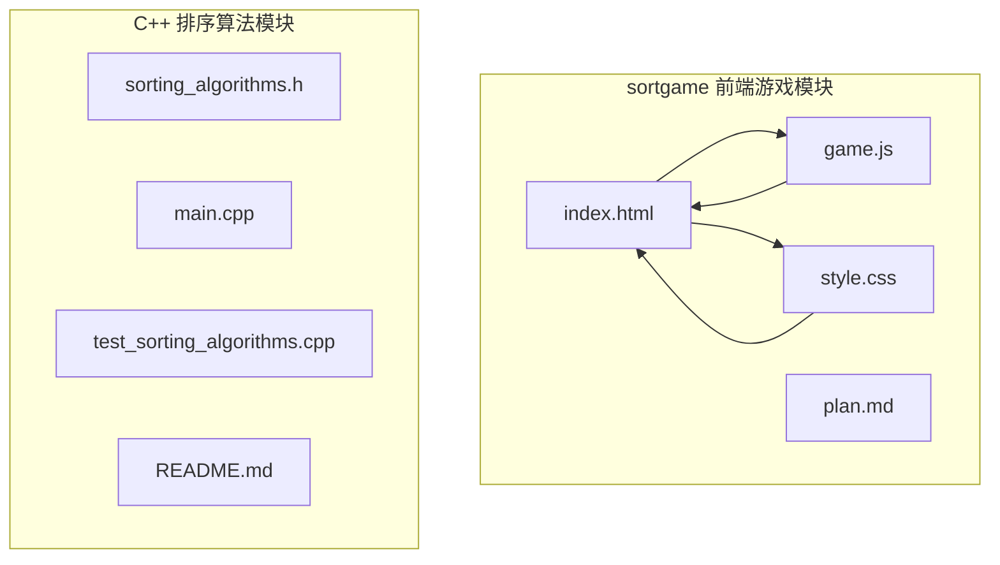
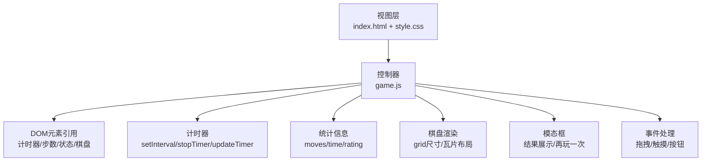
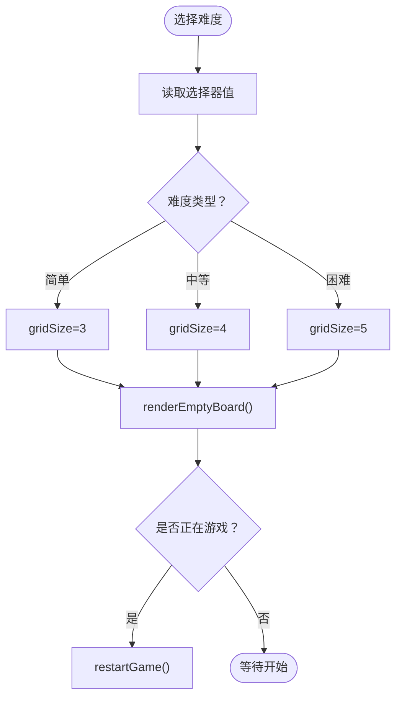
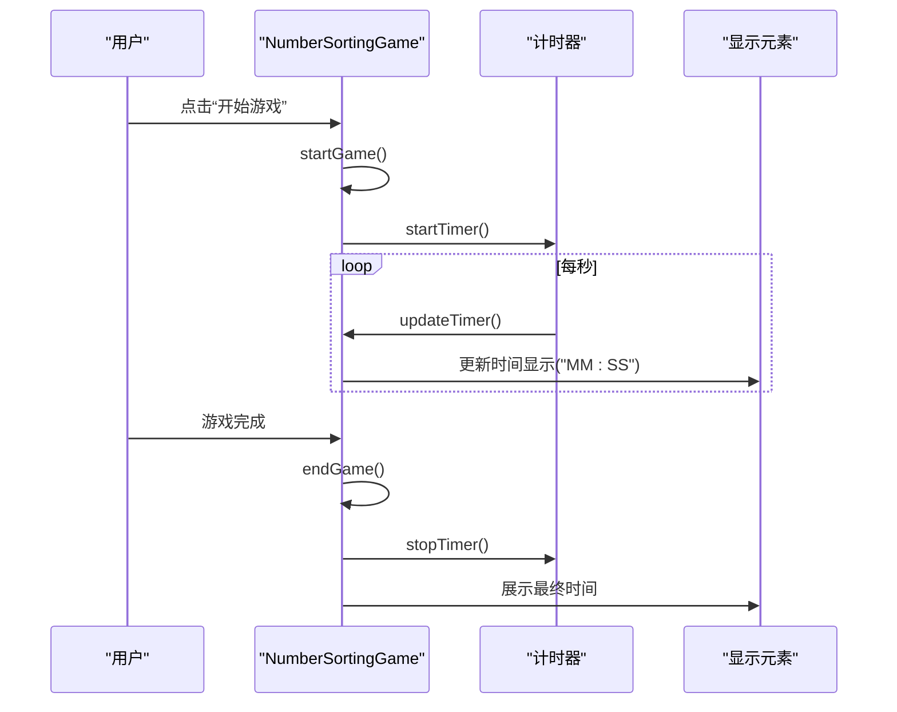
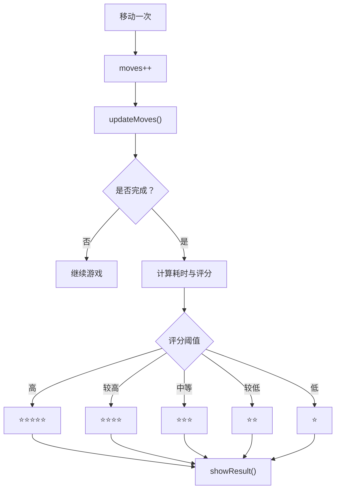
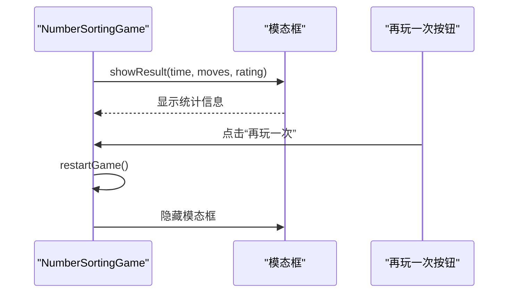
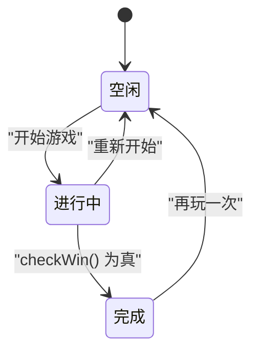
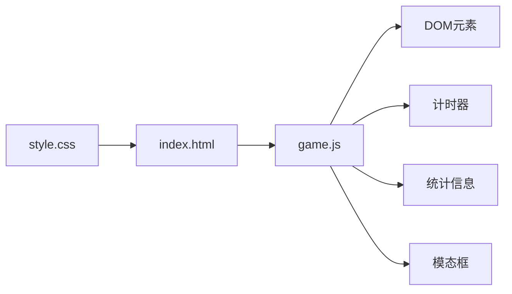

# 游戏功能管理

<cite>
**本文引用的文件**
- [sortgame/game.js](file://sortgame/game.js)
- [sortgame/index.html](file://sortgame/index.html)
- [sortgame/style.css](file://sortgame/style.css)
- [sortgame/plan.md](file://sortgame/plan.md)
- [README.md](file://README.md)
- [sorting_algorithms.h](file://sorting_algorithms.h)
- [main.cpp](file://main.cpp)
- [test_sorting_algorithms.cpp](file://test_sorting_algorithms.cpp)
</cite>

## 目录
1. [简介](#简介)
2. [项目结构](#项目结构)
3. [核心组件](#核心组件)
4. [架构总览](#架构总览)
5. [详细组件分析](#详细组件分析)
6. [依赖关系分析](#依赖关系分析)
7. [性能考虑](#性能考虑)
8. [故障排查指南](#故障排查指南)
9. [结论](#结论)
10. [附录](#附录)

## 简介
本文件面向SortTest项目中的“手动拖拽数字排序小游戏”模块，提供一套系统化的功能管理文档。重点涵盖：
- 难度选择系统：简单(3×3)、中等(4×4)、困难(5×5)的配置参数与体验差异
- 计时功能：时间计算精度、显示格式与时钟更新机制
- 统计信息收集：移动次数、完成时间与用户表现评估
- 模态框系统：结果弹窗触发条件、统计展示与重新开始处理
- 用户界面交互：按钮状态管理、表单验证与错误提示
- 游戏流程控制：开始/重新开始、完成检测与奖励系统
- 扩展接口与自定义选项：可拓展的设计建议与实现指南

本项目同时包含C++排序算法实现与测试，文档亦会结合这些内容进行关联说明。

## 项目结构
SortTest项目包含两部分：
- sortgame/：前端HTML/CSS/JS小游戏模块，负责用户交互与游戏逻辑
- 根目录下的C++排序算法实现与测试：独立的算法库与测试套件

图表来源
- [sortgame/index.html](file://sortgame/index.html#L1-L65)
- [sortgame/style.css](file://sortgame/style.css#L1-L286)
- [sortgame/game.js](file://sortgame/game.js#L1-L282)
- [sortgame/plan.md](file://sortgame/plan.md#L38-L45)
- [sorting_algorithms.h](file://sorting_algorithms.h#L1-L104)
- [main.cpp](file://main.cpp#L1-L158)
- [test_sorting_algorithms.cpp](file://test_sorting_algorithms.cpp#L1-L294)
- [README.md](file://README.md#L1-L229)

章节来源
- [sortgame/index.html](file://sortgame/index.html#L1-L65)
- [sortgame/style.css](file://sortgame/style.css#L1-L286)
- [sortgame/game.js](file://sortgame/game.js#L1-L282)
- [sortgame/plan.md](file://sortgame/plan.md#L38-L45)
- [sorting_algorithms.h](file://sorting_algorithms.h#L1-L104)
- [main.cpp](file://main.cpp#L1-L158)
- [test_sorting_algorithms.cpp](file://test_sorting_algorithms.cpp#L1-L294)
- [README.md](file://README.md#L1-L229)

## 核心组件
- 游戏控制器（NumberSortingGame）：封装难度选择、计时、移动统计、完成检测、模态框展示等核心逻辑
- 视图层（index.html + style.css）：提供难度选择、开始/重新开始按钮、计时器、步数显示、游戏棋盘与结果模态框
- 事件与交互：拖拽与触摸事件、按钮状态切换、输入验证与错误提示
- 游戏流程：开始游戏、随机打乱数字、相邻交换、完成检测、结束计时与评分

章节来源
- [sortgame/game.js](file://sortgame/game.js#L1-L282)
- [sortgame/index.html](file://sortgame/index.html#L16-L52)
- [sortgame/style.css](file://sortgame/style.css#L144-L235)

## 架构总览
前端游戏采用“视图-控制器”分离的结构：
- 视图层负责渲染与用户交互（HTML/CSS）
- 控制器负责业务逻辑与状态管理（game.js）

图表来源
- [sortgame/game.js](file://sortgame/game.js#L1-L282)
- [sortgame/index.html](file://sortgame/index.html#L16-L52)
- [sortgame/style.css](file://sortgame/style.css#L144-L235)

## 详细组件分析

### 难度选择系统
- 配置参数
  - 简单：3×3网格，瓦片尺寸较大，空位在右下角，目标序列长度为8
  - 中等：4×4网格，瓦片尺寸适中，目标序列长度为15
  - 困难：5×5网格，瓦片尺寸较小，目标序列长度为24
- 实现机制
  - 通过选择器读取当前难度值，更新内部gridSize
  - 若正在游戏中，难度变更会触发重新开始；否则仅刷新空棋盘
  - CSS根据难度类名动态调整网格尺寸与瓦片大小
- 体验差异
  - 网格越大，可移动范围越复杂，完成难度越高
  - 瓦片尺寸随网格增大而减小，影响触控精度与视觉密度

图表来源
- [sortgame/game.js](file://sortgame/game.js#L36-L55)
- [sortgame/style.css](file://sortgame/style.css#L150-L163)

章节来源
- [sortgame/game.js](file://sortgame/game.js#L36-L55)
- [sortgame/index.html](file://sortgame/index.html#L18-L24)
- [sortgame/style.css](file://sortgame/style.css#L150-L163)

### 计时功能
- 精度控制
  - 使用每秒更新一次的定时器，计算自开始以来的秒数
  - 显示格式为“MM:SS”，分钟与秒均以两位数补零
- 时钟更新机制
  - 开始游戏时启动计时器，停止游戏时停止计时器
  - 更新显示时将累计秒数转换为分钟与秒
- 暂停/恢复
  - 当前实现未提供暂停/恢复功能，计时器在游戏开始后持续运行直至结束

图表来源
- [sortgame/game.js](file://sortgame/game.js#L64-L77)
- [sortgame/game.js](file://sortgame/game.js#L195-L214)
- [sortgame/game.js](file://sortgame/game.js#L224-L233)

章节来源
- [sortgame/game.js](file://sortgame/game.js#L195-L214)
- [sortgame/game.js](file://sortgame/game.js#L224-L233)
- [sortgame/index.html](file://sortgame/index.html#L31-L33)

### 统计信息收集
- 移动次数统计
  - 每次成功与空位相邻交换后递增
  - 显示在“步数”区域，实时更新
- 完成时间记录
  - 游戏结束时计算总耗时（秒），转换为“MM:SS”格式
- 用户表现评估
  - 评分依据：移动步数与最大允许步数、完成时间与最大允许时间
  - 评分等级：五星级别，分数越高星数越多

图表来源
- [sortgame/game.js](file://sortgame/game.js#L149-L168)
- [sortgame/game.js](file://sortgame/game.js#L216-L218)
- [sortgame/game.js](file://sortgame/game.js#L235-L248)
- [sortgame/game.js](file://sortgame/game.js#L250-L260)

章节来源
- [sortgame/game.js](file://sortgame/game.js#L149-L168)
- [sortgame/game.js](file://sortgame/game.js#L216-L218)
- [sortgame/game.js](file://sortgame/game.js#L235-L248)
- [sortgame/game.js](file://sortgame/game.js#L250-L260)

### 模态框系统
- 触发条件
  - 游戏完成时调用结束流程，停止计时并计算评分
- 统计展示
  - 在模态框内显示最终时间、步数与评分
- 重新开始
  - 提供“再玩一次”按钮，点击后隐藏模态框并重置界面状态

图表来源
- [sortgame/game.js](file://sortgame/game.js#L224-L233)
- [sortgame/game.js](file://sortgame/game.js#L250-L260)
- [sortgame/game.js](file://sortgame/game.js#L262-L276)
- [sortgame/index.html](file://sortgame/index.html#L42-L52)

章节来源
- [sortgame/game.js](file://sortgame/game.js#L224-L233)
- [sortgame/game.js](file://sortgame/game.js#L250-L260)
- [sortgame/game.js](file://sortgame/game.js#L262-L276)
- [sortgame/index.html](file://sortgame/index.html#L42-L52)

### 用户界面交互
- 按钮状态管理
  - 开始游戏：禁用开始按钮，启用重新开始与难度选择
  - 结束/重启：恢复开始按钮可用，禁用其他按钮
- 表单验证与错误提示
  - 难度选择变更时，若正在游戏中则自动重启
  - 拖拽/触摸事件仅在游戏进行中生效
- 错误提示机制
  - 未实现显式的错误消息提示；可通过扩展增加提示层

章节来源
- [sortgame/game.js](file://sortgame/game.js#L64-L77)
- [sortgame/game.js](file://sortgame/game.js#L262-L276)
- [sortgame/game.js](file://sortgame/game.js#L126-L147)

### 游戏流程控制
- 开始游戏
  - 初始化状态、生成随机数字序列、启动计时器、禁用相关按钮
- 重新开始
  - 停止计时、隐藏模态框、重置显示、恢复按钮状态
- 完成检测
  - 检查瓦片是否按顺序排列且空位位于右下角
- 奖励系统
  - 基于评分的星级奖励，无额外资源或动画

图表来源
- [sortgame/game.js](file://sortgame/game.js#L64-L77)
- [sortgame/game.js](file://sortgame/game.js#L186-L193)
- [sortgame/game.js](file://sortgame/game.js#L224-L233)
- [sortgame/game.js](file://sortgame/game.js#L262-L276)

章节来源
- [sortgame/game.js](file://sortgame/game.js#L64-L77)
- [sortgame/game.js](file://sortgame/game.js#L186-L193)
- [sortgame/game.js](file://sortgame/game.js#L224-L233)
- [sortgame/game.js](file://sortgame/game.js#L262-L276)

### C++排序算法模块（补充说明）
虽然本功能文档聚焦前端游戏模块，但项目同时包含C++排序算法实现与测试，可用于：
- 算法学习与演示
- 性能对比与稳定性验证
- 作为教学或测试用途的参考

章节来源
- [sorting_algorithms.h](file://sorting_algorithms.h#L1-L104)
- [main.cpp](file://main.cpp#L1-L158)
- [test_sorting_algorithms.cpp](file://test_sorting_algorithms.cpp#L1-L294)
- [README.md](file://README.md#L1-L229)

## 依赖关系分析
- HTML与CSS
  - index.html定义DOM结构与模态框容器
  - style.css提供网格布局、瓦片样式与响应式设计
- JavaScript与DOM
  - game.js通过元素ID引用计时器、步数、状态、棋盘与模态框
  - 事件绑定在初始化阶段完成，贯穿游戏生命周期
- 逻辑耦合
  - 游戏控制器与视图层松耦合，通过DOM ID与事件驱动交互
  - 难度与网格尺寸通过CSS类名传递到视图层

图表来源
- [sortgame/index.html](file://sortgame/index.html#L16-L52)
- [sortgame/style.css](file://sortgame/style.css#L144-L235)
- [sortgame/game.js](file://sortgame/game.js#L1-L34)

章节来源
- [sortgame/index.html](file://sortgame/index.html#L16-L52)
- [sortgame/style.css](file://sortgame/style.css#L144-L235)
- [sortgame/game.js](file://sortgame/game.js#L1-L34)

## 性能考虑
- DOM操作频率
  - 渲染棋盘与更新步数在每次移动后触发，建议避免在高频移动场景中进行不必要的重排
- 计时器精度
  - 使用1秒间隔计时，满足一般需求；如需毫秒级显示，可调整updateTimer逻辑
- 响应式布局
  - CSS媒体查询在不同屏幕尺寸下调整网格与瓦片尺寸，减少触摸交互误差
- 算法模块（补充）
  - C++排序算法模块为独立库，与前端游戏无直接性能耦合

## 故障排查指南
- 难度切换无效
  - 检查选择器值是否正确读取，确认是否处于游戏状态导致自动重启
- 计时不更新
  - 确认计时器已启动且未被意外停止
- 拖拽无响应
  - 确保游戏状态为进行中，瓦片元素具备拖拽属性与事件监听
- 模态框不显示
  - 检查结束流程是否调用showResult，确认模态框容器可见性

章节来源
- [sortgame/game.js](file://sortgame/game.js#L36-L55)
- [sortgame/game.js](file://sortgame/game.js#L195-L214)
- [sortgame/game.js](file://sortgame/game.js#L126-L147)
- [sortgame/game.js](file://sortgame/game.js#L250-L260)

## 结论
本功能文档系统梳理了SortTest前端小游戏的核心功能与实现要点，包括难度选择、计时、统计、模态框与交互流程。整体架构清晰、职责明确，适合进一步扩展与优化。后续可在以下方面增强：
- 增加暂停/恢复计时功能
- 引入本地存储保存最佳记录
- 丰富模态框动画与音效
- 扩展难度与主题自定义选项

## 附录
- 执行计划与技术选型
  - 参考计划文件了解模块化开发思路与技术栈选择
- C++排序算法参考
  - 参考头文件与测试文件了解算法接口与测试覆盖

章节来源
- [sortgame/plan.md](file://sortgame/plan.md#L47-L51)
- [sorting_algorithms.h](file://sorting_algorithms.h#L1-L104)
- [test_sorting_algorithms.cpp](file://test_sorting_algorithms.cpp#L1-L294)