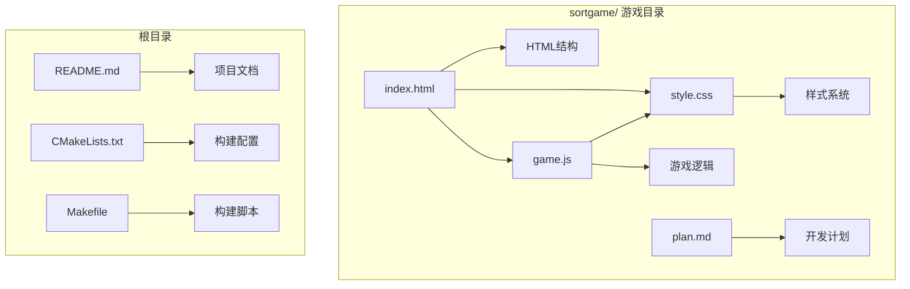
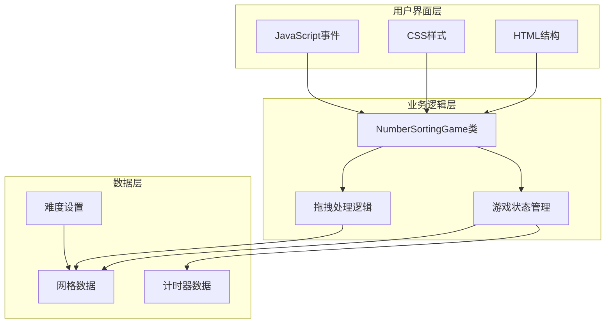
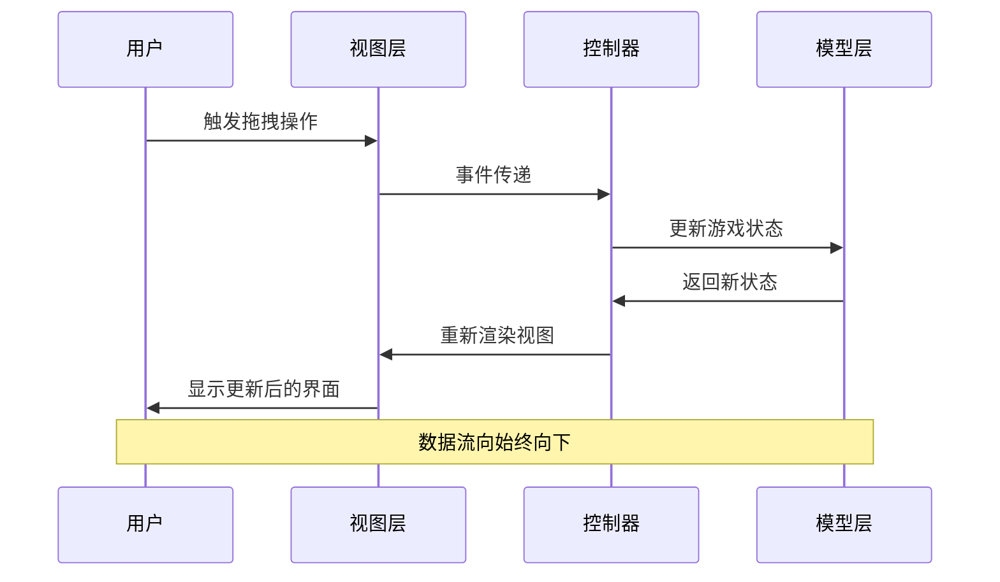
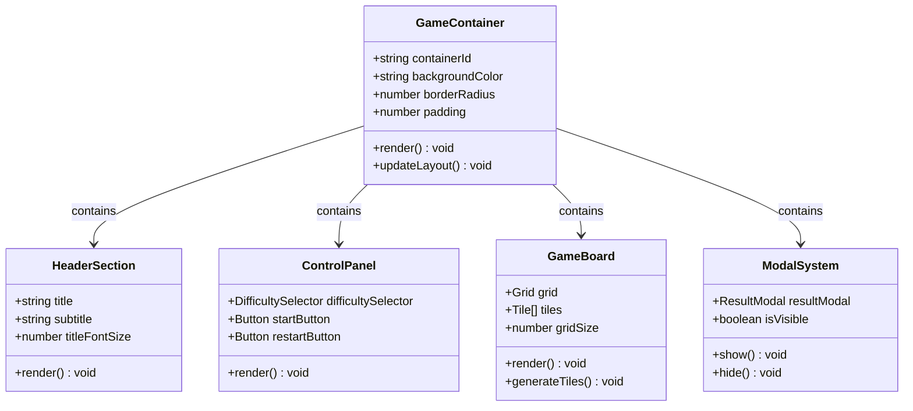
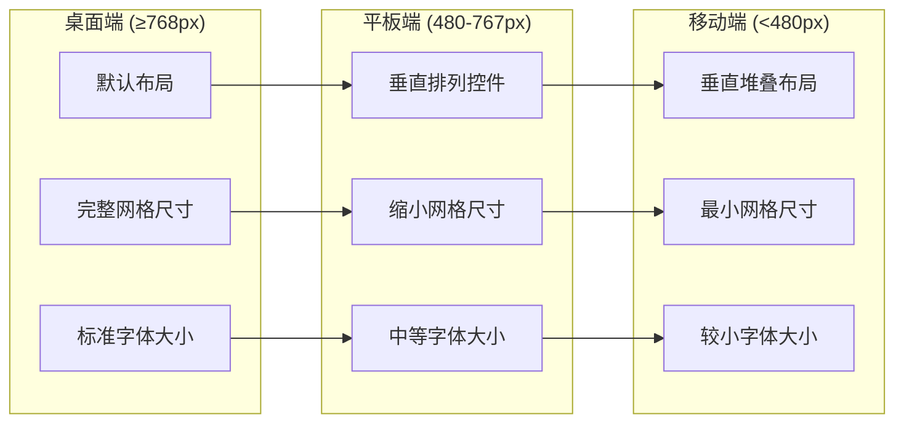
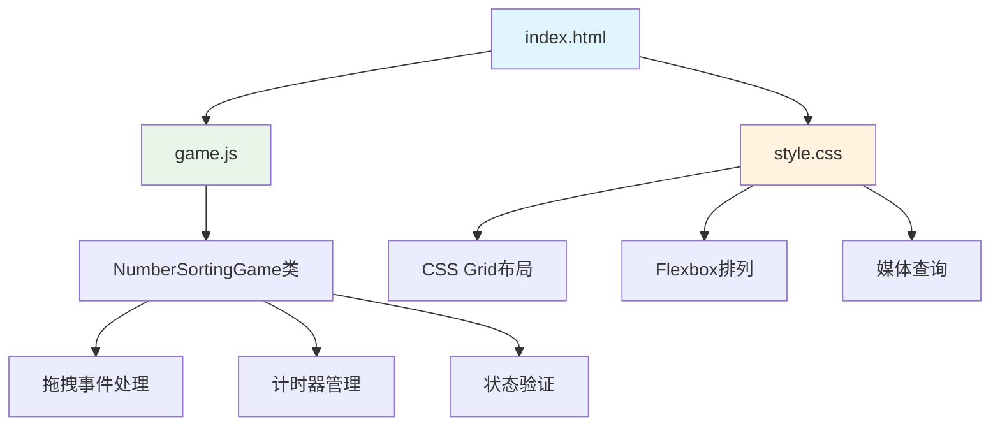

# 游戏界面设计

<cite>
**本文档引用的文件**
- [index.html](file://sortgame/index.html)
- [style.css](file://sortgame/style.css)
- [game.js](file://sortgame/game.js)
- [plan.md](file://sortgame/plan.md)
- [README.md](file://README.md)
</cite>

## 目录
1. [简介](#简介)
2. [项目结构](#项目结构)
3. [核心组件](#核心组件)
4. [架构概览](#架构概览)
5. [详细组件分析](#详细组件分析)
6. [依赖关系分析](#依赖关系分析)
7. [性能考虑](#性能考虑)
8. [故障排除指南](#故障排除指南)
9. [结论](#结论)

## 简介

SortTest项目是一个基于HTML5技术栈开发的数字排序挑战游戏。该项目采用原生JavaScript、CSS3和HTML5技术，实现了拖拽交互式的数字排序游戏界面。游戏界面设计注重用户体验，提供了响应式布局、动画效果和直观的视觉层次结构。

本项目的核心目标是创建一个具有良好可访问性和跨平台兼容性的HTML5游戏，通过拖拽操作实现数字的正确排序，同时提供实时计时、步数统计和难度选择等功能。

## 项目结构

SortTest项目的前端部分主要由三个核心文件组成，形成了清晰的分层架构：



**图表来源**
- [index.html](file://sortgame/index.html#L1-L65)
- [style.css](file://sortgame/style.css#L1-L286)
- [game.js](file://sortgame/game.js#L1-L282)

**章节来源**
- [index.html](file://sortgame/index.html#L1-L65)
- [style.css](file://sortgame/style.css#L1-L286)
- [game.js](file://sortgame/game.js#L1-L282)

## 核心组件

### HTML结构设计

游戏的HTML结构采用了语义化的标记方式，确保了良好的可访问性和SEO友好性：

- **文档结构**: 使用标准的HTML5文档类型声明，包含正确的语言属性和字符编码设置
- **语义化标签**: 合理使用header、section等语义化标签，提升内容结构的清晰度
- **响应式元标签**: 包含viewport配置，确保在移动设备上的正确缩放和显示

### CSS样式系统

样式系统采用了现代化的CSS3技术，实现了丰富的视觉效果和响应式设计：

- **盒模型统一**: 通过全局盒模型设置，简化了布局计算
- **渐变背景**: 使用CSS渐变创建美观的背景效果
- **阴影效果**: 为容器添加立体感的阴影效果
- **过渡动画**: 为交互元素提供流畅的过渡效果

### JavaScript游戏逻辑

游戏逻辑通过面向对象的方式实现，提供了完整的交互功能：

- **拖拽交互**: 基于HTML5拖放API实现拖拽功能
- **触摸支持**: 兼容移动设备的触摸事件处理
- **状态管理**: 完整的游戏状态跟踪和管理
- **算法实现**: 包含数字生成、移动验证和胜利检测

**章节来源**
- [index.html](file://sortgame/index.html#L1-L65)
- [style.css](file://sortgame/style.css#L1-L286)
- [game.js](file://sortgame/game.js#L1-L282)

## 架构概览

游戏采用经典的MVC（Model-View-Controller）架构模式，将数据、视图和业务逻辑清晰分离：



**图表来源**
- [game.js](file://sortgame/game.js#L1-L282)
- [index.html](file://sortgame/index.html#L1-L65)
- [style.css](file://sortgame/style.css#L1-L286)

### 数据流分析

游戏的数据流遵循单向数据流原则，确保了状态的一致性和可预测性：



**图表来源**
- [game.js](file://sortgame/game.js#L149-L168)
- [index.html](file://sortgame/index.html#L38-L52)

## 详细组件分析

### 游戏容器系统

游戏的主要容器采用了卡片式设计，提供了良好的视觉层次和空间感：



**图表来源**
- [index.html](file://sortgame/index.html#L10-L53)
- [style.css](file://sortgame/style.css#L15-L22)

#### 头部标题设计

头部区域采用了居中对齐的设计理念，通过渐变文字效果营造视觉焦点：

- **主标题**: 使用emoji装饰的标题，增强视觉吸引力
- **副标题**: 提供简短的游戏说明
- **颜色搭配**: 采用深色系文字，确保良好的可读性

#### 控制面板布局

控制面板采用了Flexbox布局，实现了响应式的按钮排列：

- **难度选择器**: 下拉菜单提供三种难度级别
- **功能按钮**: 主要按钮使用渐变背景，次要按钮使用浅色背景
- **间距控制**: 统一的间距设置确保视觉平衡

#### 游戏棋盘设计

棋盘区域采用了CSS Grid系统，支持不同难度级别的网格布局：

- **网格系统**: 支持3x3、4x4、5x5三种网格大小
- **瓷砖样式**: 每个瓷砖都具有圆角、阴影和渐变效果
- **交互反馈**: 悬停时的缩放效果和阴影变化

#### 模态框系统

结果模态框提供了游戏完成后的统计信息展示：

- **半透明背景**: 使用遮罩层确保模态框的突出显示
- **居中布局**: 通过Flexbox实现水平垂直居中
- **统计信息**: 包含时间、步数和评级信息

**章节来源**
- [index.html](file://sortgame/index.html#L10-L53)
- [style.css](file://sortgame/style.css#L15-L221)

### 响应式设计实现

项目实现了多层次的响应式设计，确保在不同设备上的良好体验：



**图表来源**
- [style.css](file://sortgame/style.css#L236-L286)

#### 媒体查询策略

项目使用了两层媒体查询来实现渐进式增强：

- **第一层**: 768px断点，处理平板设备的布局调整
- **第二层**: 480px断点，针对移动设备的极致优化

#### 布局适配方案

针对不同屏幕尺寸，项目采用了相应的布局策略：

- **控件排列**: 从水平排列改为垂直堆叠
- **网格尺寸**: 根据屏幕宽度动态调整瓷砖大小
- **字体缩放**: 逐步减小字体大小以适应小屏幕

**章节来源**
- [style.css](file://sortgame/style.css#L236-L286)

### 动画效果系统

项目实现了多层次的动画效果，提升了用户的交互体验：

```mermaid
flowchart TD
A[用户交互触发] --> B{交互类型}
B --> |悬停| C[平滑缩放动画]
B --> |拖拽| D[拖拽反馈动画]
B --> |点击| E[按钮状态变化]
B --> |加载| F[渐入渐出效果]
C --> G[transform: scale()]
D --> H[box-shadow变化]
E --> I[background渐变]
F --> J[opacity变化]
G --> K[用户体验提升]
H --> K
I --> K
J --> K
```

**图表来源**
- [style.css](file://sortgame/style.css#L92-L101)
- [style.css](file://sortgame/style.css#L180-L183)

#### 悬停效果实现

每个可交互元素都具备平滑的悬停动画效果：

- **按钮**: 抬升效果配合阴影扩散
- **瓷砖**: 轻微放大和阴影增强
- **模态框**: 居中的弹性动画

#### 过渡动画设计

项目广泛使用CSS过渡属性实现平滑的状态变化：

- **颜色过渡**: 渐变背景的平滑切换
- **位置过渡**: 按钮状态的平滑变化
- **尺寸过渡**: 瓷砖大小的自然缩放

**章节来源**
- [style.css](file://sortgame/style.css#L92-L101)
- [style.css](file://sortgame/style.css#L180-L183)

### 可访问性考虑

项目在设计时充分考虑了可访问性需求：

- **键盘导航**: 所有交互元素都支持键盘操作
- **屏幕阅读器**: 语义化HTML结构便于辅助技术识别
- **颜色对比**: 确保文本和背景有足够的对比度
- **焦点管理**: 清晰的键盘焦点指示器

## 依赖关系分析

游戏的依赖关系相对简单，主要围绕核心文件展开：



**图表来源**
- [index.html](file://sortgame/index.html#L7-L8)
- [game.js](file://sortgame/game.js#L280-L282)

### 外部依赖

项目采用零外部依赖的架构设计：

- **纯原生技术**: 仅使用HTML5、CSS3、JavaScript原生功能
- **无第三方库**: 避免引入额外的依赖包
- **浏览器兼容**: 基于现代浏览器的标准功能

### 内部模块耦合

各模块之间保持松耦合的设计原则：

- **HTML与CSS解耦**: 通过类名关联而非内联样式
- **逻辑与视图分离**: JavaScript独立管理游戏逻辑
- **状态集中管理**: 游戏状态通过单一实例管理

**章节来源**
- [index.html](file://sortgame/index.html#L7-L8)
- [game.js](file://sortgame/game.js#L280-L282)

## 性能考虑

项目在性能优化方面采取了多项措施：

### DOM操作优化

- **批量更新**: 避免频繁的DOM查询和修改
- **事件委托**: 使用事件委托减少事件监听器数量
- **虚拟DOM**: 通过字符串拼接减少实际DOM操作

### 内存管理

- **垃圾回收**: 及时清理不再使用的事件监听器
- **状态清理**: 游戏结束后重置所有状态变量
- **定时器管理**: 正确清理计时器避免内存泄漏

### 渲染性能

- **CSS硬件加速**: 利用transform和opacity属性启用GPU加速
- **重绘最小化**: 通过合理的样式设计减少重绘次数
- **布局抖动避免**: 批量读取布局信息后再进行写操作

## 故障排除指南

### 常见问题及解决方案

#### 拖拽功能异常

**问题描述**: 拖拽操作无法正常工作

**可能原因**:
- 浏览器不支持HTML5拖放API
- 触摸事件冲突
- CSS样式影响拖拽行为

**解决方法**:
- 检查浏览器兼容性
- 确认CSS中没有禁用拖拽的样式
- 验证事件监听器是否正确绑定

#### 响应式布局失效

**问题描述**: 在移动设备上布局错乱

**可能原因**:
- viewport元标签缺失
- CSS媒体查询语法错误
- 移动端缓存问题

**解决方法**:
- 确认viewport配置正确
- 检查媒体查询断点设置
- 强制刷新移动端缓存

#### 动画效果卡顿

**问题描述**: 页面动画出现卡顿现象

**可能原因**:
- 过多的DOM操作
- 复杂的CSS选择器
- 内存泄漏导致性能下降

**解决方法**:
- 优化DOM操作频率
- 简化CSS选择器
- 使用开发者工具检查内存使用

**章节来源**
- [game.js](file://sortgame/game.js#L126-L147)
- [style.css](file://sortgame/style.css#L236-L286)

## 结论

SortTest项目的HTML5游戏界面设计体现了现代Web开发的最佳实践。通过采用语义化的HTML结构、现代化的CSS3技术和原生JavaScript实现，项目成功创建了一个功能完整、界面美观且具有良好性能的数字排序游戏。

### 设计亮点

- **响应式架构**: 从桌面到移动设备的无缝适配
- **交互体验**: 流畅的拖拽操作和丰富的动画效果
- **可维护性**: 清晰的代码结构和模块化设计
- **性能优化**: 高效的DOM操作和内存管理

### 技术优势

- **零依赖**: 纯原生技术栈，降低维护成本
- **跨平台**: 良好的浏览器兼容性
- **可扩展性**: 模块化设计便于功能扩展
- **可访问性**: 符合无障碍设计标准

### 改进建议

未来可以在以下方面进一步优化：

- **性能监控**: 添加性能指标监控
- **国际化支持**: 考虑多语言本地化
- **离线支持**: 实现Service Worker缓存
- **测试覆盖**: 增加自动化测试覆盖率

该项目为HTML5游戏开发提供了优秀的参考范例，展示了如何在保持简洁性的同时实现复杂的功能需求。