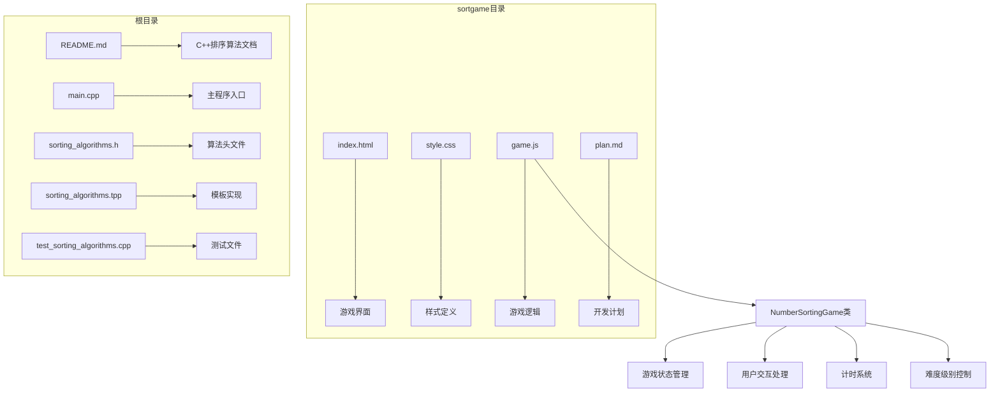
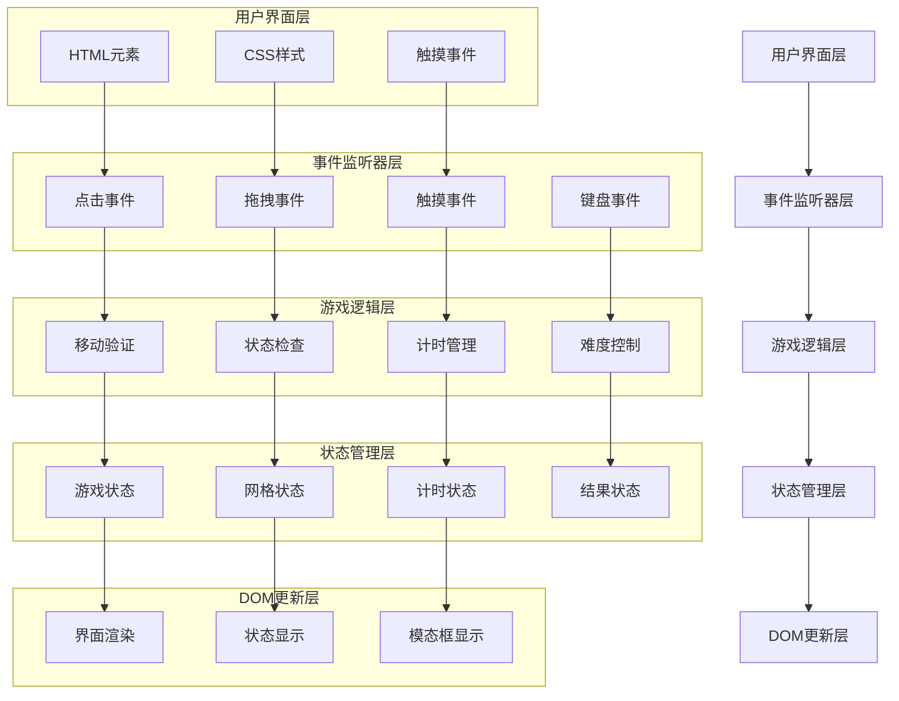
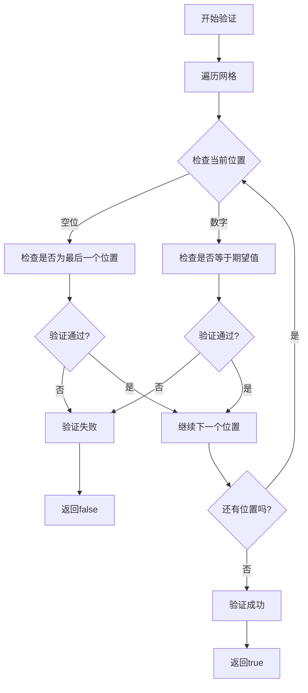
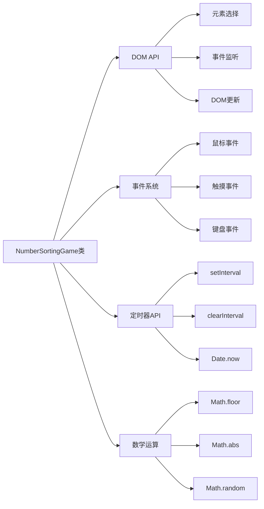

# 游戏逻辑引擎

<cite>
**本文档引用的文件**
- [sortgame/game.js](file://sortgame/game.js)
- [sortgame/index.html](file://sortgame/index.html)
- [sortgame/style.css](file://sortgame/style.css)
- [sortgame/plan.md](file://sortgame/plan.md)
- [README.md](file://README.md)
</cite>

## 目录
1. [简介](#简介)
2. [项目结构](#项目结构)
3. [核心组件](#核心组件)
4. [架构概览](#架构概览)
5. [详细组件分析](#详细组件分析)
6. [依赖关系分析](#依赖关系分析)
7. [性能考虑](#性能考虑)
8. [故障排除指南](#故障排除指南)
9. [结论](#结论)
10. [附录](#附录)

## 简介

SortTest项目是一个基于原生HTML/CSS/JavaScript的数字排序游戏，实现了经典的滑块拼图游戏玩法。该项目采用面向对象的设计模式，通过NumberSortingGame类封装了完整的游戏逻辑，包括游戏状态管理、用户交互处理、计时系统和难度级别控制等功能。

游戏的核心玩法是通过拖拽数字方块，使其按照递增顺序排列，最终形成完整的数字序列。项目提供了三种难度级别（3×3、4×4、5×5网格），实时计时和步数统计功能，并包含基于时间和步数的综合评分系统。

## 项目结构

SortTest项目采用模块化的设计，将游戏逻辑、界面展示和样式分离到不同的文件中：

**图表来源**
- [sortgame/game.js](file://sortgame/game.js#L1-L282)
- [sortgame/index.html](file://sortgame/index.html#L1-L65)
- [sortgame/style.css](file://sortgame/style.css#L1-L286)

**章节来源**
- [sortgame/game.js](file://sortgame/game.js#L1-L282)
- [sortgame/index.html](file://sortgame/index.html#L1-L65)
- [sortgame/style.css](file://sortgame/style.css#L1-L286)

## 核心组件

### NumberSortingGame类架构

NumberSortingGame类是整个游戏的核心，采用了完整的面向对象设计模式。该类负责管理游戏的所有状态和行为，包括游戏初始化、用户交互处理、状态转换和结果展示。

#### 类的构造函数和初始化

构造函数负责初始化游戏的基本属性和DOM元素引用，设置了默认的中等难度级别（4×4网格）。关键的初始化步骤包括：

- DOM元素引用绑定：获取游戏界面中的所有交互元素
- 游戏状态变量初始化：设置网格大小、空位索引、移动计数等
- 定时器和播放状态管理：初始化计时器和游戏进行状态
- 事件监听器注册：为所有交互按钮绑定相应的处理函数

#### 属性组织结构

游戏的核心属性按照功能分组，形成了清晰的层次结构：

**界面元素属性**：包含所有DOM元素的引用，如游戏棋盘、计时器显示、移动计数显示等。

**游戏状态属性**：管理当前游戏的各种状态，包括网格尺寸、数字数组、空位位置、移动次数等。

**定时器属性**：控制计时器的启动、停止和更新逻辑。

**交互状态属性**：跟踪用户的交互状态，如拖拽开始位置、触摸事件处理等。

**章节来源**
- [sortgame/game.js](file://sortgame/game.js#L1-L34)

## 架构概览

游戏采用事件驱动的架构模式，通过事件监听器响应用户的各种操作。整体架构可以分为以下几个层次：

**图表来源**
- [sortgame/game.js](file://sortgame/game.js#L25-L34)
- [sortgame/index.html](file://sortgame/index.html#L16-L52)

## 详细组件分析

### 游戏状态管理系统

游戏状态管理系统是NumberSortingGame类的核心功能之一，负责维护游戏的完整生命周期状态。系统采用布尔标志和数值变量相结合的方式，确保状态的一致性和可预测性。

#### 当前游戏状态的维护

游戏状态通过多个属性协同维护：

**播放状态 (`isPlaying`)**：控制游戏是否处于活跃状态，影响用户交互的可用性。

**网格状态 (`tiles`)**：存储当前网格中所有数字的位置信息，包括空位的特殊表示。

**计时状态 (`startTime`, `timerInterval`)**：管理计时器的启动和停止时机。

**交互状态 (`emptyIndex`, `moves`)**：跟踪空位位置和移动次数。

#### 状态转换的触发条件

状态转换遵循严格的条件判断：

**开始游戏转换**：当用户点击"开始游戏"按钮且游戏不在进行中时触发。

**结束游戏转换**：当玩家成功完成拼图（checkWin返回true）时触发。

**难度变更转换**：当用户选择新的难度级别时，根据游戏是否在进行中决定重启或重新渲染。

**交互转换**：每次成功的数字移动都会触发状态更新，包括移动计数增加和网格重新渲染。

#### 状态持久化的实现

虽然项目没有实现传统的本地存储持久化，但通过以下方式实现了状态的临时保存：

- 游戏过程中所有状态都存储在内存中，确保快速访问
- 重新开始功能会重置所有状态到初始值
- 结果模态框显示时，相关的统计数据会被保存到DOM元素中

**章节来源**
- [sortgame/game.js](file://sortgame/game.js#L12-L23)
- [sortgame/game.js](file://sortgame/game.js#L64-L77)
- [sortgame/game.js](file://sortgame/game.js#L224-L233)

### 游戏核心算法实现

游戏的核心算法围绕数字排序验证和移动合法性检查展开，采用了数学计算和数组操作相结合的方法。

#### 排序验证逻辑

排序验证算法通过遍历网格中的每个位置，检查数字是否按照期望的顺序排列：

**图表来源**
- [sortgame/game.js](file://sortgame/game.js#L186-L193)

验证过程的关键特点：
- 数字位置验证：每个非空位都必须等于其期望的数值
- 空位位置验证：最后一个位置必须为空位
- 算法复杂度：O(n)，其中n是网格中数字的总数

#### 移动计数统计

移动计数统计采用简单的增量计数方式，每次有效的数字移动都会增加计数器：

**计数触发条件**：
- 移动必须是合法的（与空位相邻）
- 移动必须发生在游戏进行期间
- 移动必须成功完成（位置交换）

**计数更新流程**：
1. 验证移动的合法性
2. 执行位置交换
3. 更新空位索引
4. 增加移动计数
5. 重新渲染网格

#### 完成条件判断

完成条件的判断结合了排序验证和空位位置检查：

**判断标准**：
- 所有非空位都必须按照正确的顺序排列
- 空位必须位于网格的右下角位置
- 算法会自动处理不同网格大小的情况

**章节来源**
- [sortgame/game.js](file://sortgame/game.js#L149-L168)
- [sortgame/game.js](file://sortgame/game.js#L186-L193)

### 用户交互处理机制

用户交互处理机制实现了多种输入方式的支持，包括鼠标拖拽、触摸操作和键盘快捷键。

#### 点击事件的响应

点击事件是最直接的用户交互方式，主要用于游戏控制按钮：

**事件绑定**：
- 开始游戏按钮：启动新游戏，初始化计时器
- 重新开始按钮：重置游戏状态，重新渲染界面
- 再玩一次按钮：重复当前游戏的结果

**事件处理流程**：
1. 阻止默认事件行为
2. 调用相应的游戏方法
3. 更新界面状态显示

#### 拖拽操作的处理

拖拽操作利用HTML5原生拖放API实现，提供了流畅的用户体验：

**拖拽事件链**：
1. `dragstart`：记录源元素的索引
2. `dragover`：阻止默认行为以允许放置
3. `drop`：获取目标索引并执行移动

**拖拽验证**：
- 检查目标位置是否为空位
- 验证源位置与目标位置的相邻关系
- 确保移动在游戏进行期间发生

#### 键盘快捷键的支持

虽然当前版本没有实现专门的键盘快捷键，但代码结构为未来的键盘支持预留了接口：

**潜在的键盘支持方向**：
- 方向键导航空位
- 空格键触发移动
- ESC键暂停游戏

**章节来源**
- [sortgame/game.js](file://sortgame/game.js#L126-L147)
- [sortgame/game.js](file://sortgame/game.js#L170-L184)

### 定时器系统的实现

定时器系统提供了精确的时间跟踪功能，支持游戏开始后的自动计时和结束时的准确停止。

#### 计时器的启动停止

定时器采用`setInterval`实现，每秒触发一次更新：

**启动流程**：
1. 停止任何现有的计时器
2. 记录开始时间戳
3. 设置新的定时器间隔
4. 开始定期更新显示

**停止流程**：
1. 清除定时器引用
2. 释放定时器资源
3. 确保内存安全

#### 时间格式化显示

时间显示采用分钟:秒的格式，使用字符串填充确保两位数显示：

**格式化规则**：
- 分钟部分：使用整除运算获取分钟数
- 秒部分：使用取余运算获取秒数
- 字符串填充：使用`padStart`确保两位数显示

#### 精度控制

定时器精度控制在秒级，通过以下方式实现：
- 定时器间隔：1000毫秒（1秒）
- 时间计算：使用`Math.floor`向下取整
- 显示更新：每秒更新一次

**章节来源**
- [sortgame/game.js](file://sortgame/game.js#L195-L214)
- [sortgame/game.js](file://sortgame/game.js#L202-L207)

### 难度级别系统的设计

难度级别系统通过调整网格大小来控制游戏的复杂度，提供了三个预设的难度级别。

#### 网格大小配置

难度级别与网格大小的对应关系：

| 难度级别 | 网格大小 | 数字总数 | 预期步数范围 |
|----------|----------|----------|--------------|
| 简单 | 3×3 | 8个数字 | 20-50步 |
| 中等 | 4×4 | 15个数字 | 50-120步 |
| 困难 | 5×5 | 24个数字 | 120-250步 |

#### 随机数生成算法

游戏使用Fisher-Yates洗牌算法生成随机布局：

**算法特点**：
- 时间复杂度：O(n)
- 空间复杂度：O(1)
- 保证完全随机性
- 就地洗牌，不需要额外空间

**洗牌过程**：
1. 从数组末尾开始向前遍历
2. 对于每个位置，生成0到当前位置的随机索引
3. 交换当前位置和随机索引处的元素
4. 继续处理前一个位置

#### 初始布局的打乱逻辑

布局打乱采用多次随机交换的方式：

**打乱策略**：
- 生成完整的数字序列（1到n-1）
- 随机打乱序列
- 在末尾添加空位
- 确保生成的布局是可解的

**可解性保证**：
- 通过随机洗牌确保布局的随机性
- 空位始终位于正确位置（最后一个位置）
- 保证生成的布局存在解

**章节来源**
- [sortgame/game.js](file://sortgame/game.js#L36-L55)
- [sortgame/game.js](file://sortgame/game.js#L79-L95)

### 游戏扩展性的设计考虑

项目在设计时充分考虑了未来的扩展需求，提供了多个扩展点和改进方向。

#### 新功能添加的实现指南

**1. 音效系统集成**
- 在游戏状态变化时触发相应的音效
- 提供音效开关控制
- 支持多种音效类型（移动、完成、错误）

**2. 动画效果增强**
- 为数字移动添加平滑动画
- 实现网格重新渲染的过渡效果
- 添加完成时的庆祝动画

**3. 成绩记录系统**
- 实现本地存储的成绩记录
- 支持多难度级别的最佳成绩
- 提供成绩排行榜功能

**4. 自定义主题系统**
- 支持用户自定义颜色主题
- 提供多种预设主题
- 实现主题切换功能

**5. 高级难度选项**
- 实现自定义网格大小
- 添加障碍物生成算法
- 支持随机障碍物布局

#### 代码架构的扩展点

**模块化改进**：
- 将游戏逻辑拆分为独立的模块
- 实现插件系统支持
- 提供API接口供外部扩展

**性能优化方向**：
- 实现虚拟滚动以支持更大的网格
- 添加Web Workers处理复杂的计算
- 优化DOM操作减少重绘

**章节来源**
- [sortgame/game.js](file://sortgame/game.js#L279-L282)
- [sortgame/plan.md](file://sortgame/plan.md#L1-L63)

## 依赖关系分析

游戏的依赖关系相对简单，主要依赖于浏览器的原生API和DOM操作。

**图表来源**
- [sortgame/game.js](file://sortgame/game.js#L1-L282)

**章节来源**
- [sortgame/game.js](file://sortgame/game.js#L1-L282)

## 性能考虑

项目在性能方面采用了多项优化措施，确保在不同设备上都能提供流畅的用户体验。

### DOM操作优化

**批量更新策略**：
- 在渲染网格时使用一次性innerHTML更新
- 避免频繁的DOM查询和修改
- 使用DocumentFragment减少重排

**事件委托优化**：
- 为动态生成的元素使用事件委托
- 减少事件监听器的数量
- 提高事件处理效率

### 内存管理

**垃圾回收友好**：
- 及时清理定时器引用
- 避免循环引用
- 合理使用闭包

**状态管理优化**：
- 使用简单数据类型存储状态
- 避免深层嵌套的对象结构
- 及时释放大对象引用

### 移动端优化

**触摸事件优化**：
- 使用passive事件监听器提高滚动性能
- 优化触摸手势识别
- 减少触摸事件的处理开销

**响应式设计**：
- 使用CSS媒体查询适配不同屏幕尺寸
- 优化触摸目标的大小
- 提供良好的移动端用户体验

## 故障排除指南

### 常见问题及解决方案

**问题1：拖拽功能无法正常工作**
- 检查浏览器对HTML5拖放API的支持
- 确认元素具有draggable属性
- 验证dragstart和drop事件的正确绑定

**问题2：计时器显示异常**
- 检查定时器是否正确启动和停止
- 确认时间格式化函数的正确性
- 验证定时器引用的清理

**问题3：移动验证逻辑错误**
- 检查canMove方法的相邻性判断
- 确认网格边界检查的正确性
- 验证索引计算的准确性

**问题4：难度切换后布局异常**
- 检查generateNumbers方法的正确性
- 确认网格大小变化时的状态重置
- 验证DOM元素的重新渲染

**章节来源**
- [sortgame/game.js](file://sortgame/game.js#L126-L147)
- [sortgame/game.js](file://sortgame/game.js#L170-L184)
- [sortgame/game.js](file://sortgame/game.js#L202-L207)

## 结论

SortTest项目的JavaScript游戏逻辑引擎展现了优秀的面向对象设计和实用的算法实现。NumberSortingGame类通过清晰的职责分离和完善的错误处理，为用户提供了流畅的数字排序游戏体验。

项目的主要优势包括：
- **模块化设计**：清晰的类结构和方法组织
- **完整的功能覆盖**：从基础拖拽到高级评分系统
- **良好的扩展性**：为未来功能增强预留了接口
- **跨平台兼容**：支持桌面和移动设备

通过深入分析游戏的核心算法、状态管理和用户交互机制，我们可以看到项目在技术实现上的成熟度和专业性。这些设计原则和实现技巧为类似游戏项目的开发提供了宝贵的参考价值。

## 附录

### API参考

**NumberSortingGame类方法**

| 方法名 | 参数 | 返回值 | 描述 |
|--------|------|--------|------|
| constructor | 无 | 实例 | 构造函数，初始化游戏 |
| init | 无 | void | 初始化游戏界面和事件监听器 |
| startGame | 无 | void | 开始新游戏 |
| restartGame | 无 | void | 重新开始游戏 |
| endGame | 无 | void | 结束当前游戏 |
| generateNumbers | 无 | void | 生成随机数字布局 |
| renderBoard | 无 | void | 渲染游戏网格 |
| moveTile | sourceIndex, targetIndex | void | 执行数字移动 |
| canMove | sourceIndex, targetIndex | boolean | 检查移动合法性 |
| checkWin | 无 | boolean | 检查游戏是否完成 |
| startTimer | 无 | void | 启动计时器 |
| stopTimer | 无 | void | 停止计时器 |
| updateTimer | 无 | void | 更新时间显示 |
| updateMoves | 无 | void | 更新移动计数显示 |
| updateStatus | message | void | 更新状态消息 |
| calculateRating | time, moves | string | 计算游戏评级 |
| showResult | time, moves, rating | void | 显示游戏结果 |

### 开发建议

**代码质量改进建议**：
1. 添加完整的错误处理和边界检查
2. 实现单元测试覆盖关键算法
3. 优化性能关键路径的代码
4. 添加代码注释和文档生成
5. 实现ESLint和Prettier代码规范

**功能扩展建议**：
1. 添加音效和背景音乐支持
2. 实现成就系统和进度追踪
3. 添加多人对战功能
4. 实现云同步和跨设备游戏
5. 添加自定义主题和个性化选项