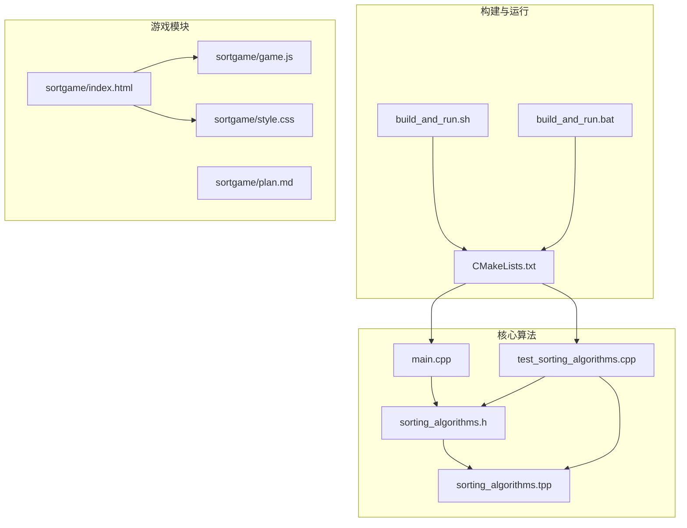
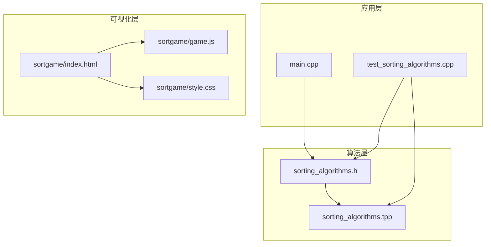
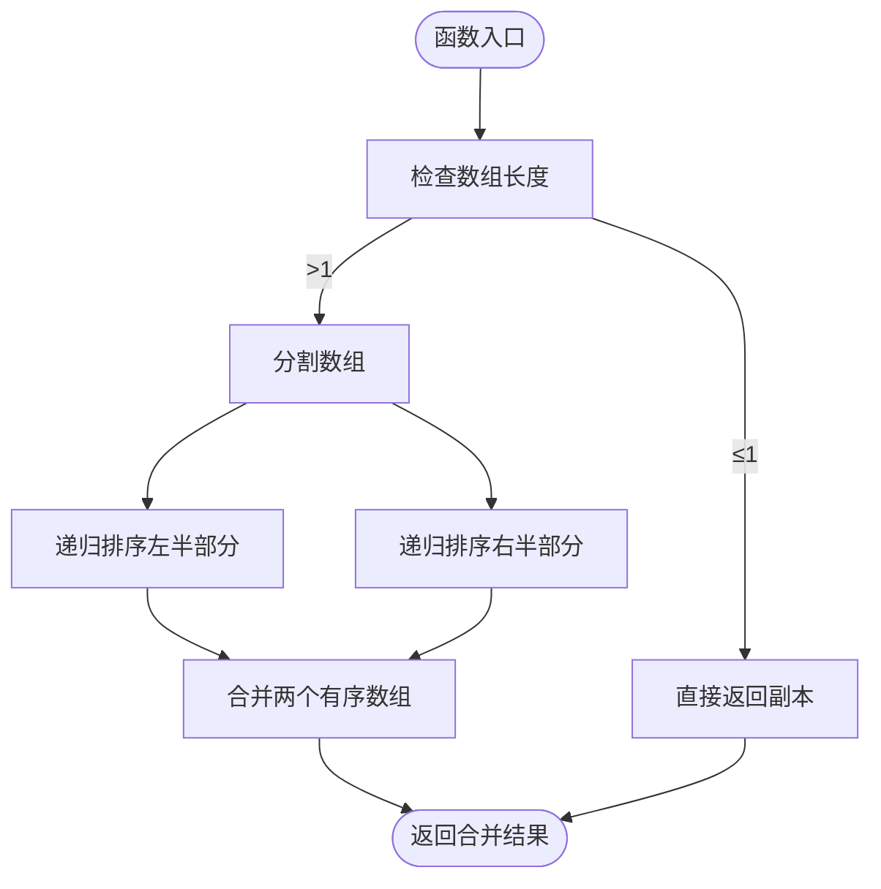
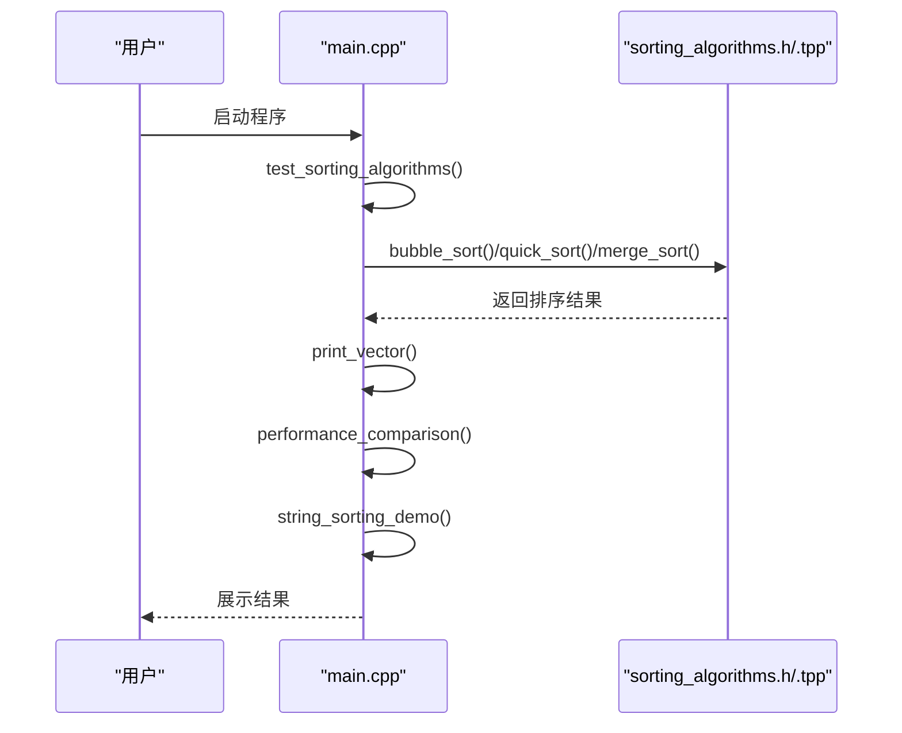
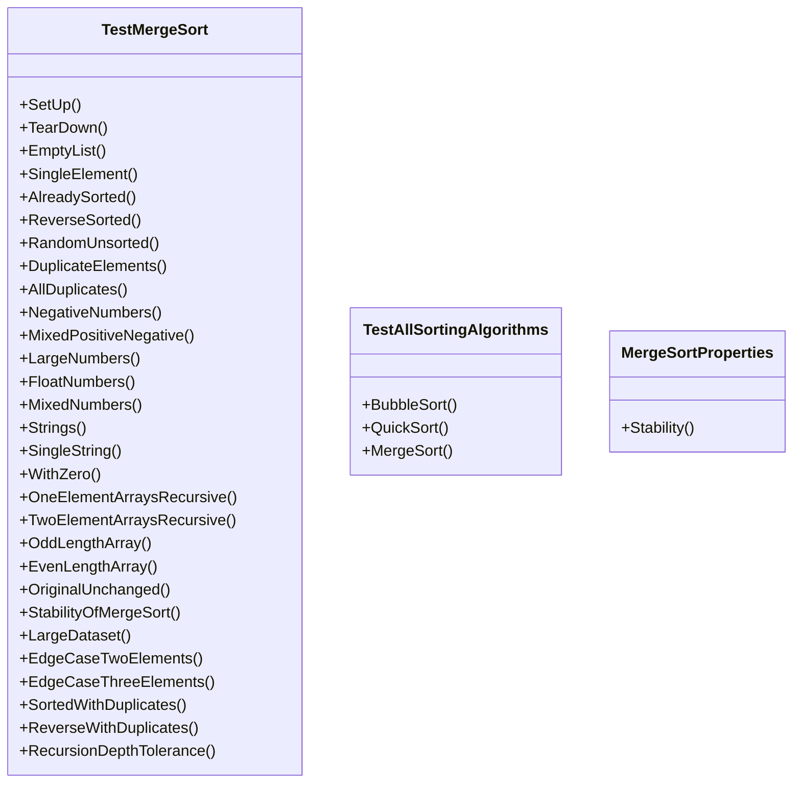
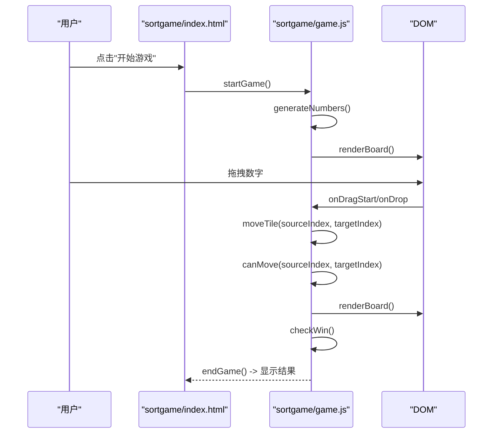
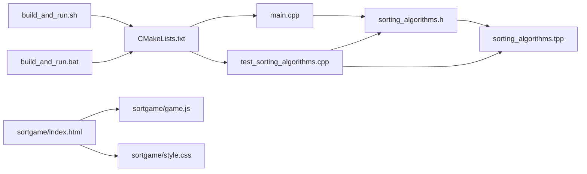

# 开发指南

<cite>
**本文引用的文件**
- [README.md](file://README.md)
- [main.cpp](file://main.cpp)
- [sorting_algorithms.h](file://sorting_algorithms.h)
- [sorting_algorithms.tpp](file://sorting_algorithms.tpp)
- [test_sorting_algorithms.cpp](file://test_sorting_algorithms.cpp)
- [CMakeLists.txt](file://CMakeLists.txt)
- [build_and_run.sh](file://build_and_run.sh)
- [build_and_run.bat](file://build_and_run.bat)
- [sortgame/index.html](file://sortgame/index.html)
- [sortgame/game.js](file://sortgame/game.js)
- [sortgame/style.css](file://sortgame/style.css)
- [sortgame/plan.md](file://sortgame/plan.md)
</cite>

## 目录
1. [简介](#简介)
2. [项目结构](#项目结构)
3. [核心组件](#核心组件)
4. [架构概览](#架构概览)
5. [详细组件分析](#详细组件分析)
6. [依赖关系分析](#依赖关系分析)
7. [性能考虑](#性能考虑)
8. [故障排查指南](#故障排查指南)
9. [结论](#结论)
10. [附录](#附录)

## 简介
本指南面向SortTest项目的开发者，提供从环境搭建、编码规范、架构设计、贡献流程到扩展方向与调试技巧的完整开发手册。项目由C++排序算法实现与一个基于HTML/CSS/JavaScript的手动拖拽排序小游戏组成，既可用于教学演示，也可作为学习模板方法、观察者等设计模式的实践案例。

## 项目结构
项目采用“算法实现 + 可视化演示 + 游戏互动”的多模块组织方式：
- 核心算法模块：C++实现的冒泡排序、快速排序、归并排序，模板化设计，支持任意可比较类型。
- 可视化演示：命令行主程序展示算法行为与性能对比，并演示字符串排序。
- 单元测试：基于Google Test的全面测试套件，覆盖边界、稳定性、大数据集等场景。
- 游戏模块：sortgame目录提供HTML/CSS/JS拖拽排序小游戏，包含计时、步数统计、难度选择与评分系统。
- 构建系统：CMake与Shell/批处理脚本，支持跨平台一键构建与运行。

图表来源
- [CMakeLists.txt](file://CMakeLists.txt#L1-L45)
- [main.cpp](file://main.cpp#L1-L158)
- [sorting_algorithms.h](file://sorting_algorithms.h#L1-L104)
- [sorting_algorithms.tpp](file://sorting_algorithms.tpp#L1-L162)
- [test_sorting_algorithms.cpp](file://test_sorting_algorithms.cpp#L1-L294)
- [build_and_run.sh](file://build_and_run.sh#L1-L107)
- [build_and_run.bat](file://build_and_run.bat#L1-L152)
- [sortgame/index.html](file://sortgame/index.html#L1-L65)
- [sortgame/game.js](file://sortgame/game.js#L1-L282)
- [sortgame/style.css](file://sortgame/style.css#L1-L286)
- [sortgame/plan.md](file://sortgame/plan.md#L1-L63)

章节来源
- [README.md](file://README.md#L1-L229)
- [CMakeLists.txt](file://CMakeLists.txt#L1-L45)

## 核心组件
- 排序算法库：提供模板化的冒泡、快速、归并排序，保证非侵入式（不修改原数组），并以新向量返回结果。
- 主程序演示：集中展示算法正确性、性能对比与字符串排序示例。
- 单元测试：覆盖边界、重复元素、稳定性、大数据集、字符串与浮点数等多场景。
- 游戏模块：基于HTML5拖拽API与CSS Grid/Flexbox的交互式数字排序游戏，支持难度切换、计时与评分。

章节来源
- [sorting_algorithms.h](file://sorting_algorithms.h#L1-L104)
- [sorting_algorithms.tpp](file://sorting_algorithms.tpp#L1-L162)
- [main.cpp](file://main.cpp#L1-L158)
- [test_sorting_algorithms.cpp](file://test_sorting_algorithms.cpp#L1-L294)
- [sortgame/index.html](file://sortgame/index.html#L1-L65)
- [sortgame/game.js](file://sortgame/game.js#L1-L282)
- [sortgame/style.css](file://sortgame/style.css#L1-L286)

## 架构概览
整体采用“算法库 + 应用层 + 可视化层”的分层设计：
- 算法层：模板函数封装在头文件中并通过.tpp实现，确保编译期展开与类型安全。
- 应用层：main.cpp负责演示与性能对比；test_sorting_algorithms.cpp负责质量保障。
- 可视化层：sortgame提供Web交互界面，独立于C++核心，便于移植与扩展。

图表来源
- [main.cpp](file://main.cpp#L1-L158)
- [test_sorting_algorithms.cpp](file://test_sorting_algorithms.cpp#L1-L294)
- [sorting_algorithms.h](file://sorting_algorithms.h#L1-L104)
- [sorting_algorithms.tpp](file://sorting_algorithms.tpp#L1-L162)
- [sortgame/index.html](file://sortgame/index.html#L1-L65)
- [sortgame/game.js](file://sortgame/game.js#L1-L282)
- [sortgame/style.css](file://sortgame/style.css#L1-L286)

## 详细组件分析

### 排序算法库（模板方法与分治策略）
- 设计要点
  - 模板化：通过头文件声明、.tpp实现，满足C++模板编译期展开要求。
  - 非侵入式：所有函数返回新向量，不修改输入数组。
  - 稳定性：归并排序保持稳定性，适合教学演示。
  - 分治策略：归并排序与快速排序采用分治思想，递归拆分与合并。
- 关键流程（归并排序）
  - 递归终止条件：数组长度≤1直接返回。
  - 分割：取中点将数组分为左右两部分。
  - 递归：对左右子数组分别排序。
  - 合并：双指针合并两个有序数组。
- 关键流程（快速排序）
  - 选择基准：采用中间元素作为基准，避免最坏情况极端选择。
  - 分区：将小于、等于、大于基准的元素分别放入不同子数组。
  - 递归：对左右子数组递归排序并拼接结果。
- 关键流程（冒泡排序）
  - 外层循环：每轮确定一个最大元素的最终位置。
  - 内层比较：相邻元素比较与交换，记录本轮是否发生交换。
  - 提前终止：若某轮无交换则提前结束。

图表来源
- [sorting_algorithms.tpp](file://sorting_algorithms.tpp#L144-L160)

章节来源
- [sorting_algorithms.h](file://sorting_algorithms.h#L1-L104)
- [sorting_algorithms.tpp](file://sorting_algorithms.tpp#L1-L162)

### 主程序演示（职责分离与数据流）
- 职责划分
  - print_vector：通用打印工具，统一输出格式。
  - test_sorting_algorithms：构造多组测试用例，调用三种排序算法并输出结果。
  - performance_comparison：输出算法特性表，便于对比。
  - string_sorting_demo：演示字符串排序。
  - main：组织流程，输出标题与分隔线，依次执行各演示。
- 数据流
  - 输入：测试用例（整数向量）、字符串向量。
  - 处理：调用排序函数，内部复制数组并排序。
  - 输出：格式化打印排序结果与性能信息。

图表来源
- [main.cpp](file://main.cpp#L1-L158)
- [sorting_algorithms.h](file://sorting_algorithms.h#L1-L104)
- [sorting_algorithms.tpp](file://sorting_algorithms.tpp#L1-L162)

章节来源
- [main.cpp](file://main.cpp#L1-L158)

### 单元测试（Google Test与测试金字塔）
- 测试层次
  - 基础功能：空数组、单元素、已排序、逆序、随机、重复元素、边界值。
  - 类型覆盖：整数、浮点数、字符串、pair（用于稳定性验证）。
  - 大数据集：随机生成100/1000元素，验证正确性与递归深度容忍度。
  - 稳定性：使用pair验证归并排序稳定性。
- 测试组织
  - TestMergeSort：归并排序专用测试夹具。
  - TestAllSortingAlgorithms：三种算法一致性测试。
  - Properties：额外属性测试（如稳定性）。

图表来源
- [test_sorting_algorithms.cpp](file://test_sorting_algorithms.cpp#L1-L294)

章节来源
- [test_sorting_algorithms.cpp](file://test_sorting_algorithms.cpp#L1-L294)

### 游戏模块（拖拽排序与状态管理）
- 功能清单
  - 难度选择：3×3/4×4/5×5网格。
  - 拖拽交互：HTML5拖放API与触摸事件支持。
  - 计时与步数：实时计时器与移动步数统计。
  - 完成判定：检查数字是否按顺序排列且空位在右下角。
  - 评分系统：综合时间与步数计算总分并给出星级评价。
  - 重新开始：重置状态、停止计时、渲染空棋盘。
- 关键流程（拖拽交换）
  - 检查目标是否为空位。
  - 计算行列坐标，判断是否相邻（上下左右）。
  - 交换位置，更新空位索引与步数，渲染棋盘。
  - 若完成则结束游戏并弹出结果模态框。

图表来源
- [sortgame/index.html](file://sortgame/index.html#L1-L65)
- [sortgame/game.js](file://sortgame/game.js#L1-L282)

章节来源
- [sortgame/index.html](file://sortgame/index.html#L1-L65)
- [sortgame/game.js](file://sortgame/game.js#L1-L282)
- [sortgame/style.css](file://sortgame/style.css#L1-L286)
- [sortgame/plan.md](file://sortgame/plan.md#L1-L63)

## 依赖关系分析
- 构建系统
  - CMake设置C++17标准与编译警告级别；可选启用测试（FetchContent下载Google Test）。
  - Shell/批处理脚本提供跨平台构建与运行入口。
- 算法实现
  - 头文件声明模板函数，.tpp实现模板函数，遵循C++模板编译期展开约束。
- 测试与演示
  - Google Test用于单元测试；main.cpp用于演示与性能对比。
- 游戏模块
  - 独立的HTML/CSS/JS文件，无后端依赖，便于部署与分享。

图表来源
- [CMakeLists.txt](file://CMakeLists.txt#L1-L45)
- [main.cpp](file://main.cpp#L1-L158)
- [test_sorting_algorithms.cpp](file://test_sorting_algorithms.cpp#L1-L294)
- [sorting_algorithms.h](file://sorting_algorithms.h#L1-L104)
- [sorting_algorithms.tpp](file://sorting_algorithms.tpp#L1-L162)
- [build_and_run.sh](file://build_and_run.sh#L1-L107)
- [build_and_run.bat](file://build_and_run.bat#L1-L152)
- [sortgame/index.html](file://sortgame/index.html#L1-L65)
- [sortgame/game.js](file://sortgame/game.js#L1-L282)
- [sortgame/style.css](file://sortgame/style.css#L1-L286)

章节来源
- [CMakeLists.txt](file://CMakeLists.txt#L1-L45)
- [build_and_run.sh](file://build_and_run.sh#L1-L107)
- [build_and_run.bat](file://build_and_run.bat#L1-L152)

## 性能考虑
- 时间复杂度
  - 冒泡排序：平均/最坏O(n²)，最好O(n)（已实现提前终止）。
  - 快速排序：平均O(n log n)，最坏O(n²)，当前实现采用三路分区思路，有助于处理重复元素。
  - 归并排序：稳定O(n log n)，空间O(n)。
- 空间复杂度
  - 冒泡排序：O(1)原地交换。
  - 快速排序：O(log n)递归栈深。
  - 归并排序：O(n)临时数组。
- 实践建议
  - 对于大规模数据，优先选择归并或快速排序。
  - 在需要稳定性时选择归并排序。
  - 避免在热路径中频繁创建临时对象，可考虑就地排序或复用缓冲区（需评估稳定性与复杂度）。

[本节为通用性能讨论，无需列出具体文件来源]

## 故障排查指南
- 构建失败
  - 缺少编译器：确认g++/clang++或MSVC可用；Windows下可通过Visual Studio或MinGW。
  - CMake版本过低：升级至3.14+。
  - 测试依赖：若禁用测试（BUILD_TESTS=OFF），可跳过Google Test下载。
- 运行异常
  - main程序：检查输入数据类型是否可比较（重载比较运算符）。
  - 测试程序：使用ctest或verbose模式查看详细输出。
- 游戏交互问题
  - 拖拽失效：检查浏览器对HTML5拖放API的支持；移动端使用触摸事件。
  - 样式异常：确认CSS Grid/Flexbox在目标设备上的兼容性。
- 调试技巧
  - C++：使用断点与日志（如实现中的调试输出），结合单元测试定位问题。
  - Web：利用浏览器开发者工具检查事件绑定与DOM结构。

章节来源
- [build_and_run.sh](file://build_and_run.sh#L1-L107)
- [build_and_run.bat](file://build_and_run.bat#L1-L152)
- [CMakeLists.txt](file://CMakeLists.txt#L1-L45)
- [test_sorting_algorithms.cpp](file://test_sorting_algorithms.cpp#L1-L294)
- [sortgame/game.js](file://sortgame/game.js#L1-L282)

## 结论
SortTest项目以清晰的分层架构、模板化的算法实现与完善的测试体系，提供了从理论到实践的完整学习路径。同时，游戏模块展示了前端交互与状态管理的实际应用。建议在后续迭代中继续完善测试覆盖率、扩展更多排序算法与可视化效果，并引入持续集成以提升质量与效率。

[本节为总结性内容，无需列出具体文件来源]

## 附录

### 开发环境搭建
- 前置要求
  - CMake 3.14+
  - C++17兼容编译器（GCC 7+/Clang 5+/MSVC 2017+）
  - 可选：Internet连接用于下载Google Test（测试启用时）
- 构建步骤
  - 使用CMake：创建build目录，配置并编译；运行主程序与测试。
  - 使用脚本：Shell脚本支持快速构建与运行；批处理脚本支持Windows。
- IDE与调试工具
  - 推荐IDE：CLion、VSCode（配合C++/CMake插件）、Visual Studio。
  - 调试：使用GDB/LLDB或IDE内置调试器；为main与test分别设置断点。
- 版本控制最佳实践
  - 分支策略：master/main用于发布，feature分支用于功能开发，hotfix修复紧急问题。
  - 提交规范：简短主题 + 详细描述 + 关联Issue编号；变更粒度适中。
  - 合并与审查：开启PR，至少一名审阅者批准；通过CI检查后再合并。

章节来源
- [README.md](file://README.md#L44-L82)
- [CMakeLists.txt](file://CMakeLists.txt#L1-L45)
- [build_and_run.sh](file://build_and_run.sh#L1-L107)
- [build_and_run.bat](file://build_and_run.bat#L1-L152)

### 代码规范与编程约定
- C++编码标准
  - 使用C++17特性；遵循RAII与智能指针优先。
  - 模板实现放在头文件内，或明确分离声明与实现。
  - 避免魔法数字与裸指针；使用容器与迭代器。
- 命名约定
  - 类型：PascalCase（如NumberSortingGame）
  - 函数/方法：camelCase（如generateNumbers）
  - 变量：camelCase（如gridSize）
  - 常量：UPPER_SNAKE_CASE（如MAX_GRID_SIZE）
  - 模板参数：typename T（保持一致）
- 注释规范
  - 头文件与公共接口使用Doxygen风格注释，说明参数、返回值与复杂度。
  - 关键算法流程添加简要注释，解释分治、分区或合并过程。
  - TODO/NOTE标注待办事项与注意事项。

章节来源
- [sorting_algorithms.h](file://sorting_algorithms.h#L1-L104)
- [sorting_algorithms.tpp](file://sorting_algorithms.tpp#L1-L162)
- [main.cpp](file://main.cpp#L1-L158)
- [test_sorting_algorithms.cpp](file://test_sorting_algorithms.cpp#L1-L294)
- [sortgame/game.js](file://sortgame/game.js#L1-L282)

### 架构设计原则与设计模式
- 设计原则
  - 单一职责：算法实现、演示、测试、游戏各司其职。
  - 开闭原则：新增算法只需实现模板函数并保持接口一致。
  - 里氏替换：模板函数对任意可比较类型有效。
- 设计模式
  - 模板方法模式：排序算法抽象出“分治/比较/合并”流程，具体策略由实现决定。
  - 观察者模式：游戏状态变化（计时、步数、完成）可抽象为事件通知，便于扩展UI与统计。
  - 策略模式：不同排序算法可视为策略，可在运行时切换。

[本节为概念性分析，无需列出具体文件来源]

### 贡献指南
- 提交Issue
  - 描述问题现象、期望行为与复现步骤；附带环境信息（操作系统、编译器版本、CMake版本）。
- 提交Pull Request
  - 选择合适的分支；提供清晰的变更说明与测试用例；确保通过本地与CI检查。
- 代码审查流程
  - 至少一名维护者审阅；关注代码风格、复杂度与测试覆盖；必要时进行重构。
- 社区礼仪
  - 尊重他人意见，积极沟通；避免一次性提交过多无关改动。

章节来源
- [README.md](file://README.md#L217-L229)

### 扩展可能性
- 新增排序算法
  - 堆排序、基数排序、计数排序等；注意稳定性与适用场景。
  - 与现有模板接口保持一致，补充单元测试。
- 改进游戏功能
  - 增加撤销/重做、动画过渡、音效与主题切换。
  - 引入AI辅助（提示功能）或解谜模式。
- 增强可视化效果
  - 将排序过程可视化为动画，展示比较与交换步骤。
  - 提供WebAssembly版算法加速或WebGL渲染。
- 未来发展方向
  - 引入持续集成与自动化测试；建立文档站点与示例库。
  - 探索多语言前端框架（React/Vue）与后端服务（REST API）集成。

[本节为概念性扩展建议，无需列出具体文件来源]