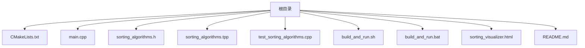
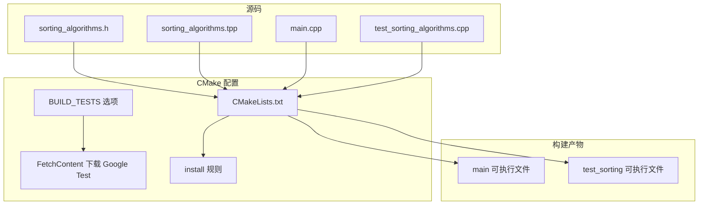
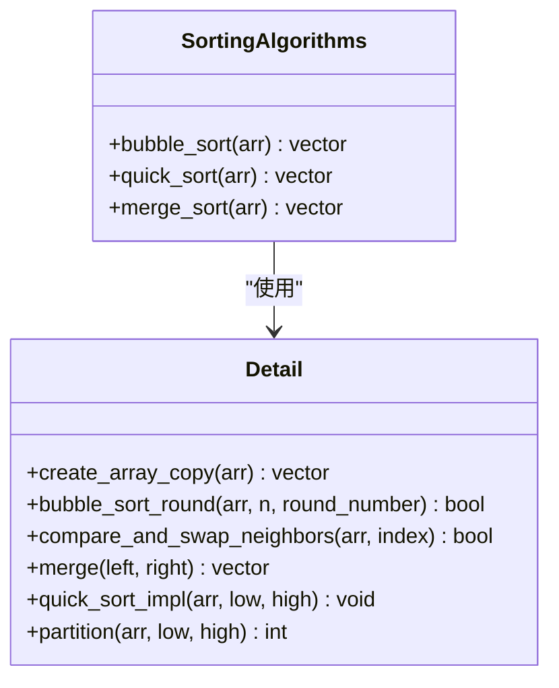
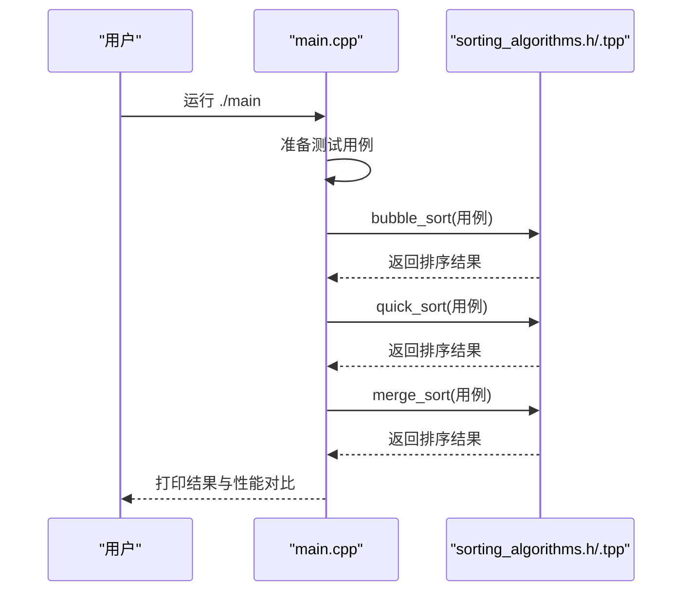
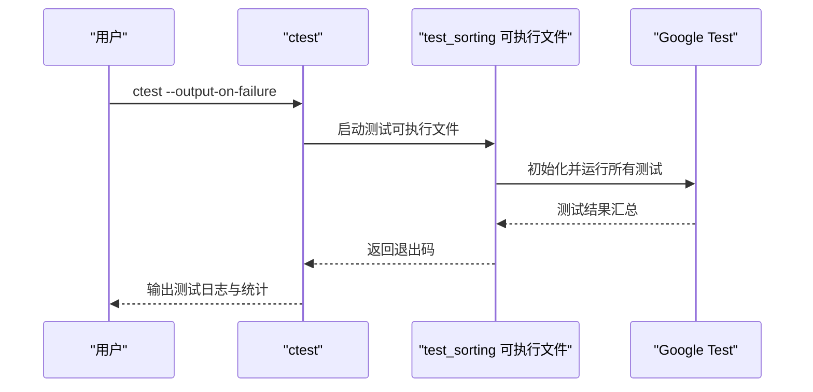
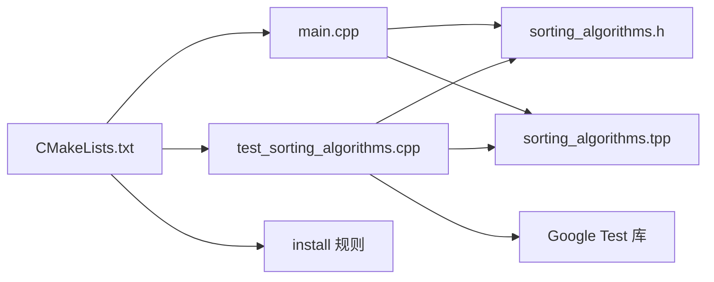

# 快速开始

<cite>
**本文引用的文件**
- [README.md](file://README.md)
- [CMakeLists.txt](file://CMakeLists.txt)
- [main.cpp](file://main.cpp)
- [sorting_algorithms.h](file://sorting_algorithms.h)
- [sorting_algorithms.tpp](file://sorting_algorithms.tpp)
- [test_sorting_algorithms.cpp](file://test_sorting_algorithms.cpp)
- [build_and_run.sh](file://build_and_run.sh)
- [build_and_run.bat](file://build_and_run.bat)
- [sorting_visualizer.html](file://sorting_visualizer.html)
</cite>

## 目录
1. [简介](#简介)
2. [项目结构](#项目结构)
3. [核心组件](#核心组件)
4. [架构总览](#架构总览)
5. [详细组件分析](#详细组件分析)
6. [依赖关系分析](#依赖关系分析)
7. [性能考虑](#性能考虑)
8. [故障排除指南](#故障排除指南)
9. [结论](#结论)
10. [附录](#附录)

## 简介
本指南面向初学者，帮助你在最短时间内成功构建并运行 SortTest 项目。你将学到：
- 环境要求与前置条件（CMake 3.14+、C++17 编译器等）
- 跨平台构建流程（Linux/Mac 与 Windows）
- 从创建构建目录到编译运行的完整命令行步骤
- 如何调用三个排序算法函数（冒泡排序、快速排序、归并排序）
- 如何运行单元测试并查看测试结果
- 常见问题的排查方法

## 项目结构
该项目采用 CMake 构建系统，核心源码由一个头文件与一个模板实现文件组成，并提供主程序演示与 Google Test 单元测试。此外还包含跨平台构建脚本与可视化页面。

图表来源
- [CMakeLists.txt](file://CMakeLists.txt#L1-L45)
- [main.cpp](file://main.cpp#L1-L158)
- [sorting_algorithms.h](file://sorting_algorithms.h#L1-L104)
- [sorting_algorithms.tpp](file://sorting_algorithms.tpp#L1-L162)
- [test_sorting_algorithms.cpp](file://test_sorting_algorithms.cpp#L1-L294)
- [build_and_run.sh](file://build_and_run.sh#L1-L107)
- [build_and_run.bat](file://build_and_run.bat#L1-L152)
- [sorting_visualizer.html](file://sorting_visualizer.html#L1-L528)
- [README.md](file://README.md#L1-L229)

章节来源
- [README.md](file://README.md#L5-L16)
- [CMakeLists.txt](file://CMakeLists.txt#L1-L45)

## 核心组件
- 排序算法库：提供三种模板化排序函数，支持整数、浮点数、字符串等可比较类型。
- 主程序：演示三种算法在多组测试用例上的表现，并输出性能特性对比与字符串排序示例。
- 单元测试：基于 Google Test 的全面测试套件，覆盖边界情况、稳定性、大数据集等。
- 构建系统：CMake 3.14+，C++17 标准；支持可选的 Google Test 测试构建。
- 跨平台脚本：Linux/Mac Bash 脚本与 Windows 批处理脚本，简化构建与运行流程。

章节来源
- [sorting_algorithms.h](file://sorting_algorithms.h#L14-L56)
- [main.cpp](file://main.cpp#L42-L156)
- [test_sorting_algorithms.cpp](file://test_sorting_algorithms.cpp#L1-L294)
- [CMakeLists.txt](file://CMakeLists.txt#L1-L45)

## 架构总览
下图展示了从源码到可执行文件的关键路径，以及测试可执行文件的生成与发现机制。

图表来源
- [CMakeLists.txt](file://CMakeLists.txt#L1-L45)
- [sorting_algorithms.h](file://sorting_algorithms.h#L97-L98)
- [sorting_algorithms.tpp](file://sorting_algorithms.tpp#L1-L162)
- [main.cpp](file://main.cpp#L1-L158)
- [test_sorting_algorithms.cpp](file://test_sorting_algorithms.cpp#L1-L294)

## 详细组件分析

### 排序算法库（头文件与模板实现）
- 头文件声明三个模板函数：冒泡排序、快速排序、归并排序，以及若干 detail 命名空间中的辅助函数。
- 模板实现位于 .tpp 文件并通过头文件包含，确保编译器可见性。
- 设计特点：非侵入式（不修改原数组）、泛型支持、稳定性（归并排序）。

图表来源
- [sorting_algorithms.h](file://sorting_algorithms.h#L14-L95)
- [sorting_algorithms.tpp](file://sorting_algorithms.tpp#L13-L92)

章节来源
- [sorting_algorithms.h](file://sorting_algorithms.h#L14-L95)
- [sorting_algorithms.tpp](file://sorting_algorithms.tpp#L96-L160)

### 主程序（功能演示与输出）
- 提供多组测试用例，依次对每组数据应用三种排序算法并打印结果。
- 输出性能特性对比表格，直观展示三者的复杂度与稳定性。
- 展示字符串排序示例，验证对 std::string 的支持。

图表来源
- [main.cpp](file://main.cpp#L42-L156)
- [sorting_algorithms.h](file://sorting_algorithms.h#L24-L56)
- [sorting_algorithms.tpp](file://sorting_algorithms.tpp#L96-L160)

章节来源
- [main.cpp](file://main.cpp#L42-L156)

### 单元测试（Google Test）
- 使用 Google Test 框架编写测试，覆盖空数组、单元素、已排序、逆序、重复元素、负数、浮点数、字符串、稳定性、大数据集等场景。
- 支持两种运行方式：直接运行可执行文件或使用 ctest 发现并运行测试。

图表来源
- [CMakeLists.txt](file://CMakeLists.txt#L22-L42)
- [test_sorting_algorithms.cpp](file://test_sorting_algorithms.cpp#L291-L294)

章节来源
- [test_sorting_algorithms.cpp](file://test_sorting_algorithms.cpp#L1-L294)
- [CMakeLists.txt](file://CMakeLists.txt#L22-L42)

### 构建系统（CMake）
- 最低版本要求：CMake 3.14+
- C++ 标准：C++17
- 编译选项：MSVC 使用 /W4，其他编译器使用 -Wall -Wextra -Wpedantic
- 可选测试：通过 BUILD_TESTS 选项控制是否包含 Google Test；默认启用
- 安装规则：可选安装 main 可执行文件

章节来源
- [CMakeLists.txt](file://CMakeLists.txt#L1-L45)

### 跨平台构建脚本
- Linux/Mac：build_and_run.sh，支持“快速构建（仅主程序）”和“完整构建（含测试）”，自动检测 g++/clang++ 和 CMake。
- Windows：build_and_run.bat，支持“快速构建（仅主程序）”和“完整构建（含测试）”，自动检测 MSVC cl 或 MinGW g++，并处理 CMake 配置与编译。

章节来源
- [build_and_run.sh](file://build_and_run.sh#L1-L107)
- [build_and_run.bat](file://build_and_run.bat#L1-L152)

## 依赖关系分析
- 源码依赖：main.cpp 依赖 sorting_algorithms.h/.tpp；test_sorting_algorithms.cpp 依赖 sorting_algorithms.h/.tpp 与 Google Test。
- 构建依赖：CMakeLists.txt 定义目标、编译选项、测试发现与安装规则。
- 运行依赖：可执行文件依赖标准库与编译器运行时。

图表来源
- [main.cpp](file://main.cpp#L6-L10)
- [sorting_algorithms.h](file://sorting_algorithms.h#L10-L12)
- [sorting_algorithms.tpp](file://sorting_algorithms.tpp#L9-L162)
- [test_sorting_algorithms.cpp](file://test_sorting_algorithms.cpp#L7-L12)
- [CMakeLists.txt](file://CMakeLists.txt#L1-L45)

章节来源
- [CMakeLists.txt](file://CMakeLists.txt#L1-L45)

## 性能考虑
- 算法复杂度与稳定性：冒泡排序 O(n²)/O(1) 稳定；快速排序平均 O(n log n)/O(log n) 不稳定；归并排序 O(n log n)/O(n) 稳定。
- 测试覆盖：包含边界、重复、负数、大数据集与稳定性验证，有助于评估实际性能与正确性。
- 可视化：提供 HTML 页面，便于直观理解算法过程与统计数据。

章节来源
- [README.md](file://README.md#L193-L200)
- [test_sorting_algorithms.cpp](file://test_sorting_algorithms.cpp#L149-L167)
- [sorting_visualizer.html](file://sorting_visualizer.html#L1-L528)

## 故障排除指南
- 未找到 CMake
  - 现象：构建脚本报错提示未找到 CMake。
  - 解决：安装 CMake（Linux 使用包管理器，macOS 使用 Homebrew，Windows 从官网下载）。
  - 参考：构建脚本会检测并提示安装方式。
  
  章节来源
  - [build_and_run.sh](file://build_and_run.sh#L50-L55)
  - [build_and_run.bat](file://build_and_run.bat#L71-L77)

- 未找到 C++ 编译器
  - 现象：Linux/Mac 未找到 g++/clang++；Windows 未找到 cl/g++。
  - 解决：安装 GCC/Clang（Linux/Mac）或 Visual Studio/MinGW（Windows）。
  
  章节来源
  - [build_and_run.sh](file://build_and_run.sh#L12-L16)
  - [build_and_run.bat](file://build_and_run.bat#L9-L24)

- CMake 配置失败（Windows）
  - 现象：CMake 配置阶段报错。
  - 解决：确认已安装 CMake，检查命令行权限与路径；必要时重新启动终端或 IDE。
  
  章节来源
  - [build_and_run.bat](file://build_and_run.bat#L82-L90)

- 编译失败
  - 现象：cmake --build 或 g++/cl 报错。
  - 解决：检查 C++17 支持与编译器版本；确保头文件与实现文件路径正确；清理旧构建产物后重试。
  
  章节来源
  - [build_and_run.sh](file://build_and_run.sh#L65-L66)
  - [build_and_run.bat](file://build_and_run.bat#L93-L101)

- 测试无法运行
  - 现象：找不到 test_sorting 可执行文件或测试未发现。
  - 解决：确认 BUILD_TESTS=ON；确保网络可用以拉取 Google Test；使用 ctest 发现测试。
  
  章节来源
  - [CMakeLists.txt](file://CMakeLists.txt#L22-L42)

- 权限不足（Linux/Mac）
  - 现象：脚本无法执行。
  - 解决：赋予执行权限：chmod +x build_and_run.sh
  
  章节来源
  - [build_and_run.sh](file://build_and_run.sh#L1-L10)

## 结论
通过本指南，你可以：
- 在 Linux/Mac 与 Windows 上完成从环境准备到构建运行的全流程
- 正确调用三种排序算法函数并理解其行为
- 运行单元测试并查看测试结果
- 使用可视化页面加深对算法的理解
- 快速定位并解决常见构建与运行问题

## 附录

### 环境要求与前置条件
- CMake 3.14 或更高版本
- C++17 兼容编译器（GCC 7+/Clang 5+/MSVC 2017+）
- 可选：互联网连接用于下载 Google Test（若启用测试）

章节来源
- [README.md](file://README.md#L46-L51)
- [CMakeLists.txt](file://CMakeLists.txt#L1-L7)

### 跨平台构建步骤

- Linux/Mac（推荐使用 CMake）
  1) 创建构建目录并进入
     - mkdir build && cd build
  2) 配置项目
     - cmake ..
  3) 编译
     - cmake --build .
  4) 运行主程序
     - ./main
  5) 运行测试（如启用）
     - ./test_sorting
     - 或使用 ctest：ctest --output-on-failure

  章节来源
  - [README.md](file://README.md#L52-L72)
  - [CMakeLists.txt](file://CMakeLists.txt#L22-L42)

- Windows（推荐使用 CMake）
  1) 打开开发者命令行（VS 开发者命令行或 MinGW）
  2) 创建构建目录并进入
     - mkdir build && cd build
  3) 配置项目
     - cmake ..
  4) 编译
     - cmake --build . --config Release
  5) 运行主程序
     - Release\main.exe 或 main.exe
  6) 运行测试
     - Release\test_sorting.exe 或 test_sorting.exe

  章节来源
  - [README.md](file://README.md#L52-L72)
  - [build_and_run.bat](file://build_and_run.bat#L78-L140)

- 使用跨平台脚本
  - Linux/Mac：./build_and_run.sh，支持快速构建与完整构建两种模式
  - Windows：build_and_run.bat，支持快速构建与完整构建两种模式

  章节来源
  - [build_and_run.sh](file://build_and_run.sh#L18-L102)
  - [build_and_run.bat](file://build_and_run.bat#L29-L146)

### 基本使用示例
- 调用三个排序算法函数
  - 包含头文件并传入 std::vector，分别调用 bubble_sort、quick_sort、merge_sort
  - 示例参考：README 中的“基本使用”与“排序不同类型”

  章节来源
  - [README.md](file://README.md#L83-L122)
  - [sorting_algorithms.h](file://sorting_algorithms.h#L24-L56)

### 运行单元测试与查看结果
- 直接运行测试可执行文件
  - ./test_sorting
  - 可选：./test_sorting --gtest_verbose
- 使用 ctest 发现并运行
  - ctest --output-on-failure

  章节来源
  - [README.md](file://README.md#L136-L147)
  - [CMakeLists.txt](file://CMakeLists.txt#L34-L42)

### 可视化与扩展
- 排序算法可视化页面：sorting_visualizer.html，支持选择算法、数组大小、动画速度，实时统计比较次数、交换次数、数组访问次数与耗时。

  章节来源
  - [sorting_visualizer.html](file://sorting_visualizer.html#L1-L528)