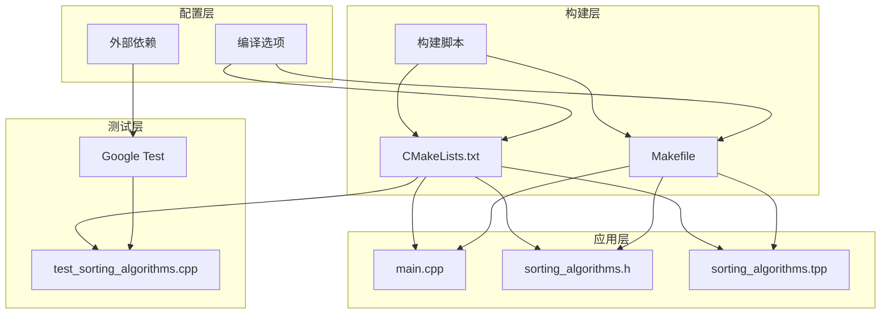
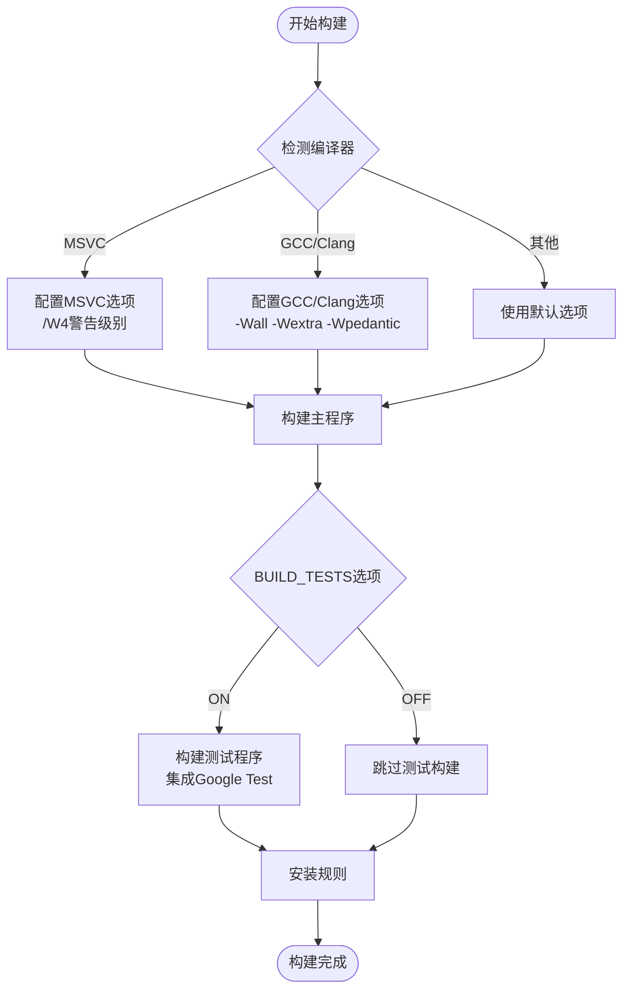
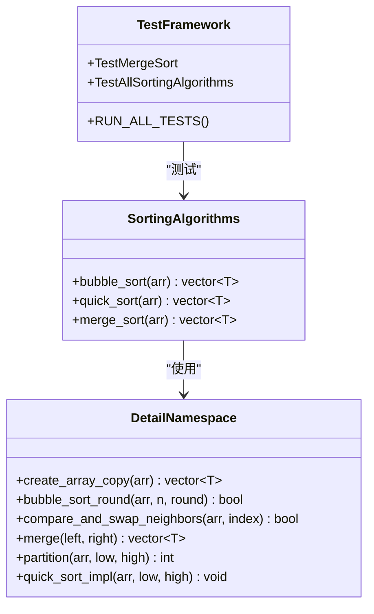
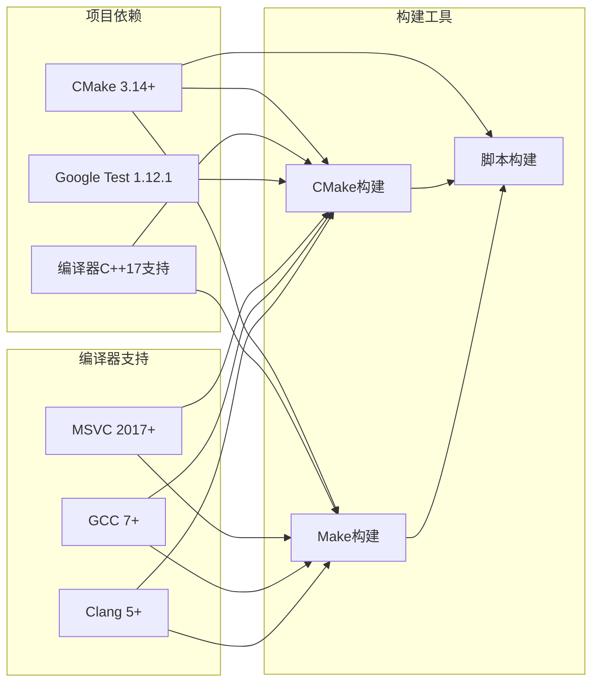

# 构建与部署

<cite>
**本文档引用的文件**
- [CMakeLists.txt](file://CMakeLists.txt)
- [Makefile](file://Makefile)
- [README.md](file://README.md)
- [build_and_run.sh](file://build_and_run.sh)
- [build_and_run.bat](file://build_and_run.bat)
- [main.cpp](file://main.cpp)
- [test_sorting_algorithms.cpp](file://test_sorting_algorithms.cpp)
- [sorting_algorithms.h](file://sorting_algorithms.h)
- [sorting_algorithms.tpp](file://sorting_algorithms.tpp)
</cite>

## 目录
1. [简介](#简介)
2. [项目结构](#项目结构)
3. [核心组件](#核心组件)
4. [架构概览](#架构概览)
5. [详细组件分析](#详细组件分析)
6. [依赖关系分析](#依赖关系分析)
7. [性能考虑](#性能考虑)
8. [故障排除指南](#故障排除指南)
9. [结论](#结论)
10. [附录](#附录)

## 简介

SortTest是一个基于C++的排序算法实现项目，提供了三种经典排序算法的完整实现：冒泡排序、快速排序和归并排序。该项目采用现代C++17标准，支持模板化设计，能够处理多种数据类型（整数、浮点数、字符串等）。项目不仅包含完整的源代码实现，还提供了灵活的构建系统，支持CMake和传统Makefile两种构建方式，以及跨平台的自动化构建脚本。

## 项目结构

项目采用清晰的模块化组织结构，主要包含以下核心组件：

```mermaid
graph TB
subgraph "项目根目录"
Root[CMakeLists.txt)
Makefile
README.md
BuildScripts[构建脚本]
SourceFiles[源代码文件]
Tests[测试文件]
end
subgraph "构建脚本"
BashScript[build_and_run.sh]
BatchScript[build_and_run.bat]
end
subgraph "源代码文件"
Main[main.cpp]
Header[sorting_algorithms.h]
Template[sorting_algorithms.tpp]
end
subgraph "测试文件"
TestFile[test_sorting_algorithms.cpp]
end
BuildScripts --> BashScript
BuildScripts --> BatchScript
SourceFiles --> Main
SourceFiles --> Header
SourceFiles --> Template
Tests --> TestFile
```

**图表来源**
- [CMakeLists.txt](file://CMakeLists.txt#L1-L45)
- [Makefile](file://Makefile#L1-L62)
- [build_and_run.sh](file://build_and_run.sh#L1-L107)
- [build_and_run.bat](file://build_and_run.bat#L1-L152)

**章节来源**
- [CMakeLists.txt](file://CMakeLists.txt#L1-L45)
- [Makefile](file://Makefile#L1-L62)
- [README.md](file://README.md#L1-L229)

## 核心组件

### CMake构建系统

CMakeLists.txt文件定义了完整的构建配置，采用现代CMake最佳实践：

- **C++17标准支持**：明确指定C++17标准，确保使用最新的语言特性
- **编译器检测**：针对MSVC和GCC/Clang提供不同的编译选项
- **测试集成**：通过BUILD_TESTS选项控制Google Test的集成
- **安装规则**：提供可选的安装配置

### 传统Makefile系统

Makefile提供了独立于CMake的构建方式，适合简单场景或嵌入式环境：

- **C++17标准**：使用-std=c++17标志
- **优化级别**：默认-O2优化
- **多目标支持**：包含all、clean、test、run等常用目标
- **跨平台兼容**：提供详细的帮助信息和使用指导

### 跨平台构建脚本

项目提供了两个自动化构建脚本，简化开发者的构建流程：

- **build_and_run.sh**：Bash脚本，适用于Unix-like系统
- **build_and_run.bat**：批处理脚本，适用于Windows系统

**章节来源**
- [CMakeLists.txt](file://CMakeLists.txt#L1-L45)
- [Makefile](file://Makefile#L1-L62)
- [build_and_run.sh](file://build_and_run.sh#L1-L107)
- [build_and_run.bat](file://build_and_run.bat#L1-L152)

## 架构概览

项目采用分层架构设计，清晰分离了构建配置、核心算法实现和测试框架：



**图表来源**
- [CMakeLists.txt](file://CMakeLists.txt#L1-L45)
- [Makefile](file://Makefile#L1-L62)
- [main.cpp](file://main.cpp#L1-L158)
- [sorting_algorithms.h](file://sorting_algorithms.h#L1-L104)
- [sorting_algorithms.tpp](file://sorting_algorithms.tpp#L1-L162)
- [test_sorting_algorithms.cpp](file://test_sorting_algorithms.cpp#L1-L294)

## 详细组件分析

### CMake构建系统深度分析

#### CMakeLists.txt结构分析

CMakeLists.txt采用了模块化的配置方式，主要包含以下几个关键部分：

**基础配置部分**
- 最低版本要求：CMake 3.14
- 项目定义：SortingAlgorithms，C++语言
- C++标准设置：C++17，严格要求，禁用扩展

**编译器特定配置**
- MSVC编译器：使用/W4警告级别
- GCC/Clang编译器：使用-Wall、-Wextra、-Wpedantic警告级别

**目标配置**
- 主程序目标：main，链接main.cpp
- 可选测试目标：test_sorting，当BUILD_TESTS为ON时创建

**Google Test集成**
- 使用FetchContent自动下载Google Test
- 支持Windows平台的特殊配置
- 自动发现和注册测试

#### 编译器检测机制

CMake提供了强大的编译器检测能力：



**图表来源**
- [CMakeLists.txt](file://CMakeLists.txt#L10-L14)
- [CMakeLists.txt](file://CMakeLists.txt#L22-L42)

**章节来源**
- [CMakeLists.txt](file://CMakeLists.txt#L1-L45)

### Makefile传统构建方式

#### Makefile设计原则

Makefile采用了简洁而实用的设计理念：

**变量管理**
- CXX：C++编译器（默认g++）
- CXXFLAGS：编译选项（C++17、警告、优化）
- INCLUDES：包含路径
- TARGET：主程序目标名
- TEST_TARGET：测试程序目标名

**目标定义**
- all：默认目标，编译主程序
- run：编译并运行主程序
- test：编译测试（需要Google Test）
- clean：清理编译产物
- help：显示帮助信息

**跨平台兼容性**
- 提供详细的使用指导
- 包含CMake构建的替代方案
- 支持手动编译测试的说明

**章节来源**
- [Makefile](file://Makefile#L1-L62)

### 跨平台构建脚本

#### build_and_run.sh（Bash脚本）

该脚本提供了交互式的构建体验：

**编译器检测**
- 自动检测g++和clang++的存在
- 提供错误提示和解决方案

**构建方式选择**
- 快速构建：仅构建主程序，使用Makefile
- 完整构建：包含测试，使用CMake

**用户交互**
- 选择构建方式的菜单界面
- 询问是否运行程序的确认对话
- 显示构建进度和结果

**章节来源**
- [build_and_run.sh](file://build_and_run.sh#L1-L107)

#### build_and_run.bat（Windows批处理）

Windows版本提供了完整的功能支持：

**编译器检测**
- 检测MSVC cl.exe和MinGW g++
- 提供详细的安装指导

**构建配置**
- 支持两种编译器的不同编译选项
- 自动处理构建目录和输出文件

**错误处理**
- 完善的错误检查和处理机制
- 用户友好的错误消息

**章节来源**
- [build_and_run.bat](file://build_and_run.bat#L1-L152)

### 排序算法核心实现

#### 模板化设计

项目采用模板化设计，支持多种数据类型的排序：

**头文件结构**
- 主要函数声明：bubble_sort、quick_sort、merge_sort
- 辅助函数声明：detail命名空间中的内部函数
- 模板实现包含：通过sorting_algorithms.tpp文件

**算法特点**
- **冒泡排序**：稳定排序，时间复杂度O(n²)，空间复杂度O(1)
- **快速排序**：平均O(n log n)，不稳定，空间复杂度O(log n)
- **归并排序**：稳定O(n log n)，稳定，空间复杂度O(n)

#### 实现细节



**图表来源**
- [sorting_algorithms.h](file://sorting_algorithms.h#L14-L95)
- [sorting_algorithms.tpp](file://sorting_algorithms.tpp#L13-L95)
- [test_sorting_algorithms.cpp](file://test_sorting_algorithms.cpp#L16-L294)

**章节来源**
- [sorting_algorithms.h](file://sorting_algorithms.h#L1-L104)
- [sorting_algorithms.tpp](file://sorting_algorithms.tpp#L1-L162)

## 依赖关系分析

### 外部依赖管理

项目对外部依赖的管理体现了现代CMake的最佳实践：



**图表来源**
- [CMakeLists.txt](file://CMakeLists.txt#L1-L45)
- [README.md](file://README.md#L46-L51)

### 依赖注入和版本控制

**Google Test集成**
- 使用FetchContent自动下载和配置
- 指定稳定的版本标签
- Windows平台的特殊配置处理

**编译器兼容性**
- C++17标准要求
- 不同编译器的警告级别配置
- 跨平台编译器检测

**章节来源**
- [CMakeLists.txt](file://CMakeLists.txt#L24-L32)
- [README.md](file://README.md#L46-L51)

## 性能考虑

### 编译优化策略

项目在构建配置中充分考虑了性能因素：

**编译器优化**
- C++17标准提供更好的性能特性
- 不同编译器的优化级别配置
- 警告级别的差异处理

**构建效率**
- CMake的增量构建支持
- Makefile的依赖跟踪
- 自动化脚本的条件构建

### 运行时性能

**算法性能对比**
- 冒泡排序：O(n²)时间复杂度，适合小数据集
- 快速排序：平均O(n log n)，内存使用较少
- 归并排序：稳定O(n log n)，内存使用较多但稳定

**模板特化考虑**
- 编译时优化减少运行时开销
- 内联函数减少调用开销
- 模板实例化优化

## 故障排除指南

### 常见构建问题

#### CMake相关问题

**CMake版本过低**
- 问题：CMake版本低于3.14
- 解决：升级CMake到3.14或更高版本

**编译器不兼容**
- 问题：编译器不支持C++17
- 解决：使用支持C++17的编译器（GCC 7+、Clang 5+、MSVC 2017+）

**Google Test下载失败**
- 问题：网络连接问题导致Google Test下载失败
- 解决：手动下载或使用离线安装包

#### Makefile相关问题

**编译器未找到**
- 问题：系统中没有g++或clang++
- 解决：安装相应的编译器

**依赖文件缺失**
- 问题：头文件或源文件路径错误
- 解决：确保所有源文件在同一目录下

#### 跨平台脚本问题

**权限问题（Linux/macOS）**
- 问题：脚本没有执行权限
- 解决：chmod +x build_and_run.sh

**Windows兼容性问题**
- 问题：批处理脚本在某些环境中无法执行
- 解决：以管理员权限运行或调整安全设置

### 调试和诊断

**编译器检测**
- 使用脚本的自动检测功能
- 手动验证编译器版本
- 检查编译器路径配置

**构建日志分析**
- 查看详细的编译输出
- 分析错误信息的具体含义
- 对比不同平台的构建差异

**章节来源**
- [build_and_run.sh](file://build_and_run.sh#L12-L16)
- [build_and_run.bat](file://build_and_run.bat#L9-L24)
- [Makefile](file://Makefile#L35-L41)

## 结论

SortTest项目的构建与部署系统展现了现代C++项目的最佳实践。通过CMake、Makefile和跨平台脚本的组合，项目实现了高度的可移植性和易用性。CMakeLists.txt提供了完整的构建配置，Makefile保证了传统构建方式的支持，而自动化脚本则简化了开发者的日常操作。

项目的核心优势包括：
- **多平台支持**：同时支持Windows、Linux和macOS
- **灵活的构建选项**：可根据需求选择不同的构建方式
- **现代化的C++17实现**：充分利用现代C++特性
- **完善的测试框架**：集成Google Test提供全面的单元测试
- **清晰的架构设计**：模块化组织，易于维护和扩展

对于持续集成和自动化构建，项目已经具备了良好的基础。建议进一步集成CI/CD流水线，实现自动化的测试和部署流程。

## 附录

### 构建选项详解

**BUILD_TESTS开关**
- **作用**：控制是否包含Google Test测试框架
- **默认值**：ON（启用测试）
- **影响**：启用时会自动下载和配置Google Test，创建测试可执行文件

**编译器选项**
- **MSVC**：/W4警告级别，/EHsc异常处理，/std:c++17标准
- **GCC/Clang**：-Wall -Wextra -Wpedantic警告级别，-std=c++17标准

### 部署指南

**二进制文件分发**
- 主程序：main（或main.exe）
- 测试程序：test_sorting（或test_sorting.exe）
- 依赖：根据编译器和平台确定

**运行环境要求**
- C++17兼容的运行时环境
- Windows：MSVC运行时库或MinGW运行时
- Linux/macOS：标准C++运行时库

### 持续集成建议

**自动化构建流程**
1. 检出代码
2. 创建构建目录
3. CMake配置
4. 编译主程序
5. 运行测试
6. 生成报告

**多平台测试**
- Windows：MSVC和MinGW
- Linux：GCC
- macOS：Clang