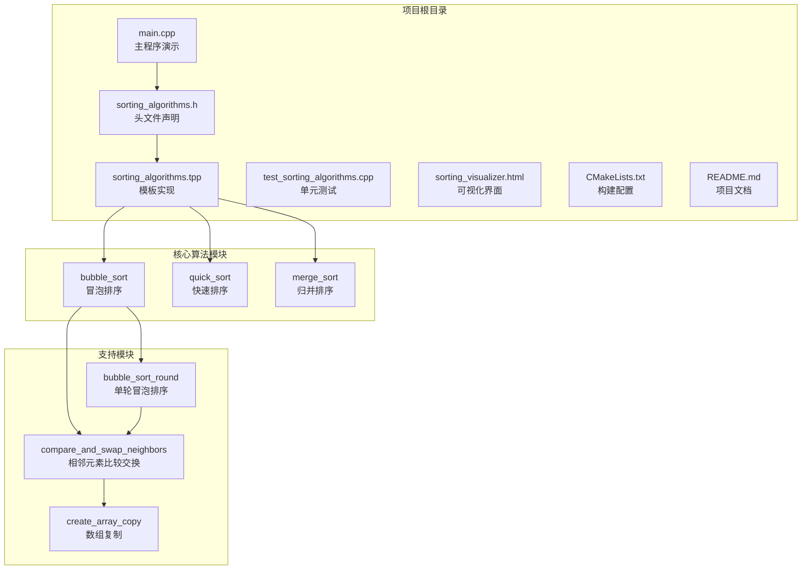
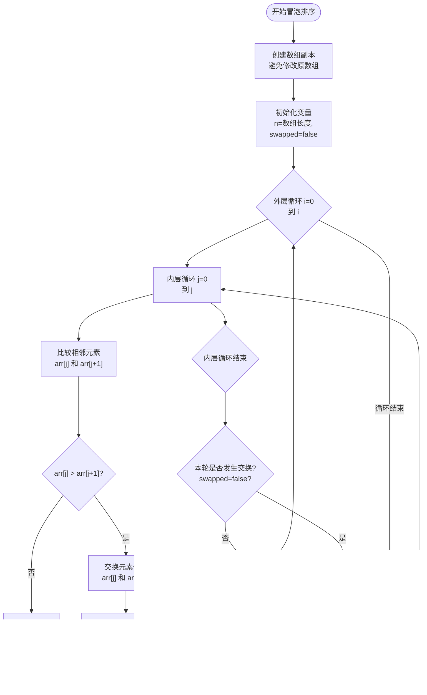
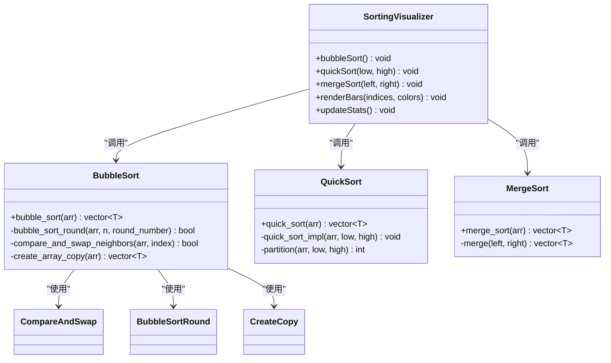
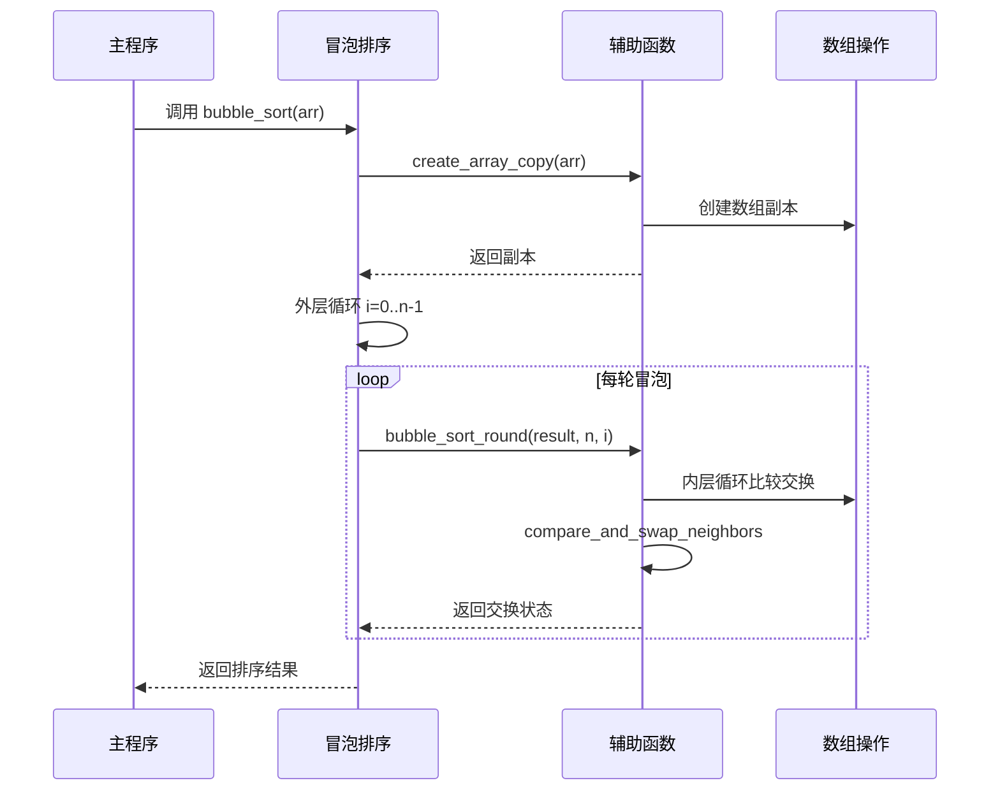
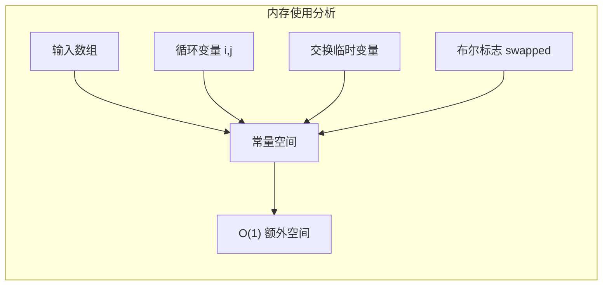
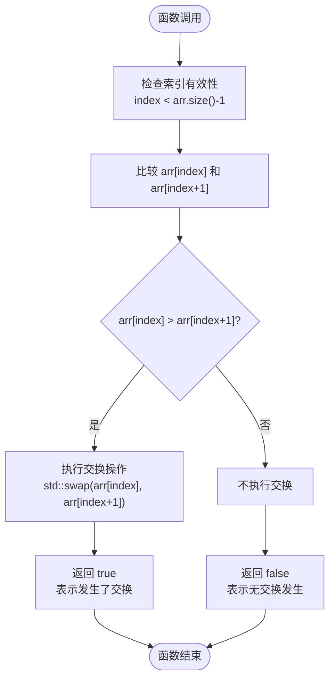
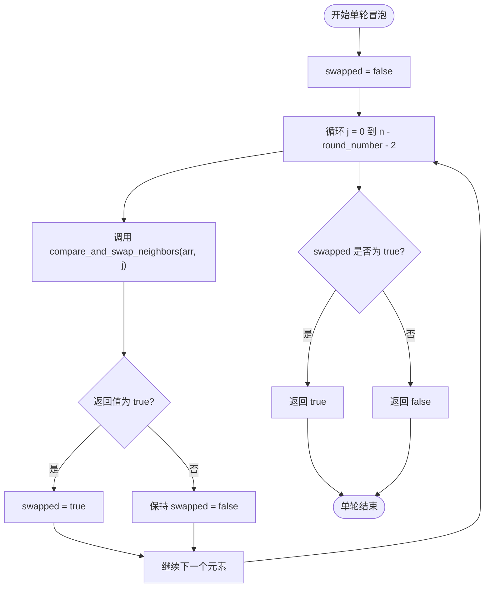
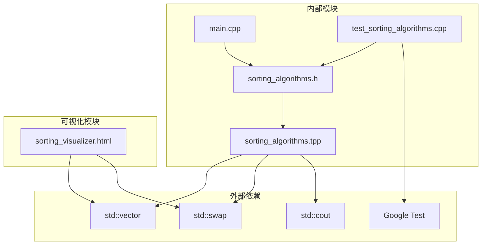

# 冒泡排序算法

<cite>
**本文档引用的文件**
- [main.cpp](file://main.cpp)
- [sorting_algorithms.h](file://sorting_algorithms.h)
- [sorting_algorithms.tpp](file://sorting_algorithms.tpp)
- [test_sorting_algorithms.cpp](file://test_sorting_algorithms.cpp)
- [README.md](file://README.md)
- [sorting_visualizer.html](file://sorting_visualizer.html)
- [CMakeLists.txt](file://CMakeLists.txt)
</cite>

## 目录
1. [简介](#简介)
2. [项目结构](#项目结构)
3. [核心组件](#核心组件)
4. [架构概览](#架构概览)
5. [详细组件分析](#详细组件分析)
6. [依赖关系分析](#依赖关系分析)
7. [性能考虑](#性能考虑)
8. [故障排除指南](#故障排除指南)
9. [结论](#结论)
10. [附录](#附录)

## 简介

冒泡排序是一种基础而经典的排序算法，以其简单直观的实现和教学价值而闻名。本项目提供了完整的C++实现，包括冒泡排序、快速排序和归并排序三种算法，以及配套的可视化工具和全面的测试套件。

冒泡排序的核心思想是重复遍历数组，比较相邻元素并根据需要交换它们的位置，较大的元素会像气泡一样逐渐"冒泡"到数组的末尾。这种算法虽然效率不高，但具有稳定的特性和直观的实现逻辑，非常适合算法学习和教学演示。

## 项目结构

该项目采用模块化设计，将不同的排序算法分离到独立的文件中，便于维护和扩展：



**图表来源**
- [main.cpp](file://main.cpp#L1-L158)
- [sorting_algorithms.h](file://sorting_algorithms.h#L1-L104)
- [sorting_algorithms.tpp](file://sorting_algorithms.tpp#L1-L162)

**章节来源**
- [main.cpp](file://main.cpp#L1-L158)
- [sorting_algorithms.h](file://sorting_algorithms.h#L1-L104)
- [sorting_algorithms.tpp](file://sorting_algorithms.tpp#L1-L162)

## 核心组件

### 冒泡排序算法实现

冒泡排序是本项目中最核心的算法实现，采用了优化的双层循环结构：



**图表来源**
- [sorting_algorithms.tpp](file://sorting_algorithms.tpp#L96-L109)
- [sorting_algorithms.tpp](file://sorting_algorithms.tpp#L21-L28)

### 关键辅助函数

项目实现了多个辅助函数来支持冒泡排序的执行：

1. **compare_and_swap_neighbors**: 比较并交换相邻元素
2. **bubble_sort_round**: 执行单轮冒泡排序
3. **create_array_copy**: 创建数组副本

**章节来源**
- [sorting_algorithms.tpp](file://sorting_algorithms.tpp#L30-L37)
- [sorting_algorithms.tpp](file://sorting_algorithms.tpp#L21-L28)
- [sorting_algorithms.tpp](file://sorting_algorithms.tpp#L15-L19)

## 架构概览

### 算法层次结构



**图表来源**
- [sorting_algorithms.h](file://sorting_algorithms.h#L14-L56)
- [sorting_algorithms.tpp](file://sorting_algorithms.tpp#L96-L160)
- [sorting_visualizer.html](file://sorting_visualizer.html#L237-L520)

### 数据流图



**图表来源**
- [main.cpp](file://main.cpp#L61-L63)
- [sorting_algorithms.tpp](file://sorting_algorithms.tpp#L96-L109)
- [sorting_algorithms.tpp](file://sorting_algorithms.tpp#L21-L28)

## 详细组件分析

### 冒泡排序算法详解

#### 基本原理

冒泡排序的核心原理是通过重复遍历待排序数组，比较相邻的元素并对不符合排序规则的元素进行交换。每一轮遍历都会将当前未排序部分的最大元素"冒泡"到正确的位置。

#### 算法步骤

1. **外层循环**: 控制排序的轮数，通常需要 n-1 轮
2. **内层循环**: 在每轮中比较相邻元素
3. **比较交换**: 如果前一个元素大于后一个元素，则交换它们
4. **优化检查**: 如果某一轮没有发生任何交换，说明数组已经有序，可以提前结束

#### 时间复杂度分析

| 情况 | 描述 | 时间复杂度 | 说明 |
|------|------|------------|------|
| 最好情况 | 数组已经完全有序 | O(n) | 只需一轮遍历，无交换发生 |
| 平均情况 | 随机排列的数组 | O(n²) | 需要进行约 n²/2 次比较 |
| 最坏情况 | 数组完全逆序 | O(n²) | 需要进行 n(n-1)/2 次比较 |

**推导过程**:
- 外层循环执行 n-1 次
- 第 i 轮内层循环执行 (n-1-i) 次
- 总比较次数: Σ(i=0 to n-2) (n-1-i) = (n-1) + (n-2) + ... + 1 = n(n-1)/2
- 因此时间复杂度为 O(n²)

#### 空间复杂度分析

冒泡排序的空间复杂度为 O(1)，这是因为它是一个原地排序算法：



**图表来源**
- [sorting_algorithms.tpp](file://sorting_algorithms.tpp#L96-L109)

#### 稳定性分析

冒泡排序是稳定的排序算法，这意味着相等元素的相对位置在排序过程中不会改变。这种稳定性在实际应用中非常重要：

**稳定性保证机制**:
- 只有当 `arr[j] > arr[j+1]` 时才进行交换
- 当 `arr[j] ≤ arr[j+1]` 时不交换，保持原有顺序
- 对于相等元素，较小索引的元素始终位于较大索引元素之前

**实际应用场景**:
- 排序学生成绩时保持同分学生的原有排名
- 对多关键字数据进行多重排序
- 维护数据的历史顺序信息

### compare_and_swap_neighbors 函数分析

这个函数是冒泡排序的核心操作单元：



**图表来源**
- [sorting_algorithms.tpp](file://sorting_algorithms.tpp#L30-L37)

**函数特点**:
- **原子操作**: 单次比较和可能的交换操作
- **布尔返回**: 提供交换状态信息，用于优化判断
- **边界检查**: 确保索引不越界
- **通用性**: 支持任何可比较的数据类型

### bubble_sort_round 函数分析

单轮冒泡排序负责执行一轮完整的相邻元素比较：



**图表来源**
- [sorting_algorithms.tpp](file://sorting_algorithms.tpp#L21-L28)

**优化机制**:
- **提前终止**: 如果某轮没有发生任何交换，说明数组已经有序
- **范围缩小**: 每轮结束后，最大元素已经在正确位置，下轮比较范围减少
- **状态跟踪**: 使用布尔标志记录本轮是否发生交换

### 性能测试与验证

项目提供了全面的测试套件来验证冒泡排序的正确性和性能特征：

**测试覆盖范围**:
- 基本功能测试: 正常数组、空数组、单元素数组
- 边界情况: 逆序数组、全相同元素数组
- 数据类型: 整数、浮点数、字符串
- 大数据集: 100元素和1000元素的随机数组
- 稳定性验证: 使用配对数据测试相等元素的顺序保持

**章节来源**
- [test_sorting_algorithms.cpp](file://test_sorting_algorithms.cpp#L277-L287)
- [test_sorting_algorithms.cpp](file://test_sorting_algorithms.cpp#L167-L182)
- [test_sorting_algorithms.cpp](file://test_sorting_algorithms.cpp#L212-L230)

## 依赖关系分析

### 模块间依赖关系



**图表来源**
- [sorting_algorithms.h](file://sorting_algorithms.h#L10-L12)
- [sorting_algorithms.tpp](file://sorting_algorithms.tpp#L9-L9)
- [main.cpp](file://main.cpp#L6-L10)

### 编译时依赖

项目采用CMake构建系统，配置了适当的编译选项和测试支持：

**编译配置特点**:
- C++17 标准支持
- 跨平台编译选项
- 可选的Google Test集成
- 警告级别配置

**章节来源**
- [CMakeLists.txt](file://CMakeLists.txt#L1-L45)

## 性能考虑

### 算法性能特征

| 特征 | 冒泡排序 | 快速排序 | 归并排序 |
|------|----------|----------|----------|
| **时间复杂度** | O(n²) | O(n log n) 平均 | O(n log n) |
| **空间复杂度** | O(1) | O(log n) | O(n) |
| **稳定性** | 稳定 | 不稳定 | 稳定 |
| **原地排序** | 是 | 是 | 否 |
| **适用场景** | 小规模数据 | 一般用途 | 需要稳定性的场景 |

### 性能优化策略

1. **提前终止优化**: 检测到数组已排序时立即停止
2. **边界优化**: 每轮后减少比较范围
3. **内存优化**: 使用原地交换避免额外空间
4. **缓存友好**: 连续内存访问模式

### 适用场景分析

**冒泡排序的优势**:
- 实现简单，易于理解和教学
- 稳定性保证
- 原地排序，内存效率高
- 对小规模数据集表现尚可

**适用场景**:
- 教学演示和算法学习
- 极小规模数据集 (n < 50)
- 需要稳定性的特殊应用
- 作为其他复杂算法的基础理解

**局限性**:
- 大数据集性能较差
- 不适合生产环境的高性能需求
- 相比其他算法效率较低

## 故障排除指南

### 常见问题及解决方案

**问题1: 数组越界异常**
- **原因**: 索引计算错误或边界条件处理不当
- **解决方案**: 确保 `index < arr.size() - 1` 的边界检查
- **预防措施**: 在所有数组访问前进行边界验证

**问题2: 内存泄漏**
- **原因**: 动态内存分配未正确释放
- **解决方案**: 使用智能指针或现代C++容器
- **预防措施**: 避免手动内存管理，使用栈变量

**问题3: 性能问题**
- **原因**: 算法复杂度过高或实现效率低
- **解决方案**: 考虑使用更高效的排序算法
- **预防措施**: 在设计阶段评估算法复杂度

### 调试技巧

1. **单元测试**: 使用Google Test框架进行全面测试
2. **可视化工具**: 利用HTML可视化界面观察算法执行过程
3. **日志输出**: 在关键步骤添加调试信息
4. **边界测试**: 专门测试极端情况和边界条件

**章节来源**
- [test_sorting_algorithms.cpp](file://test_sorting_algorithms.cpp#L1-L294)
- [sorting_visualizer.html](file://sorting_visualizer.html#L391-L420)

## 结论

冒泡排序作为最基础的排序算法，在计算机科学教育中占据着重要地位。虽然其时间复杂度为O(n²)，不适合大规模数据处理，但其简单直观的实现和稳定的特性使其成为学习算法设计的绝佳起点。

本项目的实现体现了现代C++的最佳实践：
- 模板化设计支持多种数据类型
- 原地排序避免不必要的内存开销
- 完善的测试套件确保代码质量
- 可视化工具增强学习体验

对于实际应用，建议根据数据规模和性能需求选择合适的排序算法。冒泡排序最适合教学演示、极小规模数据处理和需要稳定性的特殊场景。

## 附录

### API参考

**bubble_sort函数**
- **功能**: 对任意可比较类型的向量进行冒泡排序
- **参数**: `const std::vector<T>& arr` - 待排序的向量
- **返回**: `std::vector<T>` - 排序后的新向量
- **复杂度**: O(n²) 时间, O(1) 额外空间

**compare_and_swap_neighbors函数**
- **功能**: 比较并交换相邻元素
- **参数**: `std::vector<T>& arr`, `size_t index`
- **返回**: `bool` - 是否发生交换
- **用途**: 冒泡排序的核心操作单元

### 使用示例

```cpp
#include "sorting_algorithms.h"
#include <vector>
#include <iostream>

int main() {
    std::vector<int> arr = {64, 34, 25, 12, 22, 11, 90};
    
    // 冒泡排序
    auto sorted = bubble_sort(arr);
    
    return 0;
}
```

### 构建和运行

**编译步骤**:
1. 创建构建目录: `mkdir build && cd build`
2. 配置项目: `cmake ..`
3. 编译: `cmake --build .`
4. 运行主程序: `./main`
5. 运行测试: `./test_sorting`

**测试运行**:
- 基本测试: `ctest --output-on-failure`
- 详细测试: `./test_sorting --gtest_verbose`

**章节来源**
- [README.md](file://README.md#L52-L82)
- [README.md](file://README.md#L136-L148)