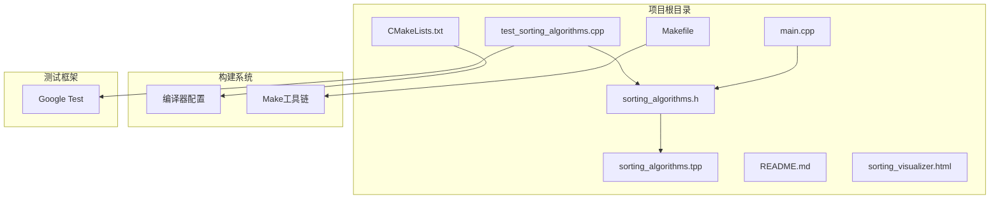
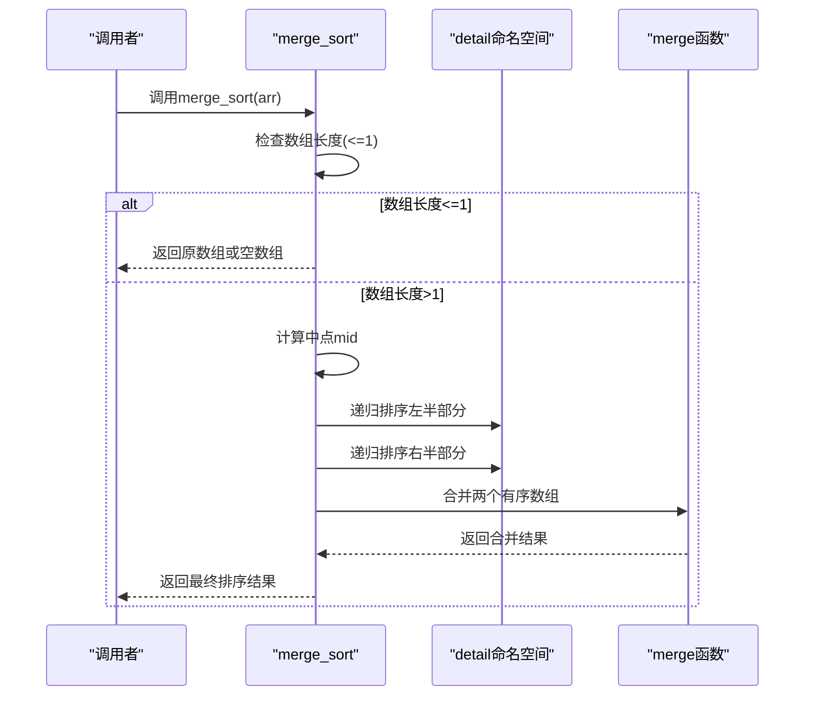
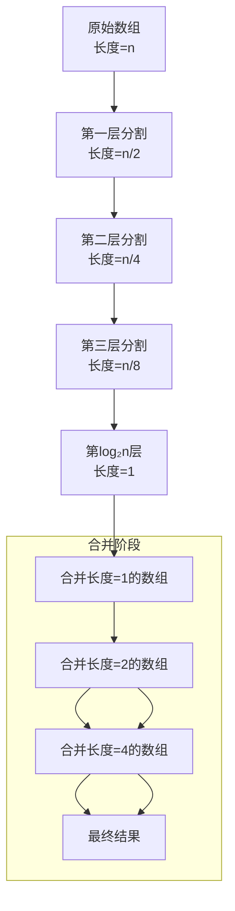
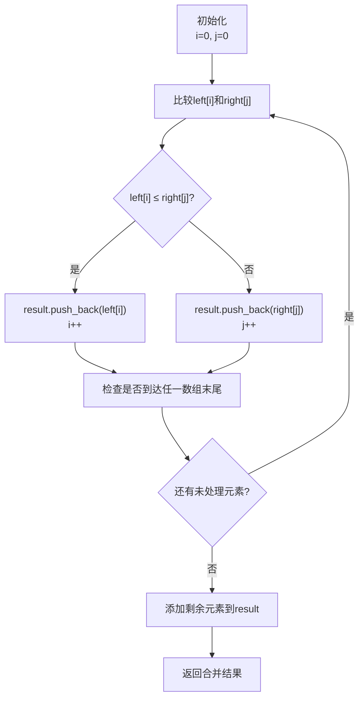
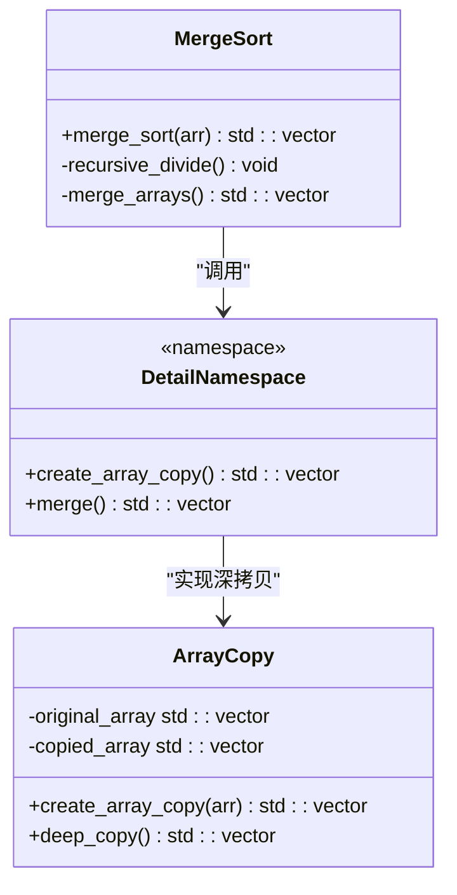
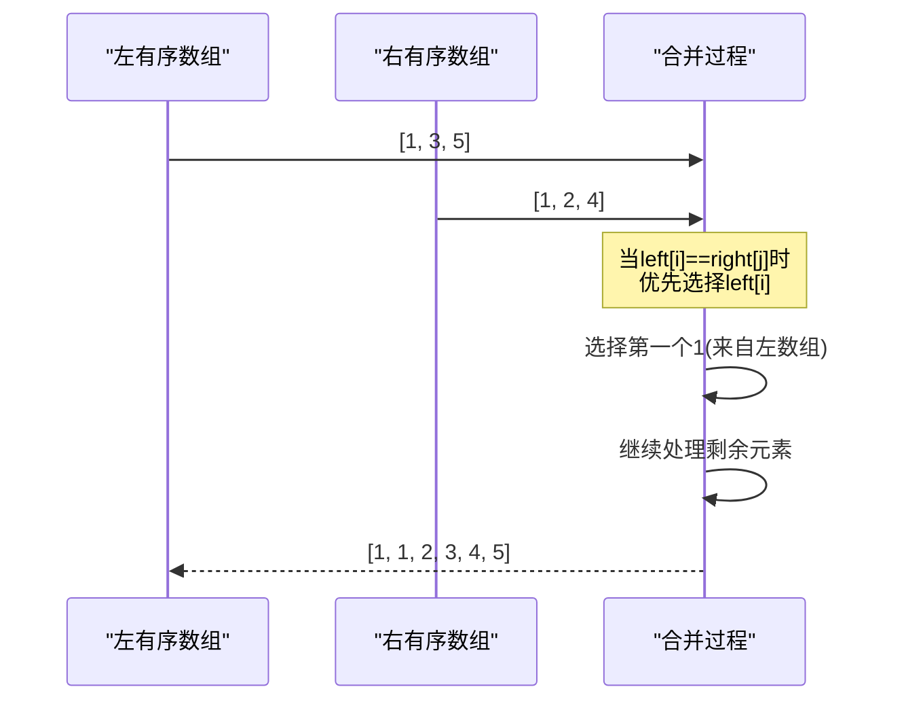
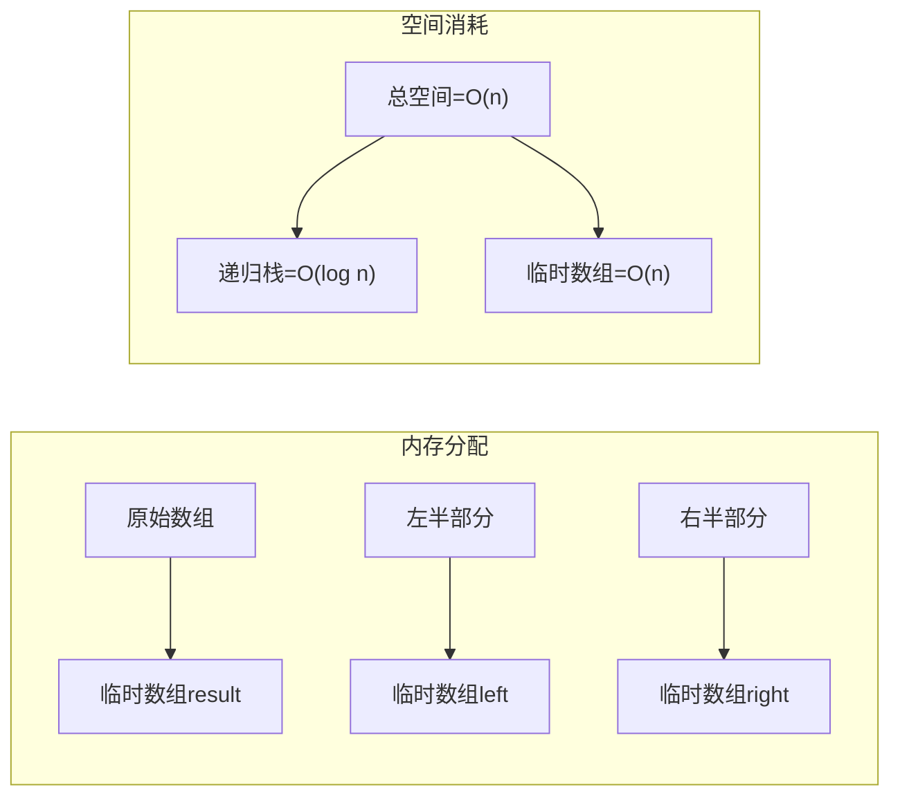
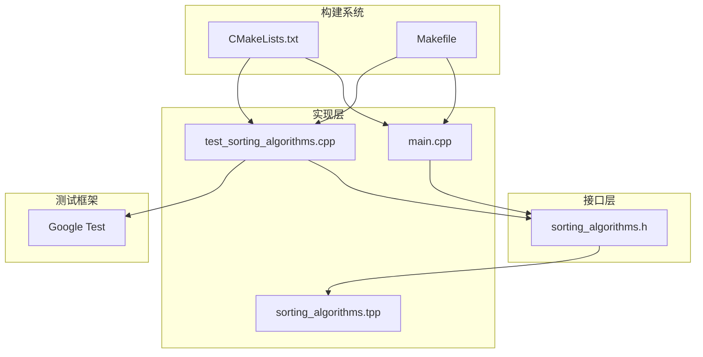

# 归并排序算法

<cite>
**本文档引用的文件**
- [main.cpp](file://main.cpp)
- [sorting_algorithms.h](file://sorting_algorithms.h)
- [sorting_algorithms.tpp](file://sorting_algorithms.tpp)
- [test_sorting_algorithms.cpp](file://test_sorting_algorithms.cpp)
- [README.md](file://README.md)
- [sorting_visualizer.html](file://sorting_visualizer.html)
- [CMakeLists.txt](file://CMakeLists.txt)
- [Makefile](file://Makefile)
</cite>

## 目录
1. [简介](#简介)
2. [项目结构](#项目结构)
3. [核心组件](#核心组件)
4. [架构概览](#架构概览)
5. [详细组件分析](#详细组件分析)
6. [依赖关系分析](#依赖关系分析)
7. [性能考量](#性能考量)
8. [故障排除指南](#故障排除指南)
9. [结论](#结论)
10. [附录](#附录)

## 简介
本项目是一个完整的C++排序算法演示系统，包含冒泡排序、快速排序和归并排序三种常见排序算法的实现。本文档专注于归并排序算法，深入解析其分治思想、时间复杂度数学推导、稳定性保证机制、空间复杂度分析以及在实际工程中的应用场景。项目提供了完整的C++实现，包括模板化的merge函数双指针合并策略和深拷贝实现，同时包含丰富的单元测试用例和可视化演示。

## 项目结构
该项目采用模块化设计，将接口声明与实现分离，支持模板化编程和跨平台构建。

**图表来源**
- [main.cpp](file://main.cpp#L1-L158)
- [sorting_algorithms.h](file://sorting_algorithms.h#L1-L104)
- [sorting_algorithms.tpp](file://sorting_algorithms.tpp#L1-L162)
- [CMakeLists.txt](file://CMakeLists.txt#L1-L45)

**章节来源**
- [README.md](file://README.md#L1-L229)
- [CMakeLists.txt](file://CMakeLists.txt#L1-L45)
- [Makefile](file://Makefile#L1-L62)

## 核心组件
本项目的核心是三个排序算法的实现，其中归并排序作为重点分析对象。所有算法都采用模板化设计，支持任意可比较的数据类型。

### 归并排序接口设计
归并排序通过模板函数提供统一的接口，确保类型安全和代码复用性：

- **模板参数**: 支持任意可比较类型T
- **输入参数**: const std::vector<T>&类型的只读数组
- **返回值**: 新创建的排序数组，不修改原始数据
- **异常处理**: 通过C++异常机制处理边界情况

### 辅助函数体系
项目实现了完整的辅助函数集合，支撑归并排序的高效执行：

- **create_array_copy**: 深拷贝实现，确保原数组不变
- **merge**: 双指针合并算法，保证稳定性
- **递归分割**: 自顶向下的分治策略

**章节来源**
- [sorting_algorithms.h](file://sorting_algorithms.h#L40-L56)
- [sorting_algorithms.tpp](file://sorting_algorithms.tpp#L14-L92)

## 架构概览
归并排序采用经典的分治算法架构，通过递归分解和合并操作实现排序。

**图表来源**
- [sorting_algorithms.tpp](file://sorting_algorithms.tpp#L144-L160)

### 递归树结构
归并排序的递归树具有完美的平衡性，每层的分割都是等分的。

**图表来源**
- [sorting_algorithms.tpp](file://sorting_algorithms.tpp#L144-L160)

## 详细组件分析

### 归并排序实现详解

#### 核心算法流程
归并排序遵循严格的分治策略：

1. **分解阶段**: 将数组递归地分成两半，直到每个子数组只有一个元素
2. **解决阶段**: 单元素数组天然有序，无需进一步处理
3. **合并阶段**: 将两个有序数组合并成一个有序数组

#### merge函数双指针策略
merge函数实现了高效的双指针合并算法：

**图表来源**
- [sorting_algorithms.tpp](file://sorting_algorithms.tpp#L40-L66)

#### create_array_copy深拷贝实现
深拷贝确保原数组不受影响，这是归并排序稳定性的基础：

**图表来源**
- [sorting_algorithms.tpp](file://sorting_algorithms.tpp#L15-L19)
- [sorting_algorithms.tpp](file://sorting_algorithms.tpp#L144-L160)

**章节来源**
- [sorting_algorithms.tpp](file://sorting_algorithms.tpp#L40-L66)
- [sorting_algorithms.tpp](file://sorting_algorithms.tpp#L15-L19)

### 稳定性保证机制
归并排序的稳定性是通过合并过程中的相等元素处理策略保证的：

#### 稳定性证明
在相等元素的情况下，算法优先选择左侧数组的元素，这保证了相等元素的相对顺序不变。

**图表来源**
- [sorting_algorithms.tpp](file://sorting_algorithms.tpp#L44-L52)

**章节来源**
- [test_sorting_algorithms.cpp](file://test_sorting_algorithms.cpp#L149-L165)

### 性能分析

#### 时间复杂度数学推导
归并排序的时间复杂度为O(n log n)，通过递推关系证明：

**递推关系**: T(n) = 2T(n/2) + O(n)

**求解过程**:
1. 分割: T(n/2) × 2次递归调用
2. 合并: O(n)时间扫描两个子数组
3. 递归深度: log₂n层
4. 总复杂度: O(n) × log₂n = O(n log n)

#### 空间复杂度分析
归并排序需要额外的O(n)空间用于存储临时数组：

**图表来源**
- [sorting_algorithms.tpp](file://sorting_algorithms.tpp#L144-L160)

**章节来源**
- [sorting_algorithms.h](file://sorting_algorithms.h#L40-L56)

### 单元测试覆盖
项目包含全面的测试用例，验证归并排序在各种场景下的正确性：

#### 测试类别
- **边界情况**: 空数组、单元素数组、两元素数组
- **数据分布**: 已排序、逆序、随机、重复元素
- **数据类型**: 整数、浮点数、字符串、自定义类型
- **稳定性**: 使用pair类型验证相等元素的相对顺序

#### 关键测试用例
- **稳定性测试**: 验证相同键值元素的原始顺序保持
- **大数据集测试**: 1000个元素的随机数组排序
- **类型多样性**: 支持int、double、string等多种类型

**章节来源**
- [test_sorting_algorithms.cpp](file://test_sorting_algorithms.cpp#L14-L230)

## 依赖关系分析

### 模块间依赖

**图表来源**
- [sorting_algorithms.h](file://sorting_algorithms.h#L1-L104)
- [sorting_algorithms.tpp](file://sorting_algorithms.tpp#L1-L162)
- [CMakeLists.txt](file://CMakeLists.txt#L1-L45)

### 外部依赖
- **C++17标准**: 使用现代C++特性和模板系统
- **Google Test**: 单元测试框架，提供断言和测试套件
- **CMake**: 跨平台构建系统，支持多种编译器

**章节来源**
- [CMakeLists.txt](file://CMakeLists.txt#L1-L45)
- [Makefile](file://Makefile#L1-L62)

## 性能考量

### 算法性能对比
| 算法 | 最好情况 | 平均情况 | 最坏情况 | 空间复杂度 | 稳定性 |
|------|---------|---------|---------|-----------|--------|
| 冒泡排序 | O(n) | O(n²) | O(n²) | O(1) | 稳定 |
| 快速排序 | O(n log n) | O(n log n) | O(n²) | O(log n) | 不稳定 |
| 归并排序 | O(n log n) | O(n log n) | O(n log n) | O(n) | 稳定 |

### 大数据处理优势
归并排序在大数据处理场景中具有显著优势：

1. **时间复杂度稳定性**: 无论输入数据如何分布，都能保证O(n log n)性能
2. **可预测性**: 不会出现快速排序的最坏情况退化
3. **并行化潜力**: 合并阶段可以并行处理不同的子数组
4. **外部排序支持**: 适合处理无法完全加载到内存的大文件

### 与其他排序算法的对比
- **与快速排序相比**: 归并排序在最坏情况下表现更稳定，但需要额外的内存空间
- **与堆排序相比**: 归并排序是稳定的，但空间复杂度更高
- **与插入排序相比**: 对于大数组，归并排序的性能优势明显

## 故障排除指南

### 常见问题诊断
1. **内存不足错误**: 确保有足够的内存容纳O(n)的临时数组
2. **栈溢出**: 对于极长的数组，考虑迭代版本的归并排序
3. **类型不匹配**: 确保自定义类型实现了适当的比较运算符

### 调试技巧
- 使用调试器观察递归调用栈
- 在merge函数中添加日志输出
- 利用单元测试验证边界条件

**章节来源**
- [test_sorting_algorithms.cpp](file://test_sorting_algorithms.cpp#L167-L230)

## 结论
归并排序作为一种经典的分治算法，在理论和实践层面都表现出色。其稳定的O(n log n)时间复杂度、可预测的性能表现和稳定的排序特性，使其成为处理大规模数据和对稳定性有严格要求场景的理想选择。项目的完整实现展示了现代C++模板编程的最佳实践，包括深拷贝、模板特化和跨平台构建等关键技术。

通过本项目的深入分析，开发者可以更好地理解归并排序的核心思想，并将其应用于实际的工程实践中。无论是学习算法原理还是解决实际的排序问题，这个实现都提供了宝贵的参考价值。

## 附录

### 可视化演示
项目包含完整的排序算法可视化界面，支持实时观察归并排序的执行过程：

- **交互式控制**: 可调节数组大小、动画速度和算法选择
- **实时统计**: 显示比较次数、交换次数和数组访问次数
- **状态指示**: 实时显示排序进度和完成状态

### 构建和运行
项目支持多种构建方式，满足不同开发环境的需求：

1. **CMake构建**: 推荐的跨平台构建方式
2. **Makefile构建**: 简单的本地编译方式
3. **直接编译**: 使用g++命令行编译

**章节来源**
- [sorting_visualizer.html](file://sorting_visualizer.html#L1-L528)
- [README.md](file://README.md#L44-L82)