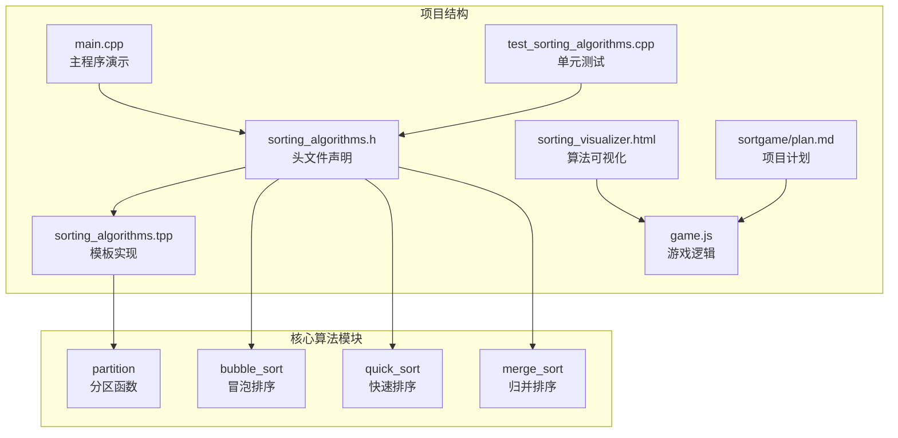
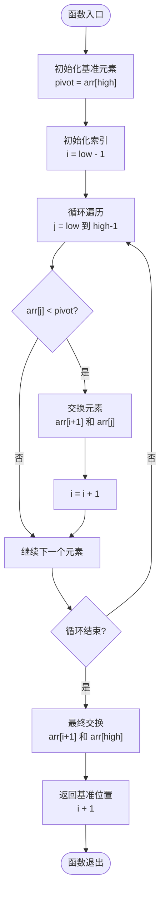
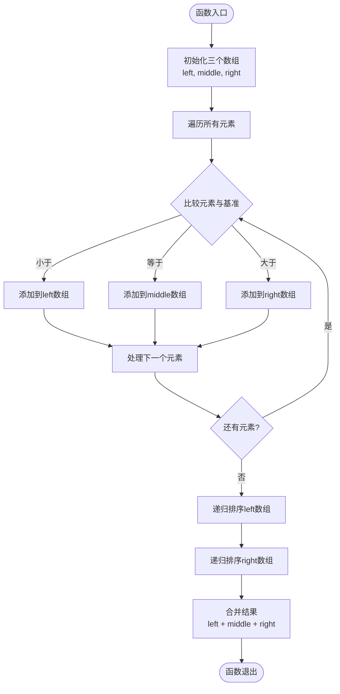
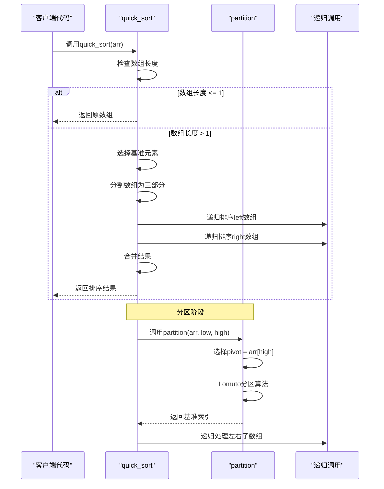
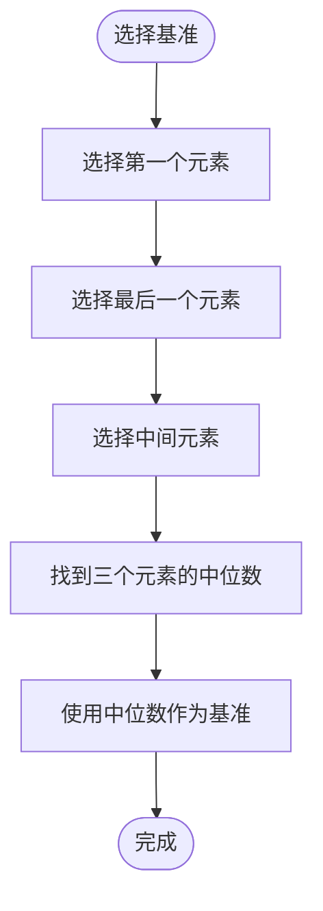
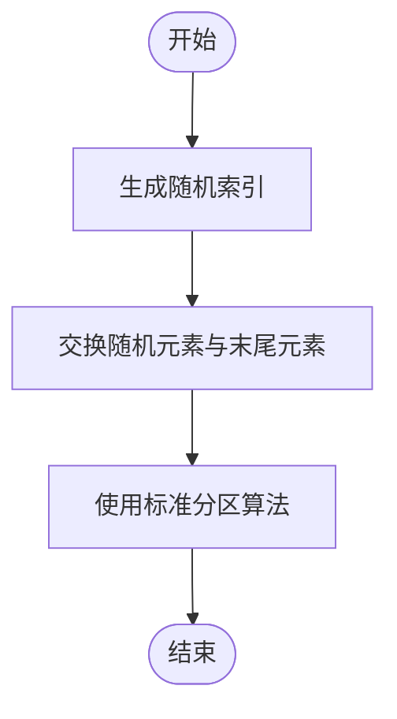
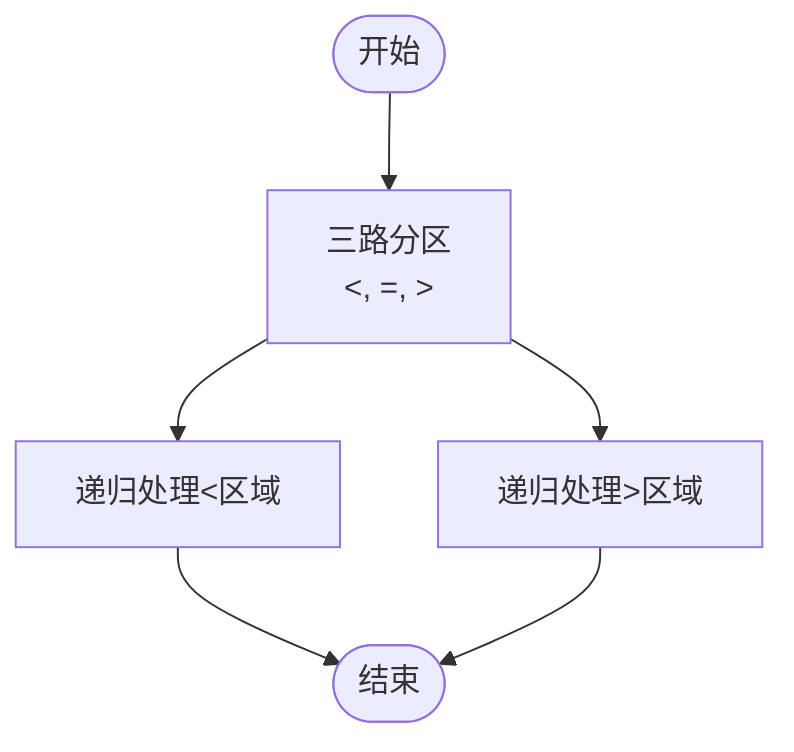
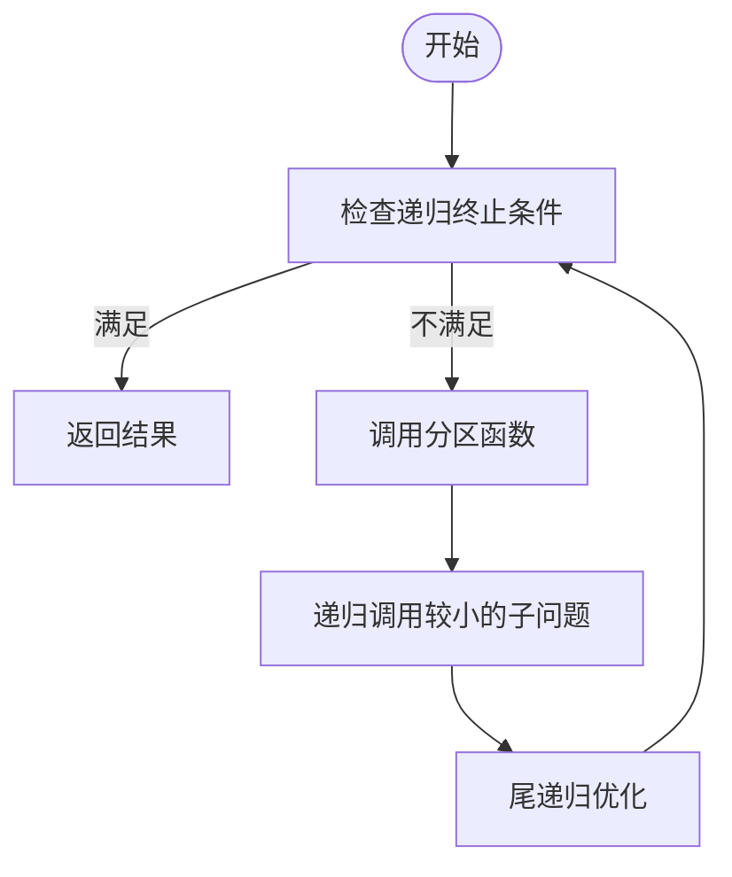
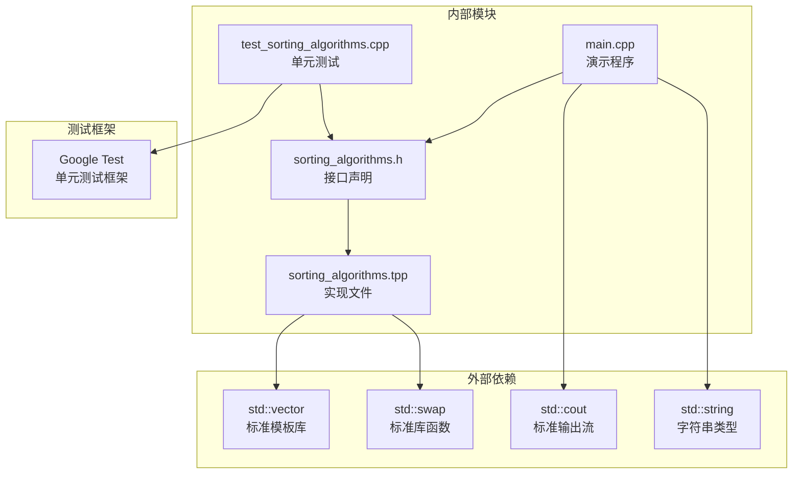

# 快速排序算法

<cite>
**本文档引用的文件**
- [main.cpp](file://main.cpp)
- [sorting_algorithms.h](file://sorting_algorithms.h)
- [sorting_algorithms.tpp](file://sorting_algorithms.tpp)
- [test_sorting_algorithms.cpp](file://test_sorting_algorithms.cpp)
- [README.md](file://README.md)
- [sorting_visualizer.html](file://sorting_visualizer.html)
- [sortgame/plan.md](file://sortgame/plan.md)
</cite>

## 目录
1. [简介](#简介)
2. [项目结构](#项目结构)
3. [核心组件](#核心组件)
4. [架构概览](#架构概览)
5. [详细组件分析](#详细组件分析)
6. [依赖关系分析](#依赖关系分析)
7. [性能考虑](#性能考虑)
8. [故障排除指南](#故障排除指南)
9. [结论](#结论)
10. [附录](#附录)

## 简介

快速排序是一种高效的分治排序算法，由英国计算机科学家托尼·霍尔在1960年提出。该算法通过选择一个"基准"(pivot)元素，将数组分割为小于和大于基准的两部分，然后递归地对子数组进行排序。

在本项目中，我们实现了三种常见的排序算法：冒泡排序、快速排序和归并排序，提供了完整的C++实现、单元测试和可视化演示。本文档将深入分析快速排序的核心分治策略、时间复杂度分析、空间复杂度以及各种优化策略。

## 项目结构

该项目采用模块化设计，包含以下主要组件：



**图表来源**
- [main.cpp](file://main.cpp#L1-L158)
- [sorting_algorithms.h](file://sorting_algorithms.h#L1-L104)
- [sorting_algorithms.tpp](file://sorting_algorithms.tpp#L1-L162)

**章节来源**
- [README.md](file://README.md#L1-L229)
- [main.cpp](file://main.cpp#L1-L158)

## 核心组件

### 快速排序实现分析

项目中的快速排序采用了两种不同的实现策略：

1. **基于分区的快速排序**：使用传统的Lomuto分区法
2. **基于三路分割的快速排序**：将数组分为小于、等于、大于基准的三部分

#### 分区函数实现



**图表来源**
- [sorting_algorithms.tpp](file://sorting_algorithms.tpp#L69-L81)

#### 三路分割实现



**图表来源**
- [sorting_algorithms.tpp](file://sorting_algorithms.tpp#L111-L142)

**章节来源**
- [sorting_algorithms.h](file://sorting_algorithms.h#L27-L56)
- [sorting_algorithms.tpp](file://sorting_algorithms.tpp#L69-L142)

## 架构概览

### 算法执行流程



**图表来源**
- [sorting_algorithms.tpp](file://sorting_algorithms.tpp#L84-L90)
- [sorting_algorithms.tpp](file://sorting_algorithms.tpp#L69-L81)

### 递归树结构

```mermaid
graph TD
Root[数组 [64,34,25,12,22,11,90]] --> Left[左子数组]
Root --> Right[右子数组]
Root --> Middle[等于基准数组]
Left --> Left1[子数组1]
Left --> Left2[子数组2]
Left --> Left3[子数组3]
Right --> Right1[子数组1]
Right --> Right2[子数组2]
Right --> Right3[子数组3]
Middle --> Middle1[单元素]
Middle --> Middle2[单元素]
Middle --> Middle3[单元素]
style Root fill:#e1f5fe
style Left fill:#f3e5f5
style Right fill:#f3e5f5
style Middle fill:#e8f5e8
```

**图表来源**
- [sorting_algorithms.tpp](file://sorting_algorithms.tpp#L117-L129)

**章节来源**
- [main.cpp](file://main.cpp#L42-L73)
- [sorting_algorithms.tpp](file://sorting_algorithms.tpp#L111-L142)

## 详细组件分析

### 快速排序算法实现

#### 时间复杂度分析

快速排序的时间复杂度取决于基准元素的选择和数组的初始状态：

| 情况 | 描述 | 时间复杂度 | 形成原因 |
|------|------|------------|----------|
| 最佳情况 | 每次分区都能将数组均匀分割 | O(n log n) | 每层递归处理O(n)时间，共log n层 |
| 平均情况 | 随机选择基准元素 | O(n log n) | 大多数情况下接近均匀分割 |
| 最坏情况 | 每次选择的基准都是最小或最大元素 | O(n²) | 退化为线性链表，共n层递归 |

#### 空间复杂度分析

快速排序的空间复杂度主要来自递归调用栈：

- **最佳情况**：O(log n) - 递归深度为log n
- **最坏情况**：O(n) - 递归深度为n
- **平均情况**：O(log n) - 递归深度为log n

#### 不稳定性分析

快速排序是不稳定的排序算法，这意味着相等元素的相对位置可能会在排序过程中发生变化。这在某些应用场景中可能是一个重要考虑因素。

**章节来源**
- [sorting_algorithms.h](file://sorting_algorithms.h#L27-L31)
- [README.md](file://README.md#L27-L30)

### 分区策略对比

#### Lomuto分区法

Lomuto分区法是最常用的分区策略，其特点：

- **实现简单**：只需要一个指针维护小于基准的区域
- **易于理解**：逻辑清晰，适合教学演示
- **性能良好**：在大多数情况下表现优秀

#### Hoare分区法

Hoare分区法的特点：

- **交换次数少**：通常比Lomuto分区法交换次数更少
- **性能更优**：在某些情况下比Lomuto分区法更快
- **实现复杂**：需要两个指针从两端向中间移动

#### 三数取中策略

为了改善最坏情况的表现，可以采用三数取中策略选择基准：



**图表来源**
- [sorting_algorithms.tpp](file://sorting_algorithms.tpp#L117-L118)

**章节来源**
- [sorting_algorithms.tpp](file://sorting_algorithms.tpp#L69-L81)
- [sorting_algorithms.tpp](file://sorting_algorithms.tpp#L111-L142)

### 性能优化策略

#### 1. 随机化基准选择

通过随机选择基准元素，可以避免最坏情况的发生：



#### 2. 三路快排

对于包含大量重复元素的数组，三路快排可以显著提高性能：



#### 3. 尾递归优化

通过消除尾递归调用，可以减少递归调用栈的使用：



**章节来源**
- [sorting_algorithms.tpp](file://sorting_algorithms.tpp#L111-L142)

## 依赖关系分析

### 组件依赖图



**图表来源**
- [sorting_algorithms.h](file://sorting_algorithms.h#L10-L12)
- [sorting_algorithms.tpp](file://sorting_algorithms.tpp#L9-L11)
- [main.cpp](file://main.cpp#L6-L10)

### 模块耦合分析

项目采用松耦合的设计原则：

- **高内聚低耦合**：每个模块职责明确，相互依赖最小
- **接口清晰**：所有公共接口都通过头文件暴露
- **模板化设计**：支持多种数据类型的通用实现

**章节来源**
- [sorting_algorithms.h](file://sorting_algorithms.h#L1-L104)
- [sorting_algorithms.tpp](file://sorting_algorithms.tpp#L1-L162)

## 性能考虑

### 算法性能对比

| 算法 | 最好情况 | 平均情况 | 最坏情况 | 空间复杂度 | 稳定性 | 适用场景 |
|------|----------|----------|----------|------------|--------|----------|
| 冒泡排序 | O(n) | O(n²) | O(n²) | O(1) | 稳定 | 教学演示、小规模数据 |
| 快速排序 | O(n log n) | O(n log n) | O(n²) | O(log n) | 不稳定 | 大规模数据、一般用途 |
| 归并排序 | O(n log n) | O(n log n) | O(n log n) | O(n) | 稳定 | 需要稳定性的场景 |

### 实际应用建议

#### 何时使用快速排序

1. **大规模数据排序**：当数据量较大且内存充足时
2. **不需要稳定性保证**：当相等元素的相对位置不重要时
3. **内存受限环境**：相比归并排序，快速排序更节省内存
4. **随机数据**：对于随机分布的数据，性能最佳

#### 何时避免使用快速排序

1. **需要稳定性**：当必须保持相等元素的相对顺序时
2. **数据量很小**：对于小规模数据，插入排序可能更快
3. **最坏情况敏感**：当输入数据可能呈现特定模式时
4. **实时系统**：当需要保证最坏情况性能时

**章节来源**
- [README.md](file://README.md#L193-L200)
- [main.cpp](file://main.cpp#L96-L99)

## 故障排除指南

### 常见问题及解决方案

#### 1. 栈溢出错误

**症状**：程序在递归深度过大时崩溃

**原因**：最坏情况下递归深度达到O(n)

**解决方案**：
- 实现迭代版本的快速排序
- 使用尾递归优化
- 在递归前先处理较小的子问题

#### 2. 性能异常

**症状**：在某些输入下性能明显下降

**原因**：基准选择不当导致分区不平衡

**解决方案**：
- 实现随机化基准选择
- 使用三数取中策略
- 对于已排序或近似排序的数据使用插入排序

#### 3. 内存使用过高

**症状**：程序占用内存超出预期

**原因**：递归调用栈过深

**解决方案**：
- 实现尾递归优化
- 使用迭代实现
- 控制递归深度

**章节来源**
- [test_sorting_algorithms.cpp](file://test_sorting_algorithms.cpp#L1-L294)
- [sorting_algorithms.tpp](file://sorting_algorithms.tpp#L84-L90)

### 调试技巧

#### 1. 添加日志输出

在关键位置添加调试信息，跟踪递归深度和分区过程：

```cpp
// 示例：添加调试输出
std::cout << "递归深度: " << depth << std::endl;
std::cout << "处理范围: [" << low << ", " << high << "]" << std::endl;
```

#### 2. 性能监控

使用计时器监控算法执行时间，分析不同输入规模下的性能表现：

```cpp
auto start_time = std::chrono::high_resolution_clock::now();
// 执行排序
auto end_time = std::chrono::high_resolution_clock::now();
auto duration = std::chrono::duration_cast<std::chrono::microseconds>(end_time - start_time);
```

#### 3. 内存使用分析

监控递归调用栈的使用情况，确保不会超过系统限制：

```cpp
// 示例：监控递归深度
static int max_depth = 0;
max_depth = std::max(max_depth, current_depth);
```

**章节来源**
- [main.cpp](file://main.cpp#L15-L25)
- [sorting_visualizer.html](file://sorting_visualizer.html#L236-L520)

## 结论

快速排序作为一种高效的分治排序算法，在大规模数据处理中表现出色。通过合理的基准选择策略和优化技术，可以在大多数实际应用场景中获得优秀的性能表现。

### 主要优势

1. **高效性**：平均时间复杂度O(n log n)，在实践中通常比其他O(n log n)算法更快
2. **内存效率**：原地排序，空间复杂度仅为O(log n)
3. **实用性**：广泛应用于各种编程语言的标准库中
4. **可扩展性**：支持多种优化策略和变体

### 局限性

1. **不稳定性**：相等元素的相对位置可能改变
2. **最坏情况**：在特定输入下可能退化到O(n²)
3. **递归依赖**：深度递归可能导致栈溢出
4. **实现复杂性**：正确的实现需要仔细处理边界情况

### 发展趋势

随着硬件架构的发展，现代快速排序实现通常包含以下改进：

1. **混合算法**：结合多种排序算法的优势
2. **并行化**：利用多核处理器的并行计算能力
3. **缓存优化**：针对现代CPU缓存层次结构进行优化
4. **自适应性**：根据数据特征自动选择最优策略

## 附录

### 使用示例

#### 基本使用

```cpp
#include "sorting_algorithms.h"
#include <vector>
#include <iostream>

int main() {
    std::vector<int> arr = {64, 34, 25, 12, 22, 11, 90};
    
    // 快速排序
    auto sorted = quick_sort(arr);
    
    return 0;
}
```

#### 不同数据类型的使用

```cpp
// 排序浮点数
std::vector<double> doubles = {3.14, 2.71, 1.41, 1.73};
auto sorted_doubles = quick_sort(doubles);

// 排序字符串
std::vector<std::string> words = {"banana", "apple", "cherry"};
auto sorted_words = quick_sort(words);
```

### 性能测试

项目包含全面的单元测试，覆盖以下场景：

- **边界情况**：空数组、单元素数组、两元素数组
- **特殊数组**：已排序数组、逆序数组、全相同元素数组
- **数据类型**：整数、浮点数、字符串
- **大数据集**：1000元素的随机数组
- **稳定性测试**：验证归并排序的稳定性

**章节来源**
- [README.md](file://README.md#L83-L122)
- [test_sorting_algorithms.cpp](file://test_sorting_algorithms.cpp#L269-L287)