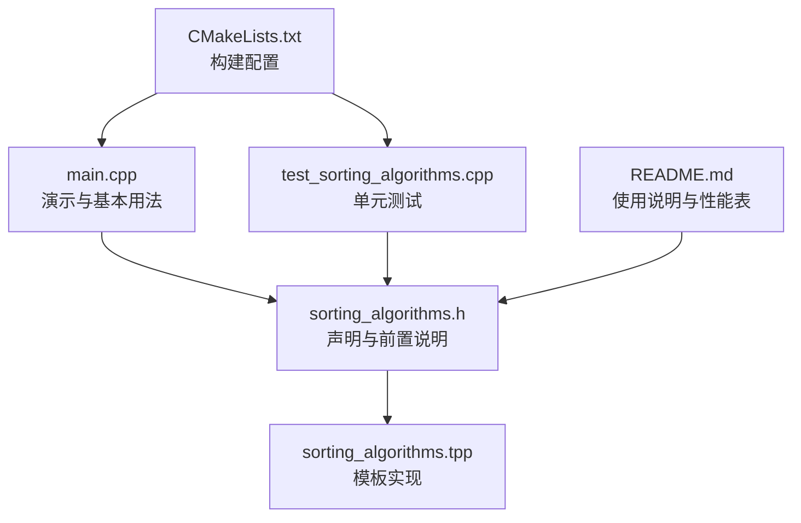
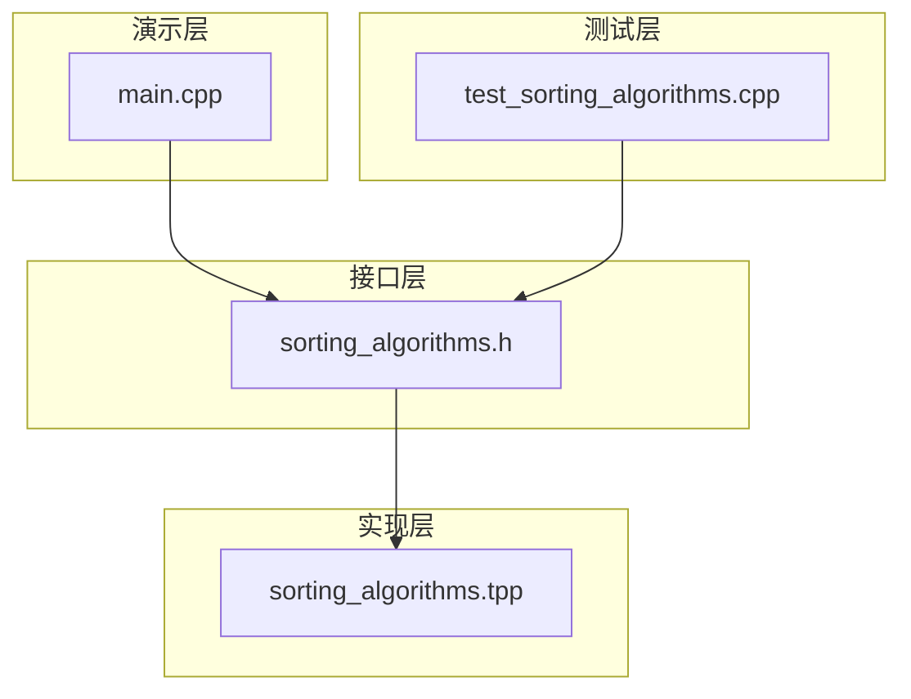
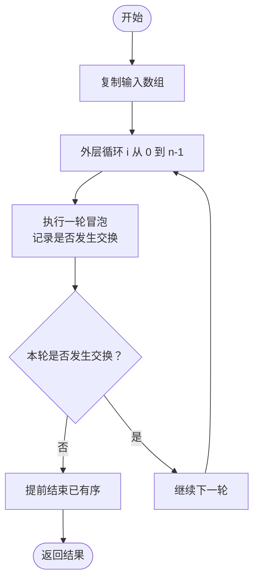
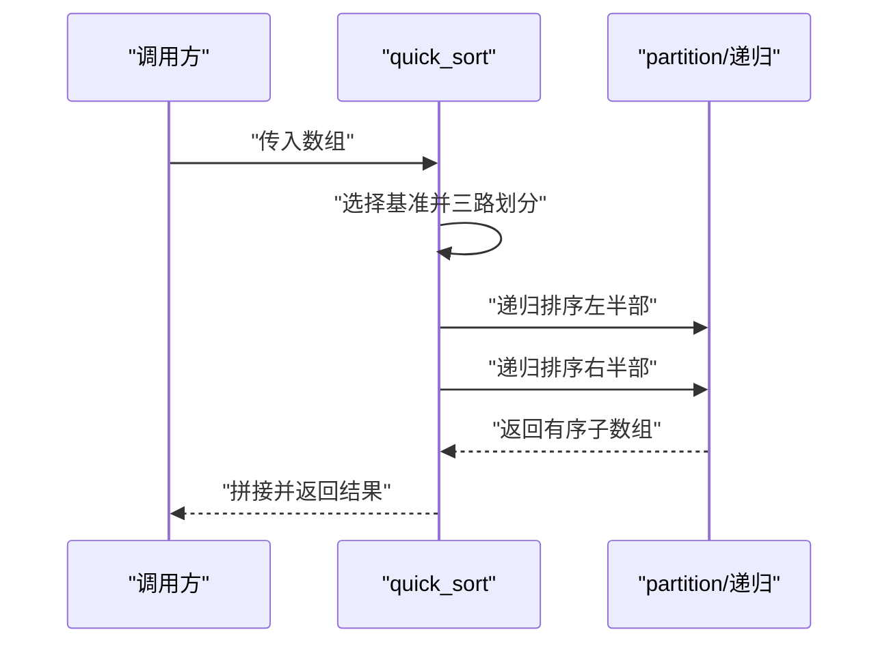
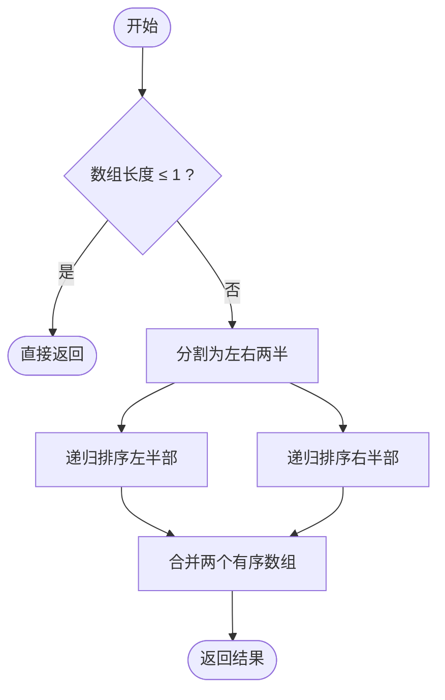
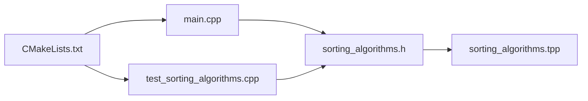

# 核心算法实现

<cite>
**本文引用的文件**
- [sorting_algorithms.h](file://sorting_algorithms.h)
- [sorting_algorithms.tpp](file://sorting_algorithms.tpp)
- [main.cpp](file://main.cpp)
- [test_sorting_algorithms.cpp](file://test_sorting_algorithms.cpp)
- [README.md](file://README.md)
- [CMakeLists.txt](file://CMakeLists.txt)
</cite>

## 目录
1. [引言](#引言)
2. [项目结构](#项目结构)
3. [核心组件](#核心组件)
4. [架构总览](#架构总览)
5. [详细组件分析](#详细组件分析)
6. [依赖关系分析](#依赖关系分析)
7. [性能考量](#性能考量)
8. [故障排查指南](#故障排查指南)
9. [结论](#结论)
10. [附录](#附录)

## 引言
本技术文档围绕 SortTest 项目的三种核心排序算法实现展开，系统阐述冒泡排序、快速排序与归并排序的理论基础、实现原理、性能特征与工程实践要点。文档特别强调：
- 泛型模板设计与类型安全
- 非侵入式接口（不修改输入数组）
- 稳定性与复杂度分析
- 关键流程图与代码路径定位
- 算法适用场景与性能对比

## 项目结构
该项目采用“头文件声明 + 模板实现分离”的组织方式，配合 CMake 构建系统与 Google Test 测试框架，形成清晰的模块化结构。

图表来源
- [sorting_algorithms.h](file://sorting_algorithms.h#L1-L104)
- [sorting_algorithms.tpp](file://sorting_algorithms.tpp#L1-L162)
- [main.cpp](file://main.cpp#L1-L158)
- [test_sorting_algorithms.cpp](file://test_sorting_algorithms.cpp#L1-L294)
- [CMakeLists.txt](file://CMakeLists.txt#L1-L45)

章节来源
- [README.md](file://README.md#L1-L229)
- [CMakeLists.txt](file://CMakeLists.txt#L1-L45)

## 核心组件
- 冒泡排序：稳定、原地比较交换、时间复杂度 O(n²)、空间复杂度 O(1)，适合小规模或教学演示。
- 快速排序：分治策略、平均 O(n log n)、不稳定，实现采用三路划分以提升相等元素处理效率。
- 归并排序：分治 + 合并、稳定、O(n log n)、额外 O(n) 空间，适合需要稳定性的场景。

章节来源
- [sorting_algorithms.h](file://sorting_algorithms.h#L14-L56)
- [sorting_algorithms.tpp](file://sorting_algorithms.tpp#L96-L160)
- [README.md](file://README.md#L193-L200)

## 架构总览
整体架构由“公共接口层 + 模板实现层 + 演示与测试层”构成，接口层仅声明模板函数；实现层集中于 .tpp 文件并通过 include 注入；演示与测试分别位于 main.cpp 与 test_sorting_algorithms.cpp 中。

图表来源
- [sorting_algorithms.h](file://sorting_algorithms.h#L97-L98)
- [sorting_algorithms.tpp](file://sorting_algorithms.tpp#L1-L162)
- [main.cpp](file://main.cpp#L1-L158)
- [test_sorting_algorithms.cpp](file://test_sorting_algorithms.cpp#L1-L294)

## 详细组件分析

### 冒泡排序（Bubble Sort）
- 设计要点
  - 非侵入式：通过辅助函数复制输入数组，保证原数组不变。
  - 稳定性：相邻元素比较交换，相等元素不改变相对位置。
  - 优化：每轮记录是否发生交换，若无则提前结束。
- 关键实现路径
  - 外层调用：[bubble_sort](file://sorting_algorithms.tpp#L96-L109)
  - 单轮处理：[bubble_sort_round](file://sorting_algorithms.tpp#L21-L28)
  - 相邻比较与交换：[compare_and_swap_neighbors](file://sorting_algorithms.tpp#L30-L37)
  - 复制逻辑：[create_array_copy](file://sorting_algorithms.tpp#L15-L19)
- 复杂度与稳定性
  - 时间复杂度：最好 O(n)（已排好），平均/最坏 O(n²)
  - 空间复杂度：O(1)（原数组外仅局部变量）
  - 稳定性：稳定
- 适用场景
  - 教学演示、极小规模数据、对稳定性有要求但对性能要求不高。

图表来源
- [sorting_algorithms.tpp](file://sorting_algorithms.tpp#L96-L109)
- [sorting_algorithms.tpp](file://sorting_algorithms.tpp#L21-L28)
- [sorting_algorithms.tpp](file://sorting_algorithms.tpp#L30-L37)

章节来源
- [sorting_algorithms.h](file://sorting_algorithms.h#L14-L25)
- [sorting_algorithms.tpp](file://sorting_algorithms.tpp#L96-L109)

### 快速排序（Quick Sort）
- 设计要点
  - 分治策略：以某个基准将数组分为小于、等于、大于三部分，递归排序两侧并拼接。
  - 非侵入式：返回新的排序数组，不修改原数组。
  - 稳定性：不稳定（相等元素可能被打乱相对顺序）。
- 关键实现路径
  - 主入口：[quick_sort](file://sorting_algorithms.tpp#L111-L142)
  - 三路划分与递归合并：[partition 与递归调用](file://sorting_algorithms.tpp#L117-L139)
- 复杂度与稳定性
  - 时间复杂度：平均 O(n log n)，最坏 O(n²)
  - 空间复杂度：O(log n)（递归栈）
  - 稳定性：不稳定
- 适用场景
  - 一般用途、追求平均性能、不需要稳定性的场合。

图表来源
- [sorting_algorithms.tpp](file://sorting_algorithms.tpp#L111-L142)

章节来源
- [sorting_algorithms.h](file://sorting_algorithms.h#L27-L38)
- [sorting_algorithms.tpp](file://sorting_algorithms.tpp#L111-L142)

### 归并排序（Merge Sort）
- 设计要点
  - 分治思想：递归拆分至单元素，再合并两个有序序列。
  - 非侵入式：返回新的排序数组，原数组不变。
  - 稳定性：稳定（合并时相等取左侧元素优先）。
- 关键实现路径
  - 主入口：[merge_sort](file://sorting_algorithms.tpp#L144-L160)
  - 合并函数：[merge](file://sorting_algorithms.tpp#L39-L66)
- 复杂度与稳定性
  - 时间复杂度：O(n log n)（最好/平均/最坏一致）
  - 空间复杂度：O(n)（临时结果数组）
  - 稳定性：稳定
- 适用场景
  - 对稳定性有严格要求、大数据集、外部排序等。

图表来源
- [sorting_algorithms.tpp](file://sorting_algorithms.tpp#L144-L160)
- [sorting_algorithms.tpp](file://sorting_algorithms.tpp#L39-L66)

章节来源
- [sorting_algorithms.h](file://sorting_algorithms.h#L40-L56)
- [sorting_algorithms.tpp](file://sorting_algorithms.tpp#L144-L160)

### 泛型与类型安全
- 模板设计
  - 三个算法均以模板形式声明与实现，支持任意可比较类型（如 int、double、string 等）。
  - 头文件包含实现文件，确保编译期实例化与链接。
- 类型约束
  - 通过比较运算符（如 <、>、==）隐式约束元素类型，需确保自定义类型提供相应比较操作。
- 非侵入式优势
  - 输入数组保持不变，便于复用与并发安全。
  - 返回新数组，简化调用方内存管理。

章节来源
- [sorting_algorithms.h](file://sorting_algorithms.h#L20-L56)
- [sorting_algorithms.tpp](file://sorting_algorithms.tpp#L97-L160)
- [README.md](file://README.md#L37-L42)

### 算法执行流程图与代码示例路径
- 冒泡排序流程图见上文“冒泡排序”小节。
- 快速排序流程图见上文“快速排序”小节。
- 归并排序流程图见上文“归并排序”小节。
- 关键实现路径定位
  - 冒泡排序：[bubble_sort](file://sorting_algorithms.tpp#L96-L109)、[bubble_sort_round](file://sorting_algorithms.tpp#L21-L28)、[compare_and_swap_neighbors](file://sorting_algorithms.tpp#L30-L37)
  - 快速排序：[quick_sort](file://sorting_algorithms.tpp#L111-L142)
  - 归并排序：[merge_sort](file://sorting_algorithms.tpp#L144-L160)、[merge](file://sorting_algorithms.tpp#L39-L66)

章节来源
- [sorting_algorithms.tpp](file://sorting_algorithms.tpp#L96-L160)

## 依赖关系分析
- 头文件与实现文件
  - 接口声明位于 [sorting_algorithms.h](file://sorting_algorithms.h#L14-L56)，实现位于 [sorting_algorithms.tpp](file://sorting_algorithms.tpp#L96-L160)，通过 include 注入。
- 演示与测试
  - [main.cpp](file://main.cpp#L42-L73) 调用三种排序函数进行演示。
  - [test_sorting_algorithms.cpp](file://test_sorting_algorithms.cpp#L277-L287) 对三种算法进行一致性测试。
- 构建系统
  - [CMakeLists.txt](file://CMakeLists.txt#L1-L45) 定义 C++17 标准、编译选项与测试目标。

图表来源
- [sorting_algorithms.h](file://sorting_algorithms.h#L97-L98)
- [sorting_algorithms.tpp](file://sorting_algorithms.tpp#L1-L162)
- [main.cpp](file://main.cpp#L1-L158)
- [test_sorting_algorithms.cpp](file://test_sorting_algorithms.cpp#L1-L294)
- [CMakeLists.txt](file://CMakeLists.txt#L1-L45)

章节来源
- [CMakeLists.txt](file://CMakeLists.txt#L1-L45)

## 性能考量
- 复杂度与稳定性对照
  - 冒泡排序：时间 O(n²)，空间 O(1)，稳定。
  - 快速排序：平均 O(n log n)，空间 O(log n)，不稳定。
  - 归并排序：时间 O(n log n)，空间 O(n)，稳定。
- 实际表现建议
  - 小规模或教学：冒泡排序。
  - 一般用途：快速排序（注意最坏情况与基准选择）。
  - 需要稳定：归并排序（牺牲空间换取稳定性）。
- 代码层面的优化点
  - 冒泡排序：提前终止优化已在实现中体现。
  - 快速排序：当前实现采用三路划分，有助于处理大量重复元素。
  - 归并排序：合并过程为 O(n)，整体 O(n log n)。

章节来源
- [README.md](file://README.md#L193-L200)
- [sorting_algorithms.tpp](file://sorting_algorithms.tpp#L96-L160)

## 故障排查指南
- 常见问题
  - 自定义类型无法排序：检查是否提供合适的比较运算符（如 <、>、==）。
  - 内存不足：归并排序会分配 O(n) 临时空间，大数组时需关注内存峰值。
  - 递归过深：快速排序在最坏情况下递归深度为 O(n)，极端退化时可考虑迭代实现或随机化基准。
- 单元测试参考
  - 归并排序稳定性测试：[TestMergeSort.StabilityOfMergeSort](file://test_sorting_algorithms.cpp#L149-L165)
  - 三种算法一致性测试：[TestAllSortingAlgorithms](file://test_sorting_algorithms.cpp#L271-L287)
- 演示输出
  - 主程序输出包含算法特性表与字符串排序演示，便于快速核对行为。

章节来源
- [test_sorting_algorithms.cpp](file://test_sorting_algorithms.cpp#L149-L165)
- [test_sorting_algorithms.cpp](file://test_sorting_algorithms.cpp#L271-L287)
- [main.cpp](file://main.cpp#L78-L104)

## 结论
SortTest 项目以清晰的接口与模板化实现，提供了三种经典排序算法的高质量实现。其非侵入式设计与完备测试，使得代码易于理解、扩展与维护。在实际应用中，可根据数据规模、稳定性需求与性能目标选择合适算法，并结合具体场景进行进一步优化。

## 附录
- 使用示例与 API 文档
  - 基本用法与多类型排序示例见 [README.md](file://README.md#L83-L122)。
  - API 声明与说明见 [sorting_algorithms.h](file://sorting_algorithms.h#L14-L56)。
- 构建与运行
  - 构建与测试命令见 [README.md](file://README.md#L52-L82)。
  - CMake 配置见 [CMakeLists.txt](file://CMakeLists.txt#L1-L45)。