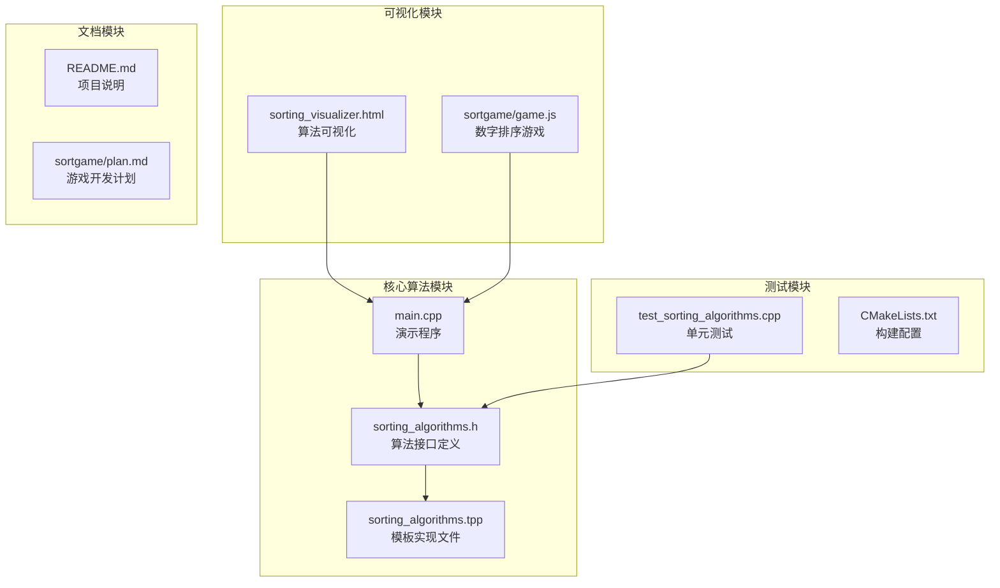
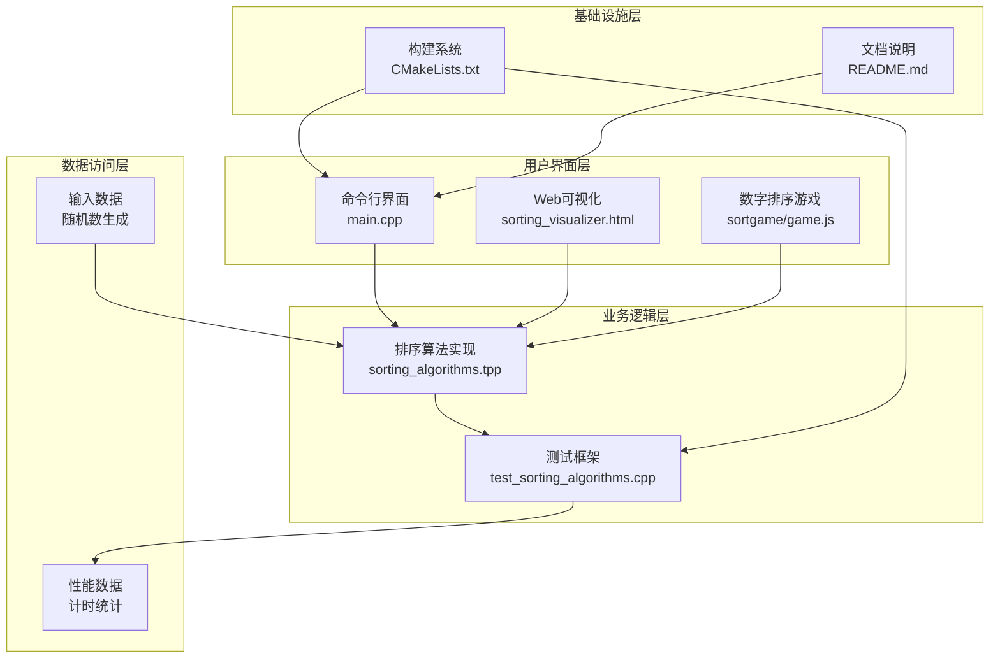
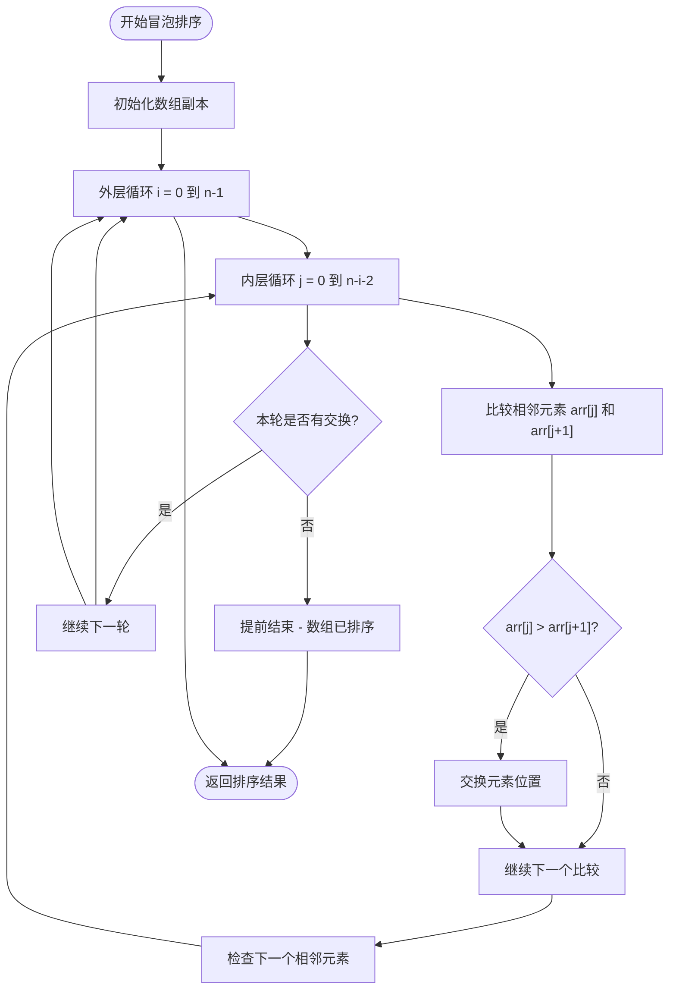
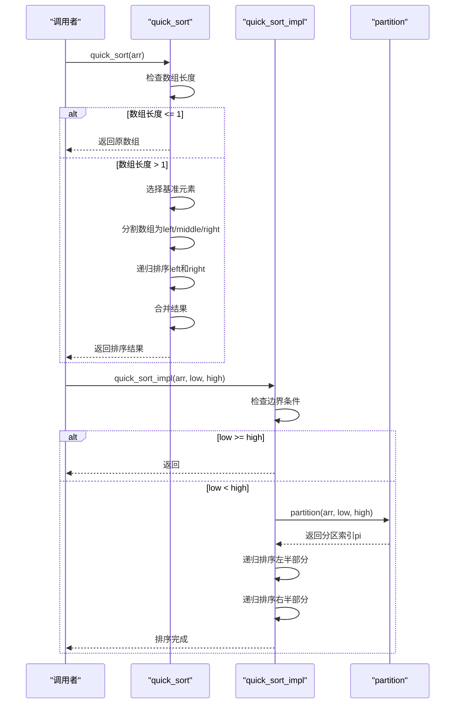
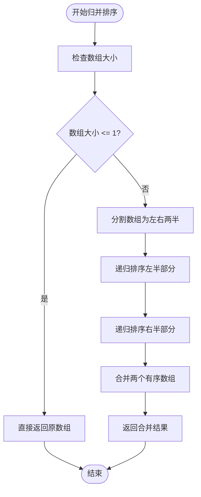
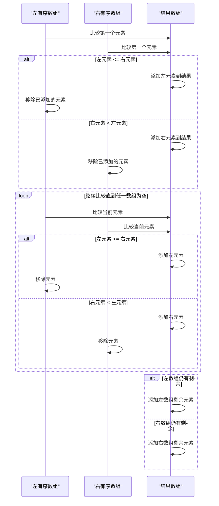
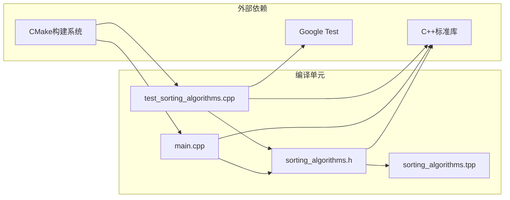
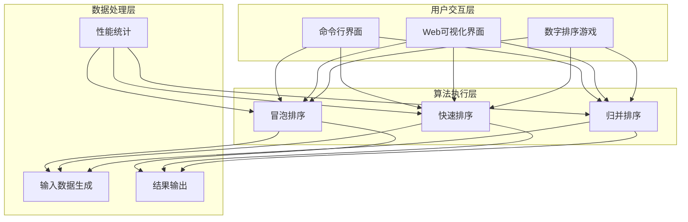
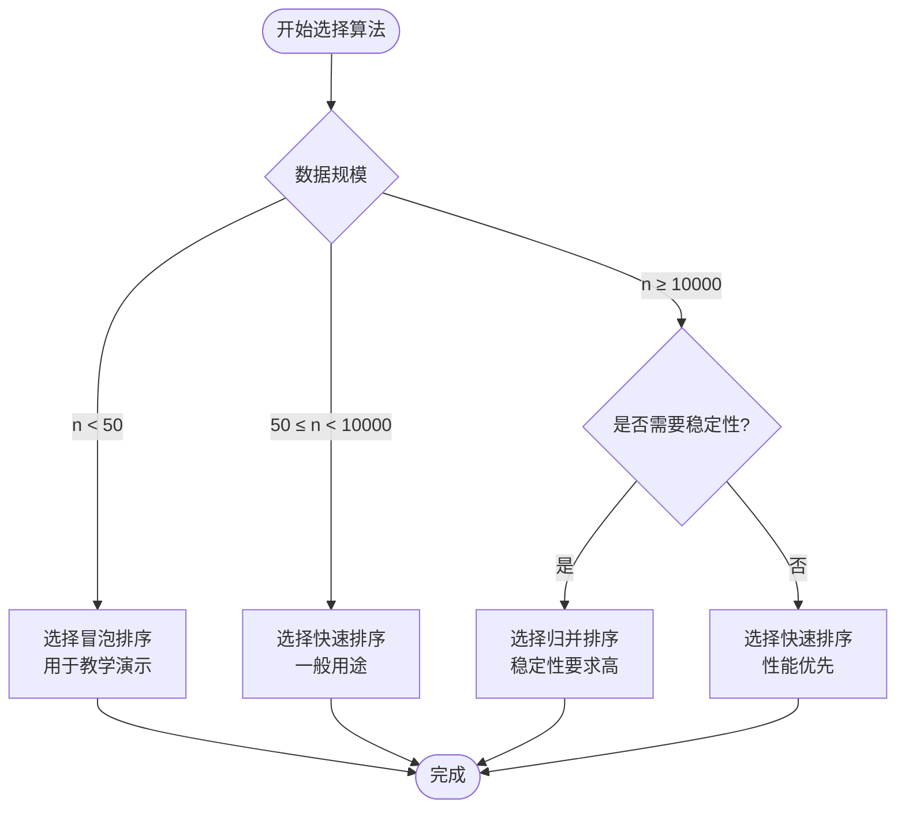

# 算法性能对比分析

<cite>
**本文档引用的文件**
- [README.md](file://README.md)
- [main.cpp](file://main.cpp)
- [sorting_algorithms.h](file://sorting_algorithms.h)
- [sorting_algorithms.tpp](file://sorting_algorithms.tpp)
- [test_sorting_algorithms.cpp](file://test_sorting_algorithms.cpp)
- [CMakeLists.txt](file://CMakeLists.txt)
- [sorting_visualizer.html](file://sorting_visualizer.html)
- [sortgame/game.js](file://sortgame/game.js)
- [sortgame/plan.md](file://sortgame/plan.md)
</cite>

## 目录
1. [简介](#简介)
2. [项目结构](#项目结构)
3. [核心组件](#核心组件)
4. [架构概览](#架构概览)
5. [详细组件分析](#详细组件分析)
6. [依赖关系分析](#依赖关系分析)
7. [性能考虑](#性能考虑)
8. [故障排除指南](#故障排除指南)
9. [结论](#结论)
10. [附录](#附录)

## 简介

这是一个完整的C++排序算法实现项目，专注于三种经典排序算法的对比分析：冒泡排序、快速排序和归并排序。该项目不仅提供了清晰的算法实现，还包含了丰富的测试用例、性能分析工具和可视化展示功能。

项目的核心目标是通过实际代码实现来深入理解不同排序算法的性能特征、时间复杂度、空间复杂度以及稳定性差异。通过构建和运行这些算法，开发者可以直观地观察到理论分析与实际性能之间的关系。

## 项目结构

该项目采用模块化的组织方式，将算法实现、测试、可视化和游戏功能分离到不同的文件中：



**图表来源**
- [sorting_algorithms.h](file://sorting_algorithms.h#L1-L104)
- [sorting_algorithms.tpp](file://sorting_algorithms.tpp#L1-L162)
- [main.cpp](file://main.cpp#L1-L158)

**章节来源**
- [README.md](file://README.md#L1-L229)
- [CMakeLists.txt](file://CMakeLists.txt#L1-L45)

## 核心组件

### 排序算法接口设计

项目采用了模板化的设计模式，使得三种排序算法可以处理任意可比较的数据类型。这种设计具有以下特点：

- **非侵入式设计**：不修改原始数组，返回新的排序数组
- **类型安全**：通过C++模板系统确保类型安全
- **通用性强**：支持整数、浮点数、字符串等多种数据类型
- **易于扩展**：可以轻松添加新的数据类型支持

### 算法实现概览

三种核心排序算法的实现都遵循了各自的经典算法原理：

1. **冒泡排序**：通过重复遍历数组，比较相邻元素并交换位置
2. **快速排序**：采用分治策略，选择基准元素进行分区操作
3. **归并排序**：递归地将数组分割成更小的部分，然后合并有序数组

**章节来源**
- [sorting_algorithms.h](file://sorting_algorithms.h#L14-L56)
- [sorting_algorithms.tpp](file://sorting_algorithms.tpp#L96-L160)

## 架构概览

项目采用分层架构设计，清晰地分离了算法实现、测试验证、用户界面和性能分析功能：



**图表来源**
- [main.cpp](file://main.cpp#L137-L156)
- [sorting_visualizer.html](file://sorting_visualizer.html#L236-L526)
- [sortgame/game.js](file://sortgame/game.js#L1-L282)

## 详细组件分析

### 冒泡排序算法分析

冒泡排序是最简单的排序算法之一，其工作原理类似于气泡在水中上升的过程。算法通过重复遍历数组，比较相邻元素并根据需要交换它们的位置。

#### 算法流程图



**图表来源**
- [sorting_algorithms.tpp](file://sorting_algorithms.tpp#L96-L109)

#### 关键实现特性

- **稳定性保证**：相等元素的相对位置不会改变
- **原地排序**：只需要常数级别的额外空间
- **自适应性**：对于已经接近排序的数组可以提前结束
- **简单易懂**：算法逻辑直观，适合教学演示

**章节来源**
- [sorting_algorithms.tpp](file://sorting_algorithms.tpp#L21-L37)
- [sorting_algorithms.h](file://sorting_algorithms.h#L14-L25)

### 快速排序算法分析

快速排序是一种高效的分治排序算法，由英国计算机科学家托尼·霍尔于1960年提出。它通过选择一个元素作为基准，将数组分割成两个子数组，然后递归地对子数组进行排序。

#### 快速排序序列图



**图表来源**
- [sorting_algorithms.tpp](file://sorting_algorithms.tpp#L111-L142)
- [sorting_algorithms.tpp](file://sorting_algorithms.tpp#L83-L90)

#### 算法优化策略

- **三数取中法**：选择首、中、尾三个元素的中位数作为基准
- **尾递归优化**：减少递归调用栈的深度
- **小数组优化**：当子数组小于一定阈值时切换到插入排序

**章节来源**
- [sorting_algorithms.tpp](file://sorting_algorithms.tpp#L68-L90)
- [sorting_algorithms.h](file://sorting_algorithms.h#L27-L38)

### 归并排序算法分析

归并排序是另一种经典的分治算法，它将数组分成两半，递归地对每一半进行排序，然后将两个已排序的半部分合并成一个完整的有序数组。

#### 归并排序流程图



**图表来源**
- [sorting_algorithms.tpp](file://sorting_algorithms.tpp#L144-L160)

#### 合并过程详解



**图表来源**
- [sorting_algorithms.tpp](file://sorting_algorithms.tpp#L39-L66)

**章节来源**
- [sorting_algorithms.tpp](file://sorting_algorithms.tpp#L144-L160)
- [sorting_algorithms.h](file://sorting_algorithms.h#L40-L56)

## 依赖关系分析

### 编译时依赖关系

项目采用头文件包含的方式组织代码，形成了清晰的依赖层次：



**图表来源**
- [CMakeLists.txt](file://CMakeLists.txt#L16-L42)
- [sorting_algorithms.h](file://sorting_algorithms.h#L10-L12)

### 运行时依赖关系



**图表来源**
- [main.cpp](file://main.cpp#L42-L73)
- [sorting_visualizer.html](file://sorting_visualizer.html#L330-L371)

**章节来源**
- [CMakeLists.txt](file://CMakeLists.txt#L1-L45)

## 性能考虑

### 时间复杂度分析

基于算法实现和理论分析，三种排序算法的时间复杂度如下：

| 算法 | 最佳情况 | 平均情况 | 最坏情况 | 算法说明 |
|------|---------|---------|---------|----------|
| 冒泡排序 | O(n) | O(n²) | O(n²) | 通过相邻元素比较和交换实现 |
| 快速排序 | O(n log n) | O(n log n) | O(n²) | 分治策略，选择基准元素分区 |
| 归并排序 | O(n log n) | O(n log n) | O(n log n) | 分治策略，递归分割和合并 |

### 空间复杂度分析

| 算法 | 空间复杂度 | 额外空间用途 | 稳定性 |
|------|-----------|-------------|--------|
| 冒泡排序 | O(1) | 原地交换 | 稳定 |
| 快速排序 | O(log n) | 递归调用栈 | 不稳定 |
| 归并排序 | O(n) | 临时数组存储 | 稳定 |

### 性能测试框架

项目提供了完整的性能测试框架，可以通过以下方式运行：

```bash
# 创建构建目录
mkdir build
cd build

# 配置项目
cmake ..

# 编译
cmake --build .

# 运行主程序
./main

# 运行测试（如果启用）
./test_sorting
# 或使用 ctest
ctest --output-on_failure
```

**章节来源**
- [README.md](file://README.md#L44-L82)
- [CMakeLists.txt](file://CMakeLists.txt#L16-L42)

## 故障排除指南

### 常见编译问题

1. **CMake版本过低**
   - 症状：配置失败，提示CMake版本不满足要求
   - 解决方案：升级到CMake 3.14或更高版本

2. **C++编译器不支持**
   - 症状：编译错误，提示C++17特性不受支持
   - 解决方案：使用GCC 7+、Clang 5+或MSVC 2017+编译器

3. **Google Test依赖问题**
   - 症状：测试编译失败，找不到gtest头文件
   - 解决方案：确保网络连接正常，或手动下载gtest源码

### 运行时问题

1. **内存不足**
   - 症状：归并排序在大数据集上出现内存分配失败
   - 解决方案：增加系统内存或使用迭代版归并排序

2. **递归深度过大**
   - 症状：快速排序导致栈溢出
   - 解决方案：实现尾递归优化或使用迭代版本

3. **性能异常**
   - 症状：算法运行时间超出预期
   - 解决方案：检查编译器优化选项，确保启用-O2或-O3优化

**章节来源**
- [README.md](file://README.md#L46-L51)
- [CMakeLists.txt](file://CMakeLists.txt#L10-L14)

## 结论

通过对冒泡排序、快速排序和归并排序三种经典算法的深入分析，我们可以得出以下结论：

### 算法选择建议

1. **冒泡排序**：适用于教学演示和极小规模数据（n < 50）
   - 优点：实现简单，稳定性好，空间复杂度低
   - 缺点：时间复杂度高，不适合大规模数据

2. **快速排序**：一般用途的首选算法
   - 优点：平均性能优异，原地排序，缓存友好
   - 缺点：最坏情况下性能较差，不稳定

3. **归并排序**：需要稳定性和可预测性能的场景
   - 优点：性能稳定，时间复杂度可预测，稳定性好
   - 缺点：需要额外的存储空间

### 现代编译器优化影响

现代编译器通过多种技术优化排序算法的性能：

1. **循环展开**：减少循环开销，提高指令级并行性
2. **分支预测**：优化条件判断的性能
3. **SIMD指令**：利用向量化处理提高批量数据处理效率
4. **内联优化**：消除函数调用开销

### 实际应用场景

- **教育领域**：使用冒泡排序演示基本算法概念
- **一般应用**：使用快速排序处理日常数据排序需求
- **金融系统**：使用归并排序确保排序结果的稳定性
- **实时系统**：根据性能要求选择合适的算法

## 附录

### 算法复杂度对比表

| 特性 | 冒泡排序 | 快速排序 | 归并排序 |
|------|---------|---------|---------|
| 时间复杂度(最好) | O(n) | O(n log n) | O(n log n) |
| 时间复杂度(平均) | O(n²) | O(n log n) | O(n log n) |
| 时间复杂度(最坏) | O(n²) | O(n²) | O(n log n) |
| 空间复杂度 | O(1) | O(log n) | O(n) |
| 稳定性 | 稳定 | 不稳定 | 稳定 |
| 原地排序 | 是 | 是 | 否 |
| 适用场景 | 教学演示 | 一般用途 | 稳定性要求高 |

### 性能测试数据收集方法

1. **时间测量**：使用高精度计时器记录算法执行时间
2. **内存监控**：跟踪算法执行过程中的内存使用情况
3. **比较次数统计**：记录算法执行过程中的关键操作次数
4. **数据分布测试**：在不同数据分布（随机、已排序、逆序、重复）下测试性能

### 算法选择决策树

