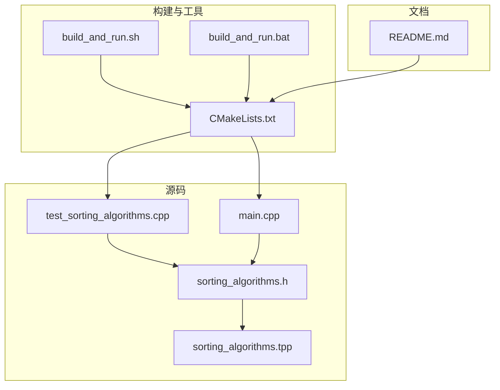
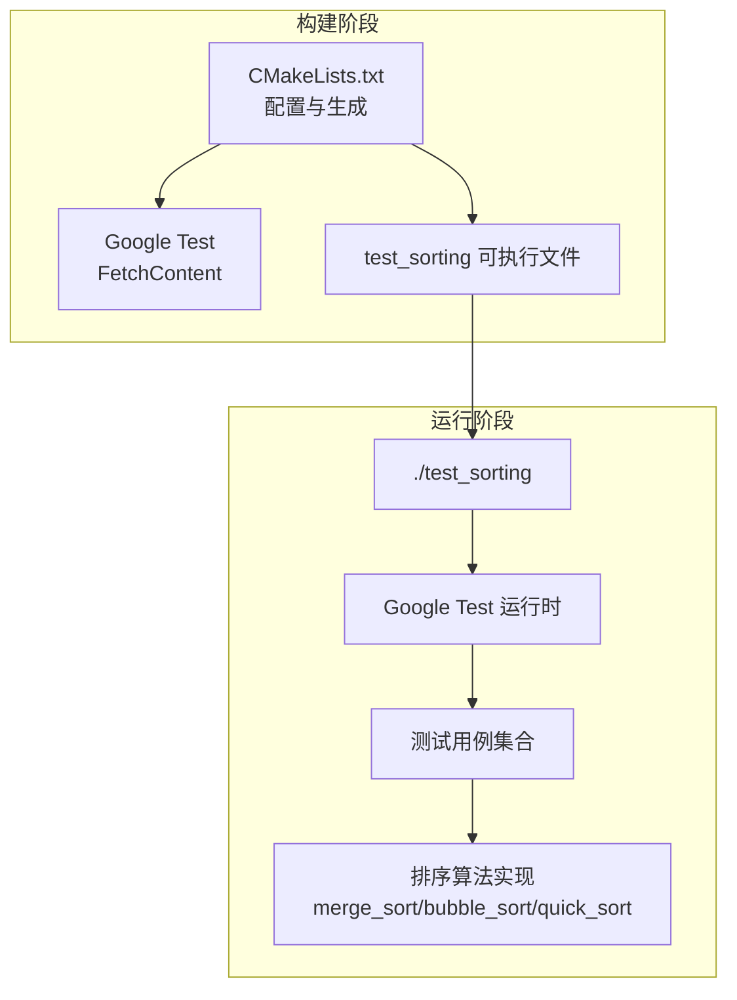
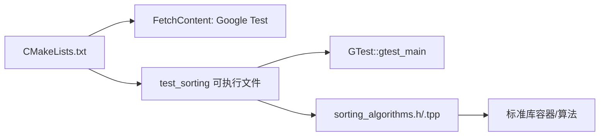

# 测试框架与质量保证

<cite>
**本文引用的文件**
- [CMakeLists.txt](file://CMakeLists.txt)
- [test_sorting_algorithms.cpp](file://test_sorting_algorithms.cpp)
- [sorting_algorithms.h](file://sorting_algorithms.h)
- [sorting_algorithms.tpp](file://sorting_algorithms.tpp)
- [main.cpp](file://main.cpp)
- [README.md](file://README.md)
- [build_and_run.sh](file://build_and_run.sh)
- [build_and_run.bat](file://build_and_run.bat)
</cite>

## 目录
1. [简介](#简介)
2. [项目结构](#项目结构)
3. [核心组件](#核心组件)
4. [架构总览](#架构总览)
5. [详细组件分析](#详细组件分析)
6. [依赖关系分析](#依赖关系分析)
7. [性能考量](#性能考量)
8. [故障排查指南](#故障排查指南)
9. [结论](#结论)
10. [附录](#附录)

## 简介
本文件面向SortTest项目的测试框架与质量保证体系，系统阐述Google Test在CMake中的集成与配置、测试用例设计思路与覆盖维度、稳定性验证方法、多数据类型测试覆盖、测试运行与调试指南、结果解读与性能基准建议，以及测试最佳实践与持续集成建议。目标是帮助开发者与测试人员高效理解并维护该项目的质量保障流程。

## 项目结构
项目采用模块化组织，核心由“算法实现”“测试”“构建配置”三部分组成，并提供跨平台构建脚本与主程序演示。

图表来源
- [CMakeLists.txt](file://CMakeLists.txt#L1-L45)
- [test_sorting_algorithms.cpp](file://test_sorting_algorithms.cpp#L1-L294)
- [sorting_algorithms.h](file://sorting_algorithms.h#L1-L104)
- [sorting_algorithms.tpp](file://sorting_algorithms.tpp#L1-L162)
- [main.cpp](file://main.cpp#L1-L158)
- [build_and_run.sh](file://build_and_run.sh#L1-L107)
- [build_and_run.bat](file://build_and_run.bat#L1-L152)
- [README.md](file://README.md#L1-L229)

章节来源
- [CMakeLists.txt](file://CMakeLists.txt#L1-L45)
- [README.md](file://README.md#L1-L229)

## 核心组件
- Google Test集成与CMake配置：通过FetchContent自动拉取指定版本的Google Test，启用测试并生成测试可执行文件，使用gtest_discover_tests自动发现测试用例。
- 测试用例设计：围绕边界条件、已排序/逆序、重复元素、负数/混合正负数、大数据集、稳定性、不同数据类型（整数、浮点数、字符串）等维度构建。
- 算法实现与模板化：三种排序算法以模板形式实现，支持任意可比较类型；归并排序强调稳定性，快速排序强调平均性能。
- 跨平台构建脚本：提供Unix风格与Windows批处理脚本，支持快速构建与完整构建两种模式。

章节来源
- [CMakeLists.txt](file://CMakeLists.txt#L19-L42)
- [test_sorting_algorithms.cpp](file://test_sorting_algorithms.cpp#L1-L294)
- [sorting_algorithms.h](file://sorting_algorithms.h#L14-L98)
- [sorting_algorithms.tpp](file://sorting_algorithms.tpp#L96-L162)
- [build_and_run.sh](file://build_and_run.sh#L18-L102)
- [build_and_run.bat](file://build_and_run.bat#L29-L146)

## 架构总览
下图展示测试框架在构建与运行阶段的交互关系，以及测试用例与算法实现之间的调用链。

图表来源
- [CMakeLists.txt](file://CMakeLists.txt#L22-L42)
- [test_sorting_algorithms.cpp](file://test_sorting_algorithms.cpp#L291-L294)
- [sorting_algorithms.h](file://sorting_algorithms.h#L24-L56)

## 详细组件分析

### Google Test集成与CMake配置
- 选项控制：通过BUILD_TESTS选项决定是否构建测试；默认开启。
- FetchContent：自动拉取指定版本的Google Test，避免外部依赖管理复杂度。
- 测试目标：生成独立的测试可执行文件，链接gtest_main。
- 自动发现：使用gtest_discover_tests自动扫描并注册测试用例，减少手工维护成本。

章节来源
- [CMakeLists.txt](file://CMakeLists.txt#L19-L42)

### 测试用例设计与覆盖维度
- 边界条件测试：空数组、单元素数组、两元素、三元素等。
- 序列状态测试：已排序、逆序、奇偶长度数组。
- 重复元素处理：全相同、含重复、重复在两端/中间等。
- 数值范围测试：负数、零、混合正负数、大数值。
- 数据类型覆盖：整数、浮点数、字符串；通过模板实现统一接口。
- 稳定性验证：针对归并排序的稳定性进行断言，确保相等元素相对顺序不变。
- 大数据集与递归深度：构造大规模随机数组与打乱数组，验证算法正确性与递归深度容忍度。
- 多算法一致性：在同一组输入上验证三种算法输出一致。

章节来源
- [test_sorting_algorithms.cpp](file://test_sorting_algorithms.cpp#L27-L230)

### 稳定性验证测试
- 设计要点：使用pair<int,char>构造具有相同键值的元素，验证排序后相同键值元素的次序是否与输入一致。
- 断言策略：先断言键值序列满足排序要求，再断言相同键值区间内字符序列与期望顺序一致。
- 适用算法：归并排序具备稳定性，快速排序不具备稳定性，因此稳定性测试仅针对归并排序或在特定场景下验证。

章节来源
- [test_sorting_algorithms.cpp](file://test_sorting_algorithms.cpp#L149-L165)

### 多数据类型测试覆盖
- 整数：覆盖正数、负数、零、重复、大数等。
- 浮点数：double类型数组的排序正确性。
- 字符串：按字典序排序的正确性。
- 模板机制：通过模板函数实现，无需为每种类型编写重复代码。

章节来源
- [test_sorting_algorithms.cpp](file://test_sorting_algorithms.cpp#L86-L108)
- [sorting_algorithms.h](file://sorting_algorithms.h#L24-L56)

### 算法实现与模板化
- 归并排序：分治策略，稳定，时间复杂度O(n log n)，空间复杂度O(n)。
- 快速排序：平均O(n log n)，最坏O(n²)，不稳定，空间复杂度O(log n)。
- 冒泡排序：O(n²)，稳定，O(1)空间。
- 模板实现：辅助函数与主函数均以模板形式实现，集中在头文件中以便编译器可见。

章节来源
- [sorting_algorithms.h](file://sorting_algorithms.h#L14-L98)
- [sorting_algorithms.tpp](file://sorting_algorithms.tpp#L96-L162)

### 测试运行与调试指南
- 运行测试：在构建目录下执行测试可执行文件，或使用ctest命令。
- verbose模式：通过命令行参数启用详细输出，便于定位失败用例与查看断言细节。
- 调试技巧：结合断言失败信息、日志输出与IDE断点，逐步缩小问题范围。

章节来源
- [README.md](file://README.md#L68-L72)
- [README.md](file://README.md#L143-L147)

### 测试结果解读与性能基准建议
- 结果解读：通过ctest或测试可执行文件输出判断用例通过/失败；关注失败用例的输入与期望差异。
- 性能基准：当前测试侧重正确性验证，未包含性能计时；可在测试框架中引入计时宏或基准库进行性能对比。

章节来源
- [README.md](file://README.md#L136-L147)

## 依赖关系分析
- 构建依赖：CMakeLists.txt依赖Google Test FetchContent；测试可执行文件依赖GTest::gtest_main。
- 运行依赖：测试可执行文件依赖排序算法实现；算法实现依赖标准库容器与比较运算。
- 脚本依赖：构建脚本依赖系统编译器与CMake工具链。

图表来源
- [CMakeLists.txt](file://CMakeLists.txt#L22-L42)
- [test_sorting_algorithms.cpp](file://test_sorting_algorithms.cpp#L7-L11)
- [sorting_algorithms.h](file://sorting_algorithms.h#L10-L12)

章节来源
- [CMakeLists.txt](file://CMakeLists.txt#L22-L42)
- [test_sorting_algorithms.cpp](file://test_sorting_algorithms.cpp#L7-L11)
- [sorting_algorithms.h](file://sorting_algorithms.h#L10-L12)

## 性能考量
- 正确性优先：当前测试以覆盖正确性为主，未包含性能计时。
- 建议扩展：在测试框架中增加性能基准（如使用高精度计时），对比不同算法在不同规模与分布下的表现。
- 大数据集测试：已包含大规模随机数组与打乱数组测试，可作为性能回归的基础。

章节来源
- [test_sorting_algorithms.cpp](file://test_sorting_algorithms.cpp#L167-L182)
- [test_sorting_algorithms.cpp](file://test_sorting_algorithms.cpp#L212-L230)

## 故障排查指南
- 构建失败：检查CMake版本、编译器可用性与网络访问（FetchContent需联网下载Google Test）。
- 测试失败：根据verbose输出定位具体用例，核对输入数据与期望结果；对于稳定性测试，确认算法是否满足预期。
- 跨平台差异：Windows使用MSVC或MinGW，Unix使用GCC/Clang；确保编译器版本满足C++17要求。
- 调试建议：使用IDE断点与日志输出，结合测试用例的输入与期望进行逐项比对。

章节来源
- [build_and_run.sh](file://build_and_run.sh#L12-L16)
- [build_and_run.bat](file://build_and_run.bat#L9-L24)
- [README.md](file://README.md#L46-L82)

## 结论
本项目通过CMake与Google Test实现了完善的测试框架，覆盖了排序算法的关键正确性维度与稳定性验证，并提供了跨平台构建脚本与清晰的运行指南。建议在现有基础上补充性能基准与持续集成流水线，以进一步提升质量保障能力与开发效率。

## 附录

### 测试用例清单与覆盖说明
- 边界条件：空数组、单元素、两元素、三元素、奇偶长度数组
- 序列状态：已排序、逆序、随机无序
- 重复元素：全相同、含重复、重复在两端/中间
- 数值范围：负数、零、混合正负数、大数
- 数据类型：整数、浮点数、字符串
- 稳定性：归并排序稳定性验证
- 大数据集：100元素随机数组、1000元素打乱数组
- 多算法一致性：同一输入下三种算法输出一致

章节来源
- [test_sorting_algorithms.cpp](file://test_sorting_algorithms.cpp#L27-L230)

### 测试运行与调试操作指引
- 运行主程序与测试：参考构建与运行章节，使用ctest或直接执行测试可执行文件。
- verbose模式：通过命令行参数启用详细输出，便于定位失败用例。
- 调试建议：结合断言失败信息与日志输出，逐步缩小问题范围。

章节来源
- [README.md](file://README.md#L68-L72)
- [README.md](file://README.md#L143-L147)