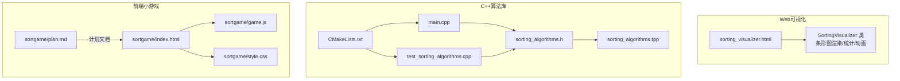
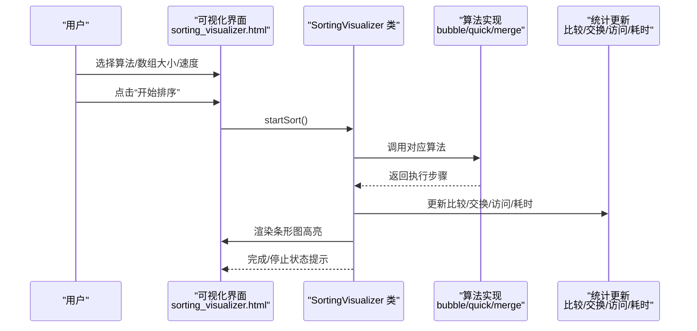
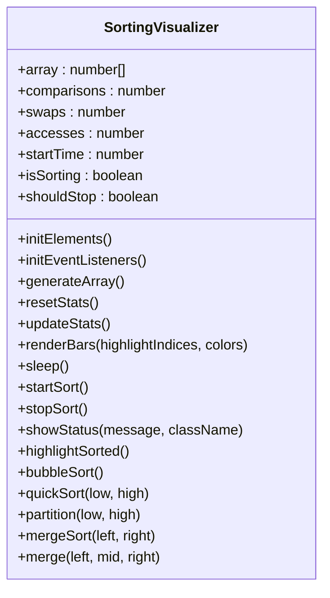
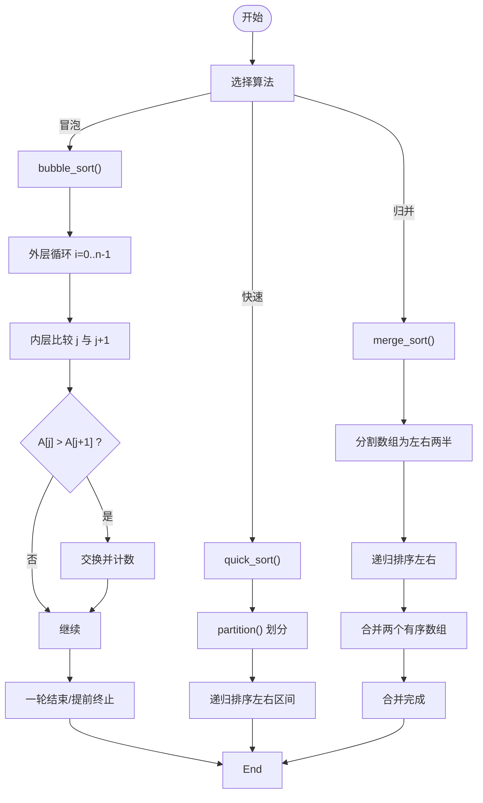
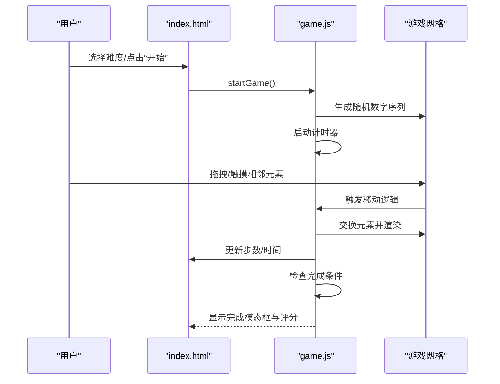
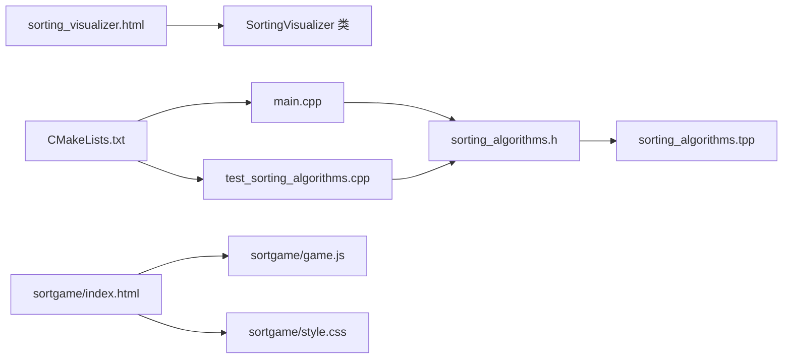

# 算法可视化工具

<cite>
**本文引用的文件列表**
- [sorting_visualizer.html](file://sorting_visualizer.html)
- [sorting_algorithms.h](file://sorting_algorithms.h)
- [sorting_algorithms.tpp](file://sorting_algorithms.tpp)
- [test_sorting_algorithms.cpp](file://test_sorting_algorithms.cpp)
- [main.cpp](file://main.cpp)
- [CMakeLists.txt](file://CMakeLists.txt)
- [README.md](file://README.md)
- [sortgame/index.html](file://sortgame/index.html)
- [sortgame/game.js](file://sortgame/game.js)
- [sortgame/style.css](file://sortgame/style.css)
- [sortgame/plan.md](file://sortgame/plan.md)
</cite>

## 目录
1. [简介](#简介)
2. [项目结构](#项目结构)
3. [核心组件](#核心组件)
4. [架构总览](#架构总览)
5. [详细组件分析](#详细组件分析)
6. [依赖关系分析](#依赖关系分析)
7. [性能考量](#性能考量)
8. [故障排查指南](#故障排查指南)
9. [结论](#结论)
10. [附录](#附录)

## 简介
本项目提供一套“算法可视化工具”，重点围绕排序算法的可视化演示与教学应用，帮助学习者直观理解冒泡排序、快速排序与归并排序的工作原理与性能差异。工具由两部分组成：
- Web端可视化演示：基于HTML5 Canvas思想的条形图动画，实时展示算法执行过程中的比较、交换与访问次数，并提供计时统计与状态提示。
- C++排序算法库：提供模板化的排序实现与完备测试，支持整数、浮点数、字符串等多种可比较类型，便于在命令行或嵌入式场景中使用。

此外，项目还包含一个“手动拖拽排序小游戏”的前端实现，强调交互式学习与即时反馈，辅助理解排序概念与游戏化学习体验。

## 项目结构
项目采用“多模块并存”的组织方式，既包含Web可视化工具，也包含C++算法库与测试套件，同时提供一个独立的前端小游戏模块。

图表来源
- [sorting_visualizer.html](file://sorting_visualizer.html#L1-L528)
- [sorting_algorithms.h](file://sorting_algorithms.h#L1-L104)
- [sorting_algorithms.tpp](file://sorting_algorithms.tpp#L1-L162)
- [main.cpp](file://main.cpp#L1-L158)
- [test_sorting_algorithms.cpp](file://test_sorting_algorithms.cpp#L1-L294)
- [CMakeLists.txt](file://CMakeLists.txt#L1-L45)
- [sortgame/index.html](file://sortgame/index.html#L1-L65)
- [sortgame/game.js](file://sortgame/game.js#L1-L282)
- [sortgame/style.css](file://sortgame/style.css#L1-L286)
- [sortgame/plan.md](file://sortgame/plan.md#L1-L63)

章节来源
- [README.md](file://README.md#L1-L229)
- [CMakeLists.txt](file://CMakeLists.txt#L1-L45)

## 核心组件
- Web可视化演示（sorting_visualizer.html）
  - 提供算法选择、数组规模、动画速度控制、生成新数组、开始/停止排序等交互。
  - 实时统计比较次数、交换次数、数组访问次数与耗时，并以条形图高亮展示当前比较/交换的元素。
  - 支持冒泡排序、快速排序、归并排序三种算法的异步演示流程。
- C++排序算法库（sorting_algorithms.h/.tpp）
  - 模板化实现：冒泡排序、快速排序、归并排序，均不修改原数组，返回新数组副本。
  - 提供稳定的归并排序与平均O(n log n)的快速排序实现，满足教学与工程需求。
- 前端小游戏（sortgame）
  - 基于原生HTML5/CSS3/JavaScript，提供拖拽排序、计时、步数统计、难度选择与完成评价。
  - 强调交互式学习与即时反馈，适合低门槛入门排序概念。

章节来源
- [sorting_visualizer.html](file://sorting_visualizer.html#L187-L234)
- [sorting_algorithms.h](file://sorting_algorithms.h#L14-L56)
- [sortgame/index.html](file://sortgame/index.html#L16-L52)

## 架构总览
Web可视化与C++算法库分别独立运行，但共享“排序算法”这一核心主题。Web端通过JavaScript类封装可视化逻辑；C++端通过模板函数实现算法，并提供测试与性能对比。

图表来源
- [sorting_visualizer.html](file://sorting_visualizer.html#L330-L371)
- [sorting_visualizer.html](file://sorting_visualizer.html#L391-L420)
- [sorting_visualizer.html](file://sorting_visualizer.html#L422-L461)
- [sorting_visualizer.html](file://sorting_visualizer.html#L463-L519)

## 详细组件分析

### Web可视化组件（SortingVisualizer）
- 关键职责
  - 控制面板：算法选择、数组大小、动画速度、生成/开始/停止按钮。
  - 统计面板：比较次数、交换次数、数组访问次数、耗时。
  - 视觉化渲染：条形图高度映射数组值，高亮当前比较/交换/已排序元素。
  - 状态提示：排序中/已完成/已停止。
- 数据流
  - 输入：用户交互（控件变更、按钮点击）。
  - 处理：根据算法类型调度对应异步函数，逐阶段更新数组与统计。
  - 输出：DOM更新（条形图、统计文本、状态提示）。
- 动画与高亮
  - 通过设置条形图CSS类实现颜色区分（比较、交换、已排序）。
  - 使用定时器控制动画帧间隔，保证可读性与流畅性。
- 错误处理
  - 排序过程中可中断，避免长时间阻塞。
  - 统计值在开始/停止/完成时正确更新。

图表来源
- [sorting_visualizer.html](file://sorting_visualizer.html#L237-L520)

章节来源
- [sorting_visualizer.html](file://sorting_visualizer.html#L237-L520)

### C++排序算法库
- 设计要点
  - 模板化：支持任意可比较类型，返回新数组副本，不修改输入。
  - 稳定性：归并排序保持相等元素相对顺序。
  - 性能：快速排序平均O(n log n)，归并排序O(n log n)，冒泡排序O(n²)。
- 实现概览
  - 冒泡排序：相邻元素比较与交换，每轮确定最大元素到末尾。
  - 快速排序：三路划分（小于/等于/大于），递归排序两侧。
  - 归并排序：分治递归，合并两个有序子数组。
- 测试覆盖
  - 空数组、单元素、已排序/逆序、重复元素、负数、大数组、字符串、稳定性验证等。

图表来源
- [sorting_algorithms.tpp](file://sorting_algorithms.tpp#L96-L109)
- [sorting_algorithms.tpp](file://sorting_algorithms.tpp#L111-L142)
- [sorting_algorithms.tpp](file://sorting_algorithms.tpp#L144-L160)

章节来源
- [sorting_algorithms.h](file://sorting_algorithms.h#L14-L56)
- [sorting_algorithms.tpp](file://sorting_algorithms.tpp#L96-L160)
- [test_sorting_algorithms.cpp](file://test_sorting_algorithms.cpp#L16-L230)
- [main.cpp](file://main.cpp#L42-L104)

### 前端小游戏（NumberSortingGame）
- 功能特性
  - 难度选择：3x3/4x4/5x5网格。
  - 拖拽与触摸：支持鼠标拖拽与移动端触摸事件。
  - 计时与步数：实时显示用时与移动步数。
  - 完成判定与评价：完成时弹出模态框，显示时间、步数与评分。
- 交互流程
  - 开始游戏：生成随机序列，启动计时器，禁用难度选择。
  - 拖拽移动：仅允许与空位相邻的元素交换，更新步数与界面。
  - 完成条件：所有数字按序排列且空位在右下角。

图表来源
- [sortgame/index.html](file://sortgame/index.html#L16-L52)
- [sortgame/game.js](file://sortgame/game.js#L64-L193)
- [sortgame/game.js](file://sortgame/game.js#L149-L184)

章节来源
- [sortgame/index.html](file://sortgame/index.html#L16-L52)
- [sortgame/game.js](file://sortgame/game.js#L64-L276)
- [sortgame/style.css](file://sortgame/style.css#L133-L193)

## 依赖关系分析
- Web可视化
  - sorting_visualizer.html 依赖浏览器DOM与事件模型，以及自身脚本中的 SortingVisualizer 类。
  - 无外部库依赖，纯原生实现，具备良好的跨浏览器兼容性。
- C++算法库
  - sorting_algorithms.h 引入 <vector>、<string>、<iostream>，并在头文件中包含 .tpp 实现。
  - main.cpp 与 test_sorting_algorithms.cpp 通过 CMake 构建系统集成。
- 前端小游戏
  - sortgame/index.html 依赖 game.js 与 style.css，HTML5拖拽API与CSS Grid/Flexbox。

图表来源
- [sorting_visualizer.html](file://sorting_visualizer.html#L236-L526)
- [sorting_algorithms.h](file://sorting_algorithms.h#L97-L98)
- [sorting_algorithms.tpp](file://sorting_algorithms.tpp#L1-L162)
- [main.cpp](file://main.cpp#L1-L158)
- [test_sorting_algorithms.cpp](file://test_sorting_algorithms.cpp#L1-L294)
- [CMakeLists.txt](file://CMakeLists.txt#L1-L45)
- [sortgame/index.html](file://sortgame/index.html#L1-L65)
- [sortgame/game.js](file://sortgame/game.js#L1-L282)
- [sortgame/style.css](file://sortgame/style.css#L1-L286)

章节来源
- [CMakeLists.txt](file://CMakeLists.txt#L1-L45)
- [README.md](file://README.md#L1-L229)

## 性能考量
- Web可视化
  - 动画速度通过输入框调节，建议根据数组规模与设备性能调整，避免过快导致卡顿。
  - 条形图渲染采用一次性批量更新DOM，减少重排开销；高亮切换通过CSS类切换实现，避免频繁计算样式。
  - 统计更新在每次关键步骤后触发，避免过度刷新。
- C++算法库
  - 快速排序采用三路划分，减少重复元素的处理开销；归并排序使用递归与临时数组，保证稳定性与可预测性能。
  - 测试覆盖大数据集与边界情况，确保在不同数据分布下的鲁棒性。
- 前端小游戏
  - 拖拽与触摸事件统一处理，避免重复绑定；网格渲染采用一次性清空与重建，减少DOM操作次数。

章节来源
- [sorting_visualizer.html](file://sorting_visualizer.html#L325-L328)
- [sorting_visualizer.html](file://sorting_visualizer.html#L301-L323)
- [sorting_algorithms.tpp](file://sorting_algorithms.tpp#L111-L142)
- [test_sorting_algorithms.cpp](file://test_sorting_algorithms.cpp#L167-L182)
- [sortgame/game.js](file://sortgame/game.js#L97-L124)

## 故障排查指南
- Web可视化无法渲染或动画卡顿
  - 检查浏览器控制台是否有错误；确认数组大小与速度设置合理。
  - 若设备性能较低，适当增大动画间隔或减小数组规模。
- 排序统计异常
  - 确认算法执行路径是否正确（比较/交换/访问计数）；检查 shouldStop 标志是否被意外置位。
- C++程序编译失败
  - 确认CMake版本与C++17支持；如需禁用测试，使用相应构建选项。
- 前端小游戏拖拽无效
  - 检查浏览器对HTML5拖拽API的支持；移动端优先使用触摸事件处理逻辑。
- 响应式布局显示异常
  - 在小屏幕设备上确认媒体查询生效；必要时调整网格尺寸与字体大小。

章节来源
- [sorting_visualizer.html](file://sorting_visualizer.html#L330-L371)
- [CMakeLists.txt](file://CMakeLists.txt#L10-L14)
- [sortgame/game.js](file://sortgame/game.js#L126-L147)
- [sortgame/style.css](file://sortgame/style.css#L237-L286)

## 结论
本项目通过Web可视化与C++算法库双轨并行的方式，提供了从直观演示到严谨实现的完整学习路径。Web端以条形图与实时统计帮助理解算法步骤与性能特征；C++端以模板化实现与完备测试确保正确性与可移植性；小游戏则以交互式体验降低学习门槛。整体架构清晰、模块独立、易于扩展，适合教学、演示与二次开发。

## 附录

### 使用指南（Web可视化）
- 打开 sorting_visualizer.html
- 选择算法、设置数组大小与动画速度
- 点击“生成新数组”生成随机序列
- 点击“开始排序”观察动画与统计变化
- 点击“停止”可中断当前排序
- 观察比较/交换/访问次数与耗时的变化趋势，对比不同算法的效率差异

章节来源
- [sorting_visualizer.html](file://sorting_visualizer.html#L187-L234)
- [sorting_visualizer.html](file://sorting_visualizer.html#L330-L371)

### 使用指南（C++算法库）
- 编译与运行
  - 使用 CMake 配置与构建，运行主程序查看算法演示与性能对比
  - 如启用测试，可运行测试可执行文件或使用 ctest
- API使用
  - 包含头文件后直接调用 bubble_sort、quick_sort、merge_sort
  - 支持整数、浮点数、字符串等可比较类型

章节来源
- [README.md](file://README.md#L44-L82)
- [main.cpp](file://main.cpp#L137-L156)
- [CMakeLists.txt](file://CMakeLists.txt#L19-L42)

### 使用指南（前端小游戏）
- 打开 sortgame/index.html
- 选择难度（3x3/4x4/5x5）
- 点击“开始游戏”，通过拖拽或触摸将数字移动到正确位置
- 游戏完成后查看用时、步数与评分

章节来源
- [sortgame/index.html](file://sortgame/index.html#L16-L52)
- [sortgame/game.js](file://sortgame/game.js#L64-L193)

### 可视化数据收集与展示方法
- 数据采集
  - 比较次数：在比较前后累加
  - 交换次数：在发生元素交换时累加
  - 数组访问次数：在读取/写入数组元素时累加
  - 耗时：记录开始时间，结束时计算差值
- 展示方式
  - DOM文本节点更新统计数值
  - 条形图高亮当前比较/交换/已排序元素
  - 状态提示框显示“排序中/已完成/已停止”

章节来源
- [sorting_visualizer.html](file://sorting_visualizer.html#L282-L299)
- [sorting_visualizer.html](file://sorting_visualizer.html#L301-L323)
- [sorting_visualizer.html](file://sorting_visualizer.html#L377-L381)

### 扩展与自定义建议
- 算法扩展
  - 新增希尔排序、堆排序等，补充更多复杂度与稳定性对比
- 视觉增强
  - 引入渐变色谱、动画曲线、暂停/步进控制
- 交互增强
  - 支持自定义数组输入、导入导出统计数据、多语言切换
- 性能优化
  - Web端：虚拟滚动、Canvas绘制、Web Workers
  - C++端：内存池、SIMD优化、并行化（在合适场景）

章节来源
- [sorting_visualizer.html](file://sorting_visualizer.html#L190-L210)
- [sorting_algorithms.h](file://sorting_algorithms.h#L14-L56)