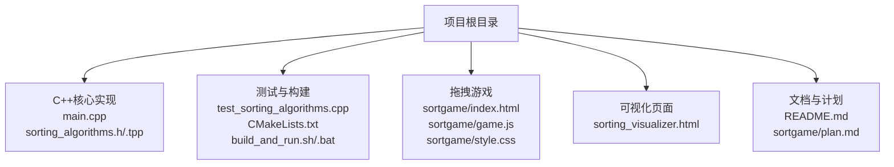
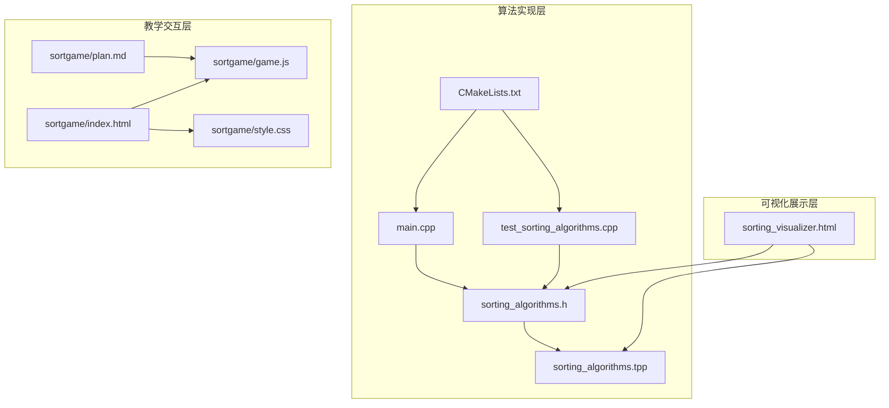
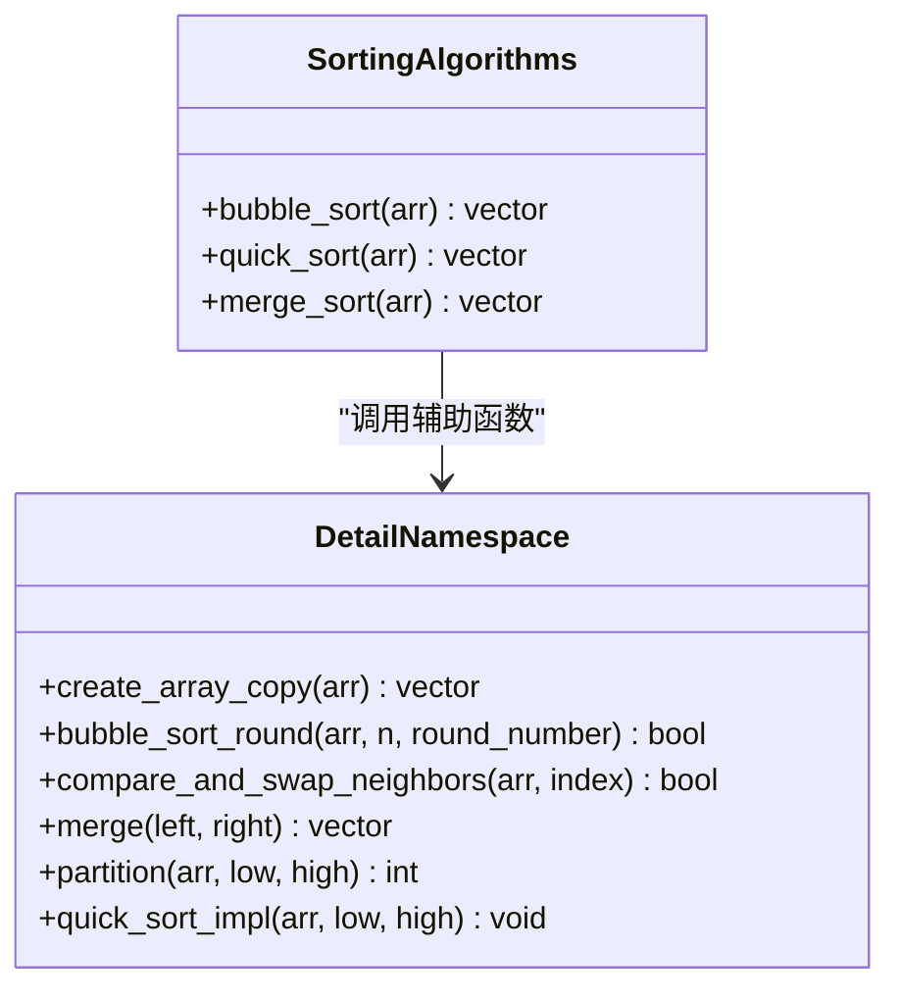
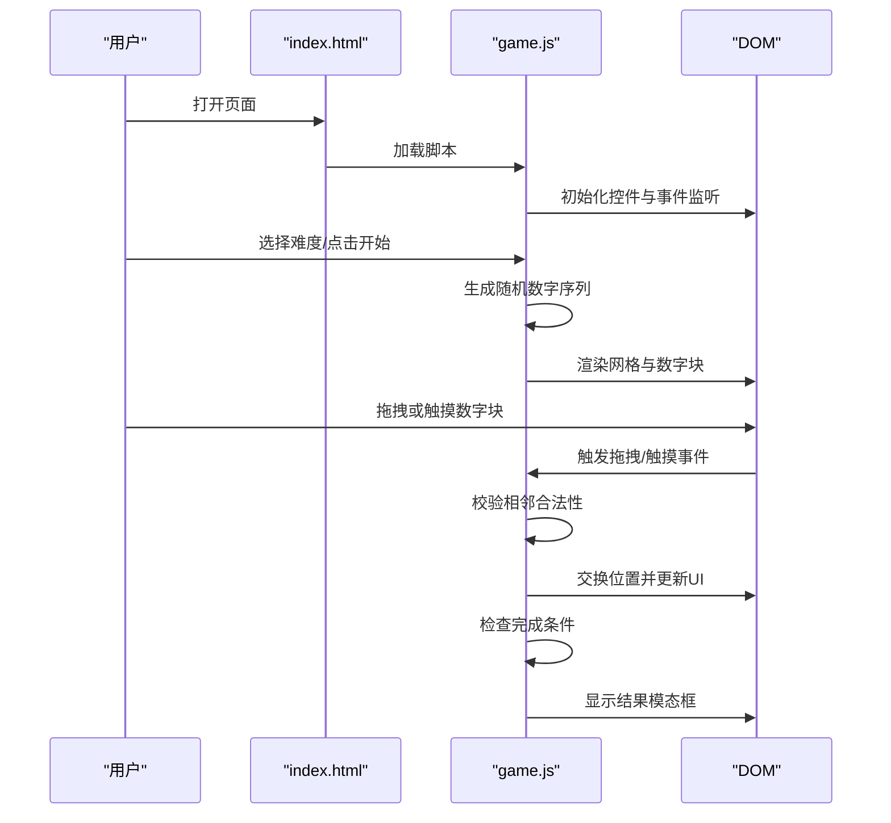
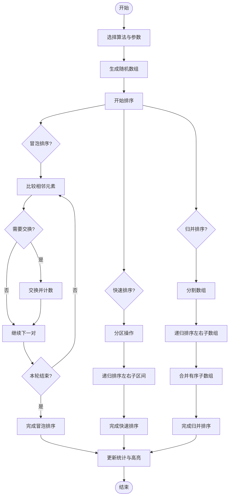
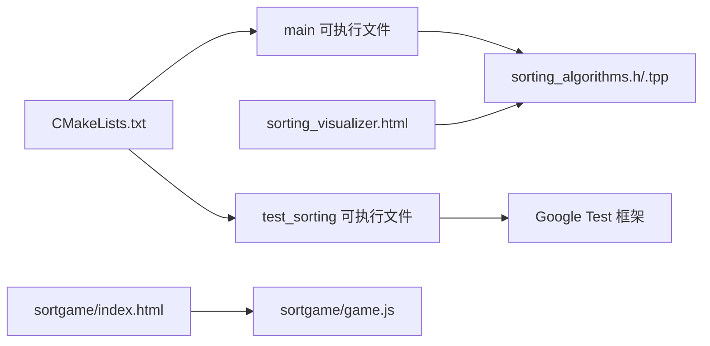

# 项目概述

<cite>
**本文档引用的文件**
- [README.md](file://README.md)
- [main.cpp](file://main.cpp)
- [sorting_algorithms.h](file://sorting_algorithms.h)
- [sorting_algorithms.tpp](file://sorting_algorithms.tpp)
- [test_sorting_algorithms.cpp](file://test_sorting_algorithms.cpp)
- [CMakeLists.txt](file://CMakeLists.txt)
- [build_and_run.sh](file://build_and_run.sh)
- [build_and_run.bat](file://build_and_run.bat)
- [sortgame/index.html](file://sortgame/index.html)
- [sortgame/game.js](file://sortgame/game.js)
- [sortgame/style.css](file://sortgame/style.css)
- [sortgame/plan.md](file://sortgame/plan.md)
- [sorting_visualizer.html](file://sorting_visualizer.html)
</cite>

## 目录
1. [简介](#简介)
2. [项目结构](#项目结构)
3. [核心组件](#核心组件)
4. [架构总览](#架构总览)
5. [详细组件分析](#详细组件分析)
6. [依赖关系分析](#依赖关系分析)
7. [性能考量](#性能考量)
8. [故障排除指南](#故障排除指南)
9. [结论](#结论)
10. [附录](#附录)

## 简介
SortTest是一个面向教学的C++排序算法综合项目，旨在通过“理论—实践—可视化—互动”的多维度学习路径，帮助不同层次的学习者掌握排序算法的核心思想与实现细节。项目由三大模块构成：
- C++排序算法实现：提供冒泡排序、快速排序、归并排序的模板化实现，强调泛型、非侵入式设计与完备测试。
- HTML5拖拽游戏：以原生HTML5/JavaScript实现的数字排序挑战游戏，结合计时、步数统计与难度分级，强化空间思维与算法直觉。
- 可视化工具：基于HTML5 Canvas风格的可视化页面，支持实时动画演示与性能指标统计，帮助理解算法过程与复杂度特征。

项目具备明确的教育价值与实用意义：既适合初学者循序渐进地建立算法基础，也为有经验的开发者提供可扩展、可测试、可可视化的参考实现。

## 项目结构
项目采用“功能域划分 + 教学资源组织”的结构，核心目录与文件如下：
- 根目录：C++排序算法源码、构建脚本、测试与文档
- sortgame：HTML5拖拽游戏的前端资源（HTML/CSS/JS）
- sorting_visualizer.html：独立的排序算法可视化页面

图表来源
- [main.cpp](file://main.cpp#L1-L158)
- [sorting_algorithms.h](file://sorting_algorithms.h#L1-L104)
- [sorting_algorithms.tpp](file://sorting_algorithms.tpp#L1-L162)
- [test_sorting_algorithms.cpp](file://test_sorting_algorithms.cpp#L1-L294)
- [CMakeLists.txt](file://CMakeLists.txt#L1-L45)
- [sortgame/index.html](file://sortgame/index.html#L1-L65)
- [sortgame/game.js](file://sortgame/game.js#L1-L282)
- [sortgame/style.css](file://sortgame/style.css#L1-L286)
- [sorting_visualizer.html](file://sorting_visualizer.html#L1-L528)
- [README.md](file://README.md#L1-L229)
- [sortgame/plan.md](file://sortgame/plan.md#L1-L63)

章节来源
- [README.md](file://README.md#L1-L229)
- [sortgame/plan.md](file://sortgame/plan.md#L1-L63)

## 核心组件
- C++排序算法库
  - 提供三种经典排序算法的模板化实现，支持整数、浮点数、字符串及自定义可比较类型。
  - 设计特点：非侵入式（不修改原数组）、泛型模板、稳定归并排序、完备单元测试。
- HTML5拖拽游戏
  - 基于原生拖拽API与触摸事件，实现3×3/4×4/5×5网格的数字排序挑战。
  - 功能：难度选择、计时器、步数统计、完成判定、评级系统、模态结果展示。
- 排序可视化工具
  - 支持选择算法、数组规模、动画速度，实时统计比较次数、交换次数、数组访问次数与耗时。
  - 提供冒泡排序、快速排序、归并排序的可视化演示。

章节来源
- [sorting_algorithms.h](file://sorting_algorithms.h#L1-L104)
- [sorting_algorithms.tpp](file://sorting_algorithms.tpp#L1-L162)
- [test_sorting_algorithms.cpp](file://test_sorting_algorithms.cpp#L1-L294)
- [sortgame/index.html](file://sortgame/index.html#L1-L65)
- [sortgame/game.js](file://sortgame/game.js#L1-L282)
- [sortgame/style.css](file://sortgame/style.css#L1-L286)
- [sorting_visualizer.html](file://sorting_visualizer.html#L1-L528)

## 架构总览
项目采用“算法实现层—教学交互层—可视化展示层”的分层架构，各层职责清晰、耦合度低，便于独立演进与组合使用。

图表来源
- [main.cpp](file://main.cpp#L1-L158)
- [sorting_algorithms.h](file://sorting_algorithms.h#L1-L104)
- [sorting_algorithms.tpp](file://sorting_algorithms.tpp#L1-L162)
- [test_sorting_algorithms.cpp](file://test_sorting_algorithms.cpp#L1-L294)
- [CMakeLists.txt](file://CMakeLists.txt#L1-L45)
- [sortgame/index.html](file://sortgame/index.html#L1-L65)
- [sortgame/game.js](file://sortgame/game.js#L1-L282)
- [sortgame/style.css](file://sortgame/style.css#L1-L286)
- [sortgame/plan.md](file://sortgame/plan.md#L1-L63)
- [sorting_visualizer.html](file://sorting_visualizer.html#L1-L528)

## 详细组件分析

### 组件A：C++排序算法库
- 设计模式与数据结构
  - 模板化设计：通过模板函数实现泛型排序，支持任意可比较类型。
  - 非侵入式：所有算法返回新数组，不修改输入数组，便于教学演示与测试。
  - 递归与分治：快速排序与归并排序采用递归实现；冒泡排序采用迭代优化。
- 关键流程
  - 冒泡排序：逐轮扫描，相邻比较与交换，提前终止优化。
  - 快速排序：三路划分（小于/等于/大于）递归排序，避免重复元素的额外开销。
  - 归并排序：分治拆分与合并，保证稳定性。
- 复杂度与稳定性
  - 冒泡排序：时间复杂度O(n²)，空间复杂度O(1)，稳定。
  - 快速排序：平均O(n log n)，最坏O(n²)，空间O(log n)，不稳定。
  - 归并排序：时间O(n log n)，空间O(n)，稳定。

图表来源
- [sorting_algorithms.h](file://sorting_algorithms.h#L14-L95)
- [sorting_algorithms.tpp](file://sorting_algorithms.tpp#L13-L92)

章节来源
- [sorting_algorithms.h](file://sorting_algorithms.h#L1-L104)
- [sorting_algorithms.tpp](file://sorting_algorithms.tpp#L1-L162)
- [main.cpp](file://main.cpp#L27-L132)
- [test_sorting_algorithms.cpp](file://test_sorting_algorithms.cpp#L1-L294)

### 组件B：HTML5拖拽游戏
- 功能特性
  - 难度选择：3×3/4×4/5×5网格，动态渲染。
  - 拖拽与触摸：原生拖拽API与触摸事件支持，只允许与空位相邻交换。
  - 计时与步数：实时计时器与步数统计，结束时弹出结果模态框。
  - 评级系统：根据时间与步数计算综合评分。
- 交互流程

图表来源
- [sortgame/index.html](file://sortgame/index.html#L1-L65)
- [sortgame/game.js](file://sortgame/game.js#L1-L282)
- [sortgame/style.css](file://sortgame/style.css#L1-L286)

章节来源
- [sortgame/index.html](file://sortgame/index.html#L1-L65)
- [sortgame/game.js](file://sortgame/game.js#L1-L282)
- [sortgame/style.css](file://sortgame/style.css#L1-L286)
- [sortgame/plan.md](file://sortgame/plan.md#L1-L63)

### 组件C：排序可视化工具
- 功能特性
  - 算法选择：冒泡排序、快速排序、归并排序。
  - 参数调节：数组规模、动画速度。
  - 实时统计：比较次数、交换次数、数组访问次数、耗时。
  - 动画高亮：比较、交换、排序完成的视觉反馈。
- 算法演示流程

图表来源
- [sorting_visualizer.html](file://sorting_visualizer.html#L236-L528)

章节来源
- [sorting_visualizer.html](file://sorting_visualizer.html#L1-L528)

## 依赖关系分析
- 构建与测试
  - CMake配置C++17标准，支持MSVC与GCC/Clang编译器，可选启用Google Test进行单元测试。
  - 提供跨平台构建脚本（shell与batch），简化编译与运行流程。
- 模块内聚与耦合
  - C++算法库高度内聚，对外仅暴露三个模板函数与少量detail辅助函数。
  - 游戏与可视化页面与算法库解耦，通过HTML侧的事件与定时器驱动，便于替换或扩展算法实现。
- 外部依赖
  - 测试框架：Google Test（可选）。
  - 前端无第三方库依赖，纯原生HTML5/CSS3/JavaScript。

图表来源
- [CMakeLists.txt](file://CMakeLists.txt#L1-L45)
- [test_sorting_algorithms.cpp](file://test_sorting_algorithms.cpp#L1-L294)
- [sorting_algorithms.h](file://sorting_algorithms.h#L1-L104)
- [sorting_algorithms.tpp](file://sorting_algorithms.tpp#L1-L162)
- [sortgame/index.html](file://sortgame/index.html#L1-L65)
- [sortgame/game.js](file://sortgame/game.js#L1-L282)
- [sorting_visualizer.html](file://sorting_visualizer.html#L1-L528)

章节来源
- [CMakeLists.txt](file://CMakeLists.txt#L1-L45)
- [build_and_run.sh](file://build_and_run.sh#L1-L107)
- [build_and_run.bat](file://build_and_run.bat#L1-L152)

## 性能考量
- C++实现
  - 冒泡排序：适合小规模数据与教学演示，注意其O(n²)时间复杂度。
  - 快速排序：平均性能优异，但需关注最坏情况与递归深度；项目采用三路划分减少重复元素开销。
  - 归并排序：稳定且性能稳定，适合大数据集与稳定性要求场景。
- 可视化与游戏
  - 动画速度可调，建议从较低速度开始观察算法过程，逐步提高以评估性能。
  - DOM操作频率与高亮渲染可能影响性能，建议在大规模数据时适当降低刷新频率。
- 测试覆盖
  - 单元测试涵盖边界情况、重复元素、负数、混合正负数、大数组、稳定性验证等，确保实现健壮性。

## 故障排除指南
- 构建失败
  - 缺少编译器：确认已安装GCC/Clang或MSVC，并在PATH中可用。
  - CMake版本过低：升级至3.14及以上版本。
  - Google Test下载失败：检查网络连接或手动指定本地仓库路径。
- 运行异常
  - main程序无输出：检查终端编码与控制台字体，确保支持中文字符。
  - 测试程序未生成：确认已启用BUILD_TESTS选项或手动添加测试目标。
- 游戏与可视化
  - 拖拽无效：检查浏览器对HTML5拖拽API的支持，或尝试触摸事件替代方案。
  - 动画卡顿：降低数组规模或提高动画速度，减少DOM高亮频率。
- 跨平台差异
  - Windows批处理脚本：确保MSVC或MinGW已正确安装并配置环境变量。
  - Unix shell脚本：赋予执行权限并确保make与cmake可用。

章节来源
- [build_and_run.sh](file://build_and_run.sh#L1-L107)
- [build_and_run.bat](file://build_and_run.bat#L1-L152)
- [CMakeLists.txt](file://CMakeLists.txt#L1-L45)
- [sortgame/game.js](file://sortgame/game.js#L1-L282)
- [sorting_visualizer.html](file://sorting_visualizer.html#L1-L528)

## 结论
SortTest通过“算法实现—教学游戏—可视化演示”的三位一体设计，为学习者提供了从理论到实践再到直观理解的完整闭环。C++实现强调泛型、非侵入式与稳定性，HTML5游戏强化交互与空间思维，可视化工具则将抽象算法具象化。项目既适合初学者入门，也便于有经验开发者进行扩展与二次开发。

## 附录
- 学习路径建议
  - 初学者：先阅读README与main.cpp演示，理解三种算法的基本思想；再通过sorting_visualizer.html观察动画；最后用sortgame/index.html进行交互练习。
  - 进阶者：阅读sorting_algorithms.h/.tpp的实现细节，编写更多测试用例，探索不同数据类型的稳定性与性能表现。
- 实际应用场景
  - 教学演示：课堂讲解与实验课配套。
  - 自主学习：算法竞赛训练与面试准备。
  - 产品原型：将游戏模块扩展为在线教育平台的互动模块。